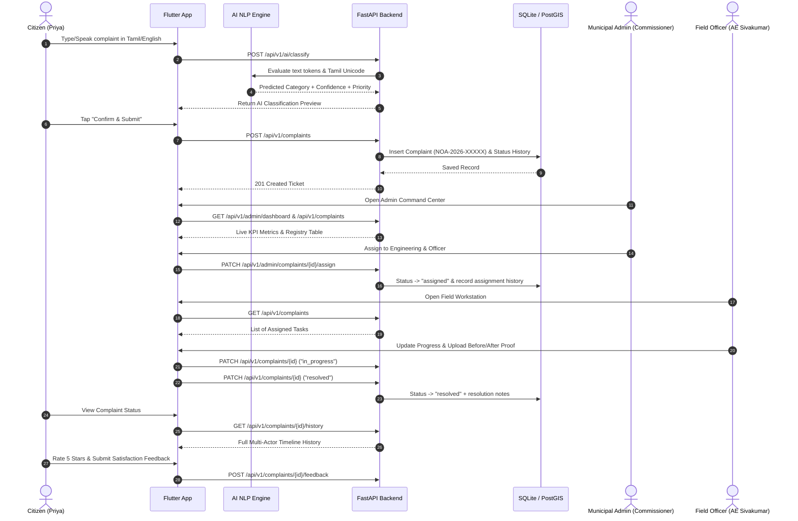

# Namma Ooru AI (நம்ம ஊரு AI)
### Intelligent Multilingual Civic Governance Platform for Tamil Nadu

[](https://fastapi.tiangolo.com)
[](https://flutter.dev)
[](https://python.org)
[](https://postgis.net)

---

## 1. Overview

**Namma Ooru AI** is a full-stack, AI-driven smart municipal governance platform built specifically for municipalities across Tamil Nadu (Greater Chennai Corporation, Coimbatore, Madurai, Tiruchirappalli, and Salem). It bridges the gap between citizens, municipal administrators, departments, and on-ground field officers.

Citizens can report civic issues (garbage accumulation, water leakages, road potholes, broken streetlights, sewage overflow, public sanitation hazards) using **Tamil or English** through text, voice, or photos.

---

## 2. Complete Citizen-to-Administrator Lifecycle (Verified)

Every Flutter screen and feature is connected to the real FastAPI backend through `ApiService`:



---

## 3. Implemented States Across All Screens

- **Loading State**: Shimmer skeletons and centered spinners while requests are in flight.
- **Empty State**: Custom `EmptyState` widget with contextual icons when zero complaints exist in a category or status filter.
- **Success State**: Real ticket generation confirmation dialogs with auto-generated `NOA-2026-XXXXX` identifier and dynamic timeline updates.
- **Error State**: Informative error cards with a **"Retry / மீண்டும் முயற்சி"** button and graceful offline fallback to local cached data.

---

## 4. Default Seeded Test Credentials

| Role | Email / Phone | Password | Name |
|---|---|---|---|
| **Municipal Administrator** | `admin@nammaooru.tn.gov.in` | `Admin@NammaOoru2026` | Thiru R. Senthil Kumar IAS (Commissioner) |
| **Citizen** | `citizen@example.com` | `Citizen@12345` | Priya Ramanathan (Zone 5, Chennai) |
| **Field Officer** | `officer@nammaooru.tn.gov.in` | `Officer@12345` | Er. K. Sivakumar (AE-Water, Zone 5) |

---

## 5. Running the Backend & Test Suite

### Start Backend API Server
```powershell
$env:PYTHONPATH="backend"
& ".\backend\venv\Scripts\python.exe" -m uvicorn app.main:app --reload --host 0.0.0.0 --port 8000
```
- Interactive Swagger UI: [http://localhost:8000/api/v1/docs](http://localhost:8000/api/v1/docs)
- Interactive ReDoc: [http://localhost:8000/api/v1/redoc](http://localhost:8000/api/v1/redoc)

### Run Integration & Lifecycle Tests
```powershell
$env:PYTHONPATH="backend"
& ".\backend\venv\Scripts\pytest.exe" "backend\tests" -v
```

**Test Execution Output (12 passed in 4.79s):**
```text
backend/tests/test_api.py::test_root_health PASSED                       [  8%]
backend/tests/test_api.py::test_auth_login_seeded_admin PASSED           [ 16%]
backend/tests/test_api.py::test_auth_login_seeded_citizen PASSED         [ 25%]
backend/tests/test_api.py::test_auth_login_seeded_officer PASSED         [ 33%]
backend/tests/test_api.py::test_user_registration_and_token_refresh PASSED [ 41%]
backend/tests/test_api.py::test_user_profile_get_and_patch PASSED        [ 50%]
backend/tests/test_api.py::test_role_based_permission_enforcement PASSED [ 58%]
backend/tests/test_api.py::test_ai_classification_tamil_text PASSED      [ 66%]
backend/tests/test_api.py::test_ai_classification_english_water_leak PASSED [ 75%]
backend/tests/test_api.py::test_maps_and_hotspots_endpoints PASSED       [ 83%]
backend/tests/test_api.py::test_public_announcements PASSED              [ 91%]
backend/tests/test_api.py::test_complete_citizen_to_administrator_lifecycle PASSED [100%]
============================= 12 passed in 4.79s ==============================
```

---

## 6. Database Migrations (Alembic)

Database schema versioning is managed via Alembic async migrations:

```powershell
# Check current migration revision
& ".\backend\venv\Scripts\alembic.exe" -c backend/alembic.ini current

# Verify schema synchronization
& ".\backend\venv\Scripts\alembic.exe" -c backend/alembic.ini check

# Apply migrations to head
& ".\backend\venv\Scripts\alembic.exe" -c backend/alembic.ini upgrade head
```

---

## 7. Containerized Deployment (Docker)

To run the complete production stack (FastAPI backend + PostGIS 16 database):

```bash
docker compose up -d --build
```
API runs on `http://localhost:8000` with automated health checks and persistent spatial storage.
