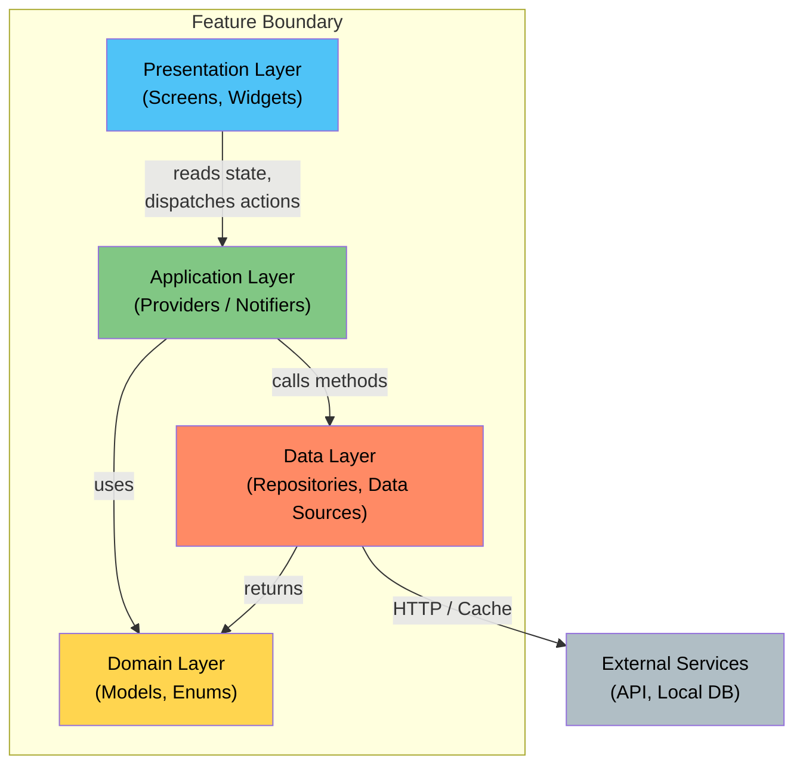
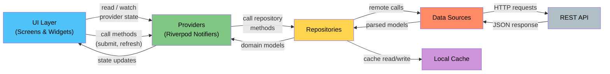
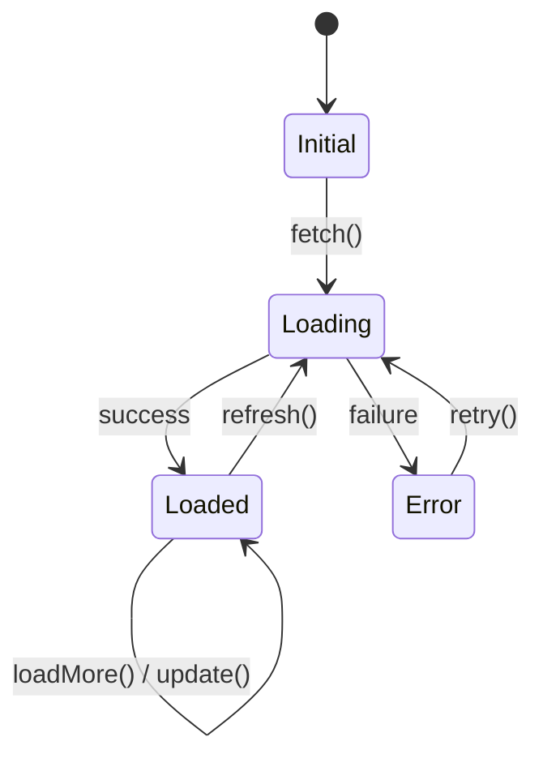
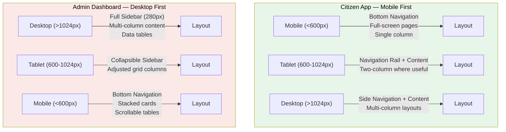
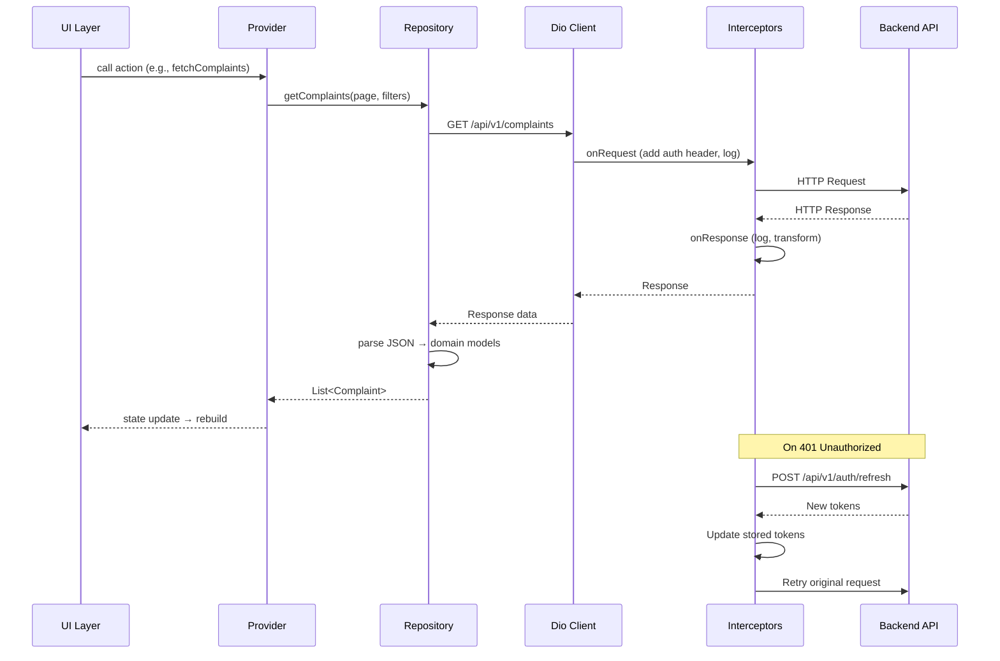
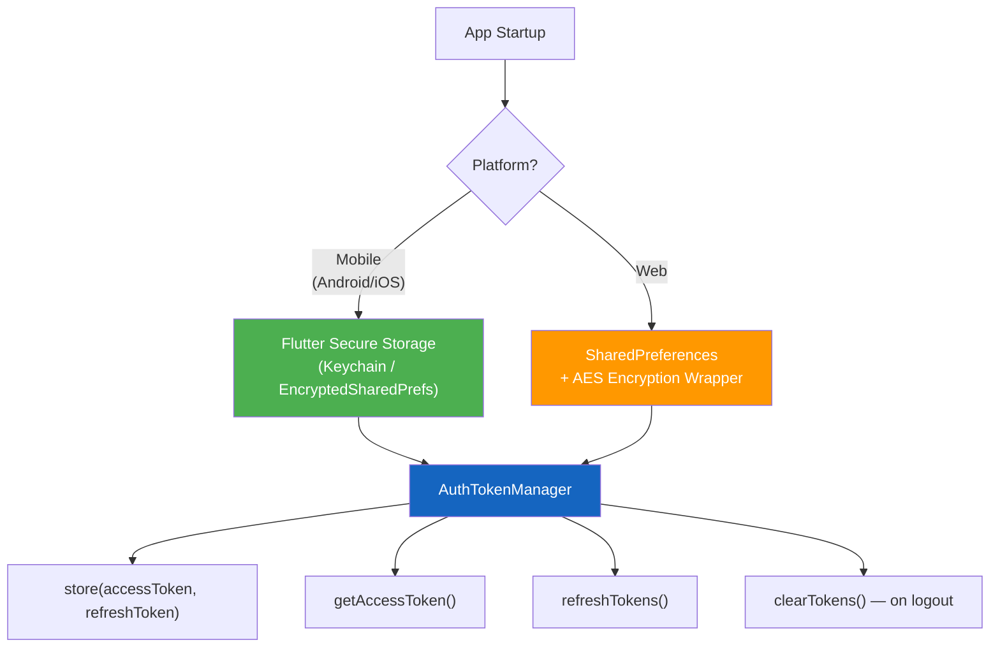
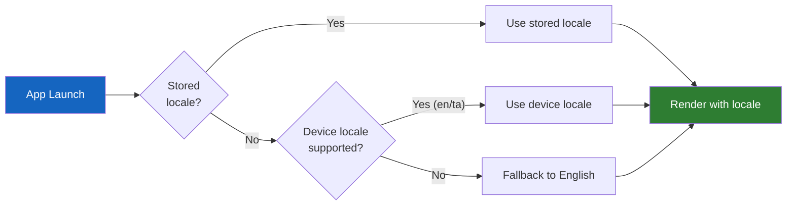

# Flutter Application Architecture — Namma Ooru AI

> **Document Version:** 1.0
> **Last Updated:** 2025-07-17
> **Scope:** Complete Flutter client architecture covering project structure, state management, navigation, theming, API communication, security, and localization.

---

## Table of Contents

1. [Architecture Pattern](#1-architecture-pattern)
2. [Project Structure Diagram](#2-project-structure-diagram)
3. [Complete Folder Structure](#3-complete-folder-structure)
4. [State Management Strategy](#4-state-management-strategy)
5. [Navigation Architecture](#5-navigation-architecture)
6. [Responsive Design Strategy](#6-responsive-design-strategy)
7. [Theming System](#7-theming-system)
8. [API Communication Layer](#8-api-communication-layer)
9. [Security](#9-security)
10. [Localization](#10-localization)

---

## 1. Architecture Pattern

Namma Ooru AI follows a **Feature-First Clean Architecture** pattern. Each feature is a self-contained vertical slice of the application, encapsulating its own presentation, domain, and data layers. Cross-cutting concerns live in `core/` and `shared/` directories.

### Core Principles

| Principle | Implementation |
|---|---|
| **Feature-first structure** | Every feature owns its screens, widgets, providers, models, repositories, and data sources |
| **Clean Architecture layers** | `presentation → application → domain → data` per feature |
| **Unidirectional data flow** | UI dispatches actions → Providers orchestrate → Repositories fetch → Data sources communicate with API/cache |
| **Dependency inversion** | Domain layer defines abstractions; data layer provides implementations |
| **Single responsibility** | Each class has one well-defined purpose |

### Technology Stack

| Concern | Technology |
|---|---|
| **State Management** | Riverpod with `riverpod_generator` (code generation) |
| **Routing** | GoRouter with declarative guards |
| **Networking** | Dio with interceptors |
| **Data Access** | Repository pattern |
| **Serialization** | `freezed` + `json_serializable` |
| **Local Storage** | `flutter_secure_storage` (mobile), encrypted `SharedPreferences` (web) |
| **Localization** | Flutter `intl` with ARB files |
| **Maps** | Google Maps Flutter |

### Layer Dependency Rules



> [!IMPORTANT]
> The **domain layer** has zero dependencies on Flutter, Dio, or any infrastructure package. It contains only plain Dart models and enums. The **data layer** depends on the domain layer but never on presentation.

---

## 2. Project Structure Diagram

```mermaid
flowchart TD
    LIB["lib/"]

    LIB --> MAIN["main.dart"]
    LIB --> APPD["app.dart"]
    LIB --> CORE["core/"]
    LIB --> SHARED["shared/"]
    LIB --> FEATURES["features/"]
    LIB --> SERVICES["services/"]
    LIB --> PROVIDERS["providers/"]

    CORE --> CFG["config/"]
    CORE --> CONST["constants/"]
    CORE --> ERR["errors/"]
    CORE --> NET["network/"]
    CORE --> ROUTE["routing/"]
    CORE --> SEC["security/"]
    CORE --> THEME["theme/"]
    CORE --> UTIL["utils/"]

    SHARED --> SW["widgets/"]
    SHARED --> SM["models/"]
    SHARED --> SE["extensions/"]

    FEATURES --> F_AUTH["authentication/"]
    FEATURES --> F_ONB["onboarding/"]
    FEATURES --> F_HOME["citizen_home/"]
    FEATURES --> F_ASSIST["complaint_assistant/"]
    FEATURES --> F_COMP["complaints/"]
    FEATURES --> F_TRACK["complaint_tracking/"]
    FEATURES --> F_MAP["maps/"]
    FEATURES --> F_NOTIF["notifications/"]
    FEATURES --> F_PROF["profile/"]
    FEATURES --> F_ADMIN["admin_dashboard/"]
    FEATURES --> F_DEPT["department_management/"]
    FEATURES --> F_OFFM["officer_management/"]
    FEATURES --> F_FIELD["field_officer/"]
    FEATURES --> F_ANALYTICS["analytics/"]
    FEATURES --> F_ANN["announcements/"]
    FEATURES --> F_AUDIT["audit_logs/"]
    FEATURES --> F_SET["settings/"]

    F_AUTH --> AUTH_DATA["data/"]
    F_AUTH --> AUTH_DOMAIN["domain/"]
    F_AUTH --> AUTH_PRES["presentation/"]
    F_AUTH --> AUTH_PROV["providers/"]

    style LIB fill:#1565C0,color:#fff
    style CORE fill:#4527A0,color:#fff
    style SHARED fill:#00695C,color:#fff
    style FEATURES fill:#BF360C,color:#fff
    style SERVICES fill:#E65100,color:#fff
    style PROVIDERS fill:#827717,color:#fff
```



---

## 3. Complete Folder Structure

```
lib/
  main.dart                          # App entry point, ProviderScope, runApp
  app.dart                           # MaterialApp.router configuration
  
  ─────────────────────────────────────────────────────────────────────
  core/                              # Cross-cutting infrastructure
  ─────────────────────────────────────────────────────────────────────
    config/
      app_config.dart                # Environment config (dev/staging/prod)
      api_config.dart                # API base URLs per environment
    constants/
      app_constants.dart             # App-wide constants (page sizes, timeouts)
      api_endpoints.dart             # Endpoint path strings
      asset_paths.dart               # Asset references (images, icons, lottie)
    errors/
      app_exception.dart             # Custom exception hierarchy
      failure.dart                   # Failure types (ServerFailure, CacheFailure, etc.)
    network/
      dio_client.dart                # Configured Dio singleton instance
      api_interceptor.dart           # Auth, logging, error-transform interceptors
      network_info.dart              # Connectivity checker (connectivity_plus)
    routing/
      app_router.dart                # GoRouter configuration with all routes
      route_names.dart               # Named route constants
      auth_guard.dart                # Authentication redirect guard
      role_guard.dart                # Role-based route guard
    security/
      secure_storage.dart            # Platform-aware secure token storage
      auth_token_manager.dart        # Token lifecycle (store, retrieve, refresh, clear)
    theme/
      app_theme.dart                 # ThemeData for light and dark modes
      app_colors.dart                # Full color palette
      app_typography.dart            # Text styles (Inter + Noto Sans Tamil)
      app_spacing.dart               # Spacing scale constants
      app_shadows.dart               # Elevation & shadow definitions
    utils/
      date_utils.dart                # Date formatting, relative time
      string_utils.dart              # String manipulation helpers
      validators.dart                # Form validation functions
      responsive_utils.dart          # Breakpoints, adaptive layout helpers
  
  ─────────────────────────────────────────────────────────────────────
  shared/                            # Reusable UI components & models
  ─────────────────────────────────────────────────────────────────────
    widgets/
      app_button.dart                # Primary, secondary, text button variants
      app_text_field.dart            # Styled text input with validation
      app_search_bar.dart            # Search bar with debounce
      loading_skeleton.dart          # Shimmer loading placeholders
      empty_state.dart               # Empty state illustration + message
      error_state.dart               # Error state with retry action
      status_badge.dart              # Colored badge for complaint status
      priority_indicator.dart        # Visual priority level indicator
      complaint_card.dart            # Reusable complaint summary card
      metric_card.dart               # Dashboard metric display card
      map_marker.dart                # Custom map marker widget
      app_dialog.dart                # Styled alert/confirmation dialog
      app_bottom_sheet.dart          # Styled modal bottom sheet
      confirmation_screen.dart       # Full-screen success/failure confirmation
      responsive_scaffold.dart       # Scaffold with responsive layout logic
      adaptive_navigation.dart       # BottomNav / Rail / Sidebar based on breakpoint
    models/
      paginated_response.dart        # Generic paginated API response wrapper
      api_response.dart              # Generic API response envelope
      location_model.dart            # Latitude, longitude, address model
    extensions/
      context_extensions.dart        # BuildContext helpers (theme, mediaQuery, l10n)
      string_extensions.dart         # String capitalize, truncate, etc.
      datetime_extensions.dart       # DateTime formatting extensions
  
  ─────────────────────────────────────────────────────────────────────
  features/                          # Feature modules (vertical slices)
  ─────────────────────────────────────────────────────────────────────
  
    authentication/
      data/
        repositories/
          auth_repository.dart       # Auth API calls, token persistence
        datasources/
          auth_remote_datasource.dart # Raw HTTP calls for auth endpoints
      domain/
        models/
          user.dart                  # User model (freezed)
          auth_tokens.dart           # Access + refresh token model
      presentation/
        screens/
          login_screen.dart          # Phone number / email login
          register_screen.dart       # Citizen registration form
          otp_verification_screen.dart # OTP input and verification
        widgets/
          login_form.dart            # Login form with validation
          register_form.dart         # Registration form with validation
      providers/
        auth_provider.dart           # AuthNotifier (login, logout, register)
        auth_state.dart              # AuthState sealed class
    
    onboarding/
      presentation/
        screens/
          splash_screen.dart         # App splash with logo animation
          onboarding_screen.dart     # Feature walkthrough carousel
          language_selection_screen.dart # Language picker (EN/TA)
        widgets/
          onboarding_page.dart       # Single onboarding page template
    
    citizen_home/
      presentation/
        screens/
          citizen_home_screen.dart   # Main citizen dashboard
        widgets/
          greeting_header.dart       # Personalized greeting with avatar
          quick_actions.dart         # Action buttons (New Complaint, Track, etc.)
          active_complaints_summary.dart # Count badges for active complaints
          recent_complaints.dart     # Horizontal list of recent complaints
          nearby_issues.dart         # Map preview of nearby complaints
          announcements_banner.dart  # Auto-scrolling announcements carousel
      providers/
        home_provider.dart           # Home screen data aggregation
    
    complaint_assistant/
      presentation/
        screens/
          ai_assistant_screen.dart   # Conversational AI complaint intake
        widgets/
          chat_bubble.dart           # User/AI message bubble
          voice_input_button.dart    # Hold-to-speak voice input FAB
          image_attachment_picker.dart # Camera/gallery image selector
          classification_preview.dart # AI-suggested category + department
          location_confirm_widget.dart # Map-based location confirmation
      providers/
        assistant_provider.dart      # Chat flow state, AI API calls
        speech_to_text_provider.dart  # Speech recognition provider
    
    complaints/
      data/
        repositories/
          complaint_repository.dart  # CRUD operations for complaints
        datasources/
          complaint_remote_datasource.dart # Raw HTTP calls for complaints
      domain/
        models/
          complaint.dart             # Complaint model (freezed)
          complaint_attachment.dart   # Attachment metadata model
          ai_classification.dart     # AI classification result model
          complaint_status.dart      # Status enum + history entry
      presentation/
        screens/
          complaint_form_screen.dart  # Manual complaint submission form
          complaint_detail_screen.dart # Full complaint view
          complaint_history_screen.dart # Complaint list with filters
        widgets/
          complaint_list_item.dart   # List tile for complaint
          status_timeline.dart       # Visual status progression
          attachment_gallery.dart    # Photo/video gallery viewer
          feedback_form.dart         # Post-resolution feedback
      providers/
        complaint_provider.dart      # Single complaint CRUD
        complaint_list_provider.dart  # Paginated complaint list
    
    complaint_tracking/
      presentation/
        screens/
          tracking_screen.dart       # Real-time complaint tracking
        widgets/
          tracking_timeline.dart     # Step-by-step tracking timeline
    
    maps/
      presentation/
        screens/
          map_screen.dart            # Full-screen map view
        widgets/
          complaint_map.dart         # Google Map with complaint markers
          map_filter_sheet.dart      # Category/status filter sheet
          cluster_marker.dart        # Clustered marker widget
          complaint_popup.dart       # Marker tap popup with summary
      providers/
        map_provider.dart            # Map state, filters, marker data
    
    notifications/
      data/
        repositories/
          notification_repository.dart # Notification API + FCM handling
      domain/
        models/
          notification_model.dart    # Notification data model
      presentation/
        screens/
          notifications_screen.dart  # Notification list with read/unread
        widgets/
          notification_tile.dart     # Single notification row
      providers/
        notification_provider.dart   # Notification list + badge count
    
    profile/
      presentation/
        screens/
          profile_screen.dart        # User profile view/edit
        widgets/
          profile_header.dart        # Avatar, name, role badge
          profile_form.dart          # Editable profile fields
      providers/
        profile_provider.dart        # Profile state + update logic
    
    admin_dashboard/
      presentation/
        screens/
          admin_dashboard_screen.dart # Admin analytics dashboard
          admin_shell_screen.dart     # Sidebar + content area shell
        widgets/
          sidebar_navigation.dart    # Admin sidebar nav with sections
          dashboard_metrics.dart     # KPI metric cards grid
          complaint_trend_chart.dart  # Line chart: complaints over time
          department_performance_chart.dart # Bar chart: dept performance
          recent_activity_feed.dart   # Real-time activity log
      providers/
        dashboard_provider.dart      # Dashboard data aggregation
    
    department_management/
      presentation/
        screens/
          department_list_screen.dart  # CRUD department list
          department_detail_screen.dart # Department detail + officers
        widgets/
          department_form.dart       # Create/edit department form
      providers/
        department_provider.dart     # Department CRUD state
    
    officer_management/
      presentation/
        screens/
          officer_list_screen.dart   # Officer list with filters
          officer_detail_screen.dart  # Officer detail + assignments
        widgets/
          officer_form.dart          # Create/edit officer form
      providers/
        officer_provider.dart        # Officer CRUD state
    
    field_officer/
      presentation/
        screens/
          officer_home_screen.dart   # Officer dashboard (assigned tasks)
          assignment_detail_screen.dart # Assignment detail + actions
        widgets/
          assignment_card.dart       # Assignment summary card
          progress_update_form.dart  # Update status + notes form
          photo_capture.dart         # Camera capture for evidence
      providers/
        assignment_provider.dart     # Assignment list + status updates
    
    analytics/
      presentation/
        screens/
          analytics_screen.dart      # Full analytics page
        widgets/
          category_chart.dart        # Pie/donut chart by category
          trend_chart.dart           # Trend line chart
          zone_heatmap.dart          # Geographic heatmap
      providers/
        analytics_provider.dart      # Analytics data + filters
    
    announcements/
      presentation/
        screens/
          announcements_screen.dart  # Announcement list + create
        widgets/
          announcement_form.dart     # Create/edit announcement form
    
    audit_logs/
      presentation/
        screens/
          audit_log_screen.dart      # Searchable audit log table
    
    settings/
      presentation/
        screens/
          settings_screen.dart       # App settings (theme, language, notifications)
          help_support_screen.dart   # FAQ, contact info, feedback
      providers/
        settings_provider.dart       # Settings persistence
  
  ─────────────────────────────────────────────────────────────────────
  services/                          # Platform & third-party service wrappers
  ─────────────────────────────────────────────────────────────────────
    api_service.dart                 # High-level API service facade
    location_service.dart            # Geolocator + geocoding wrapper
    notification_service.dart        # FCM + local notification setup
    speech_service.dart              # Speech-to-text engine wrapper
    image_service.dart               # Image picker + compression
    storage_service.dart             # Local key-value storage abstraction
  
  ─────────────────────────────────────────────────────────────────────
  providers/                         # Global (app-level) providers
  ─────────────────────────────────────────────────────────────────────
    app_providers.dart               # Dio, storage, connectivity providers
```

---

## 4. State Management Strategy

### Data Flow Architecture



### Riverpod Provider Types & Usage Guide

Namma Ooru AI uses **Riverpod 2.x with code generation** (`riverpod_generator`). All providers are generated from annotated classes or functions using `@riverpod`.

| Provider Type | When to Use | Example |
|---|---|---|
| **`AsyncNotifier`** | Complex state with multiple async operations, CRUD flows | `ComplaintNotifier` — create, update, delete complaints |
| **`Notifier`** | Complex synchronous state, multi-step form logic | `AssistantNotifier` — chat flow orchestration |
| **`FutureProvider`** | One-shot async data loading, read-only data | Fetching complaint detail by ID, loading user profile |
| **`StreamProvider`** | Real-time data, push-based updates | WebSocket notifications, FCM message stream |
| **`Provider`** | Derived/computed values, dependency injection | Dio client instance, repository instance |

### Provider Organization Rules

> [!NOTE]
> **Feature-scoped providers** live inside their feature's `providers/` directory. **Global providers** (Dio, storage, connectivity) live in `lib/providers/app_providers.dart`. A feature provider may depend on global providers but **never** on another feature's providers — use shared models in `shared/models/` for cross-feature data.

### State Class Pattern

All complex provider states use **sealed classes** (via `freezed`) to represent every possible state:

```dart
@freezed
sealed class ComplaintListState with _$ComplaintListState {
  const factory ComplaintListState.initial() = _Initial;
  const factory ComplaintListState.loading() = _Loading;
  const factory ComplaintListState.loaded({
    required List<Complaint> complaints,
    required int totalCount,
    required int currentPage,
    required bool hasMore,
  }) = _Loaded;
  const factory ComplaintListState.error(Failure failure) = _Error;
}
```

### Provider Lifecycle



### Code Generation Workflow

```bash
# One-time generation
dart run build_runner build --delete-conflicting-outputs

# Watch mode during development
dart run build_runner watch --delete-conflicting-outputs
```

Generated files follow the convention `*.g.dart` (Riverpod) and `*.freezed.dart` (Freezed models). These files are **not committed to version control**.

---

## 5. Navigation Architecture

### Router Configuration

Namma Ooru AI uses **GoRouter** with declarative route definitions, shell routes for persistent navigation, and guard-based redirects.

```dart
// core/routing/app_router.dart (conceptual)
GoRouter appRouter(Ref ref) {
  final authState = ref.watch(authProvider);

  return GoRouter(
    initialLocation: '/',
    redirect: (context, state) {
      final isLoggedIn = authState is Authenticated;
      final isAuthRoute = state.matchedLocation.startsWith('/auth');

      if (!isLoggedIn && !isAuthRoute) return '/auth/login';
      if (isLoggedIn && isAuthRoute) return _homeForRole(authState.user.role);
      return null;
    },
    routes: [ /* ... route tree below ... */ ],
  );
}
```

### Route Guards

| Guard | Purpose | Behavior |
|---|---|---|
| **Auth Guard** | Ensure user is authenticated | Redirects to `/auth/login` if no valid token |
| **Role Guard** | Restrict routes by user role | Redirects `citizen` away from `/admin/*`, `officer` away from `/admin/*`, etc. |
| **Onboarding Guard** | First-launch experience | Redirects to `/onboarding` if `isFirstLaunch` flag is true |

### Route Tree

```mermaid
flowchart TD
    ROOT["/"]

    ROOT --> AUTH["/auth"]
    AUTH --> LOGIN["/auth/login"]
    AUTH --> REGISTER["/auth/register"]
    AUTH --> OTP["/auth/verify-otp"]

    ROOT --> ONB["/onboarding"]
    ONB --> SPLASH["/onboarding/splash"]
    ONB --> WALKTHROUGH["/onboarding/walkthrough"]
    ONB --> LANG["/onboarding/language"]

    ROOT --> CITIZEN_SHELL["CitizenShellRoute<br/>(BottomNavigationBar)"]
    CITIZEN_SHELL --> C_HOME["/home"]
    CITIZEN_SHELL --> C_MAP["/map"]
    CITIZEN_SHELL --> C_HISTORY["/complaints"]
    CITIZEN_SHELL --> C_NOTIF["/notifications"]
    CITIZEN_SHELL --> C_PROFILE["/profile"]

    C_HOME --> C_ASSIST["/home/assistant"]
    C_HISTORY --> C_DETAIL["/complaints/:id"]
    C_DETAIL --> C_TRACK["/complaints/:id/track"]

    ROOT --> ADMIN_SHELL["AdminShellRoute<br/>(Sidebar Navigation)"]
    ADMIN_SHELL --> A_DASH["/admin/dashboard"]
    ADMIN_SHELL --> A_COMP["/admin/complaints"]
    ADMIN_SHELL --> A_DEPT["/admin/departments"]
    ADMIN_SHELL --> A_OFFICER["/admin/officers"]
    ADMIN_SHELL --> A_ANALYTICS["/admin/analytics"]
    ADMIN_SHELL --> A_ANN["/admin/announcements"]
    ADMIN_SHELL --> A_AUDIT["/admin/audit-logs"]
    ADMIN_SHELL --> A_SETTINGS["/admin/settings"]

    A_COMP --> A_COMP_DETAIL["/admin/complaints/:id"]
    A_DEPT --> A_DEPT_DETAIL["/admin/departments/:id"]
    A_OFFICER --> A_OFFICER_DETAIL["/admin/officers/:id"]

    ROOT --> OFFICER_SHELL["OfficerShellRoute<br/>(BottomNavigationBar)"]
    OFFICER_SHELL --> O_HOME["/officer/home"]
    OFFICER_SHELL --> O_MAP["/officer/map"]
    OFFICER_SHELL --> O_NOTIF["/officer/notifications"]
    OFFICER_SHELL --> O_PROFILE["/officer/profile"]

    O_HOME --> O_ASSIGN["/officer/assignments/:id"]

    ROOT --> SETTINGS["/settings"]
    ROOT --> HELP["/help"]

    style ROOT fill:#1565C0,color:#fff
    style CITIZEN_SHELL fill:#2E7D32,color:#fff
    style ADMIN_SHELL fill:#BF360C,color:#fff
    style OFFICER_SHELL fill:#F57F17,color:#000
```



### Shell Routes

Shell routes maintain persistent navigation UI while swapping content:

| Shell | Navigation UI | Roles |
|---|---|---|
| **CitizenShellRoute** | `BottomNavigationBar` with 5 tabs (Home, Map, New Complaint FAB, Complaints, Profile) | `citizen` |
| **AdminShellRoute** | Sidebar `NavigationDrawer` on desktop/tablet, bottom nav on mobile | `admin`, `super_admin` |
| **OfficerShellRoute** | `BottomNavigationBar` with 4 tabs (Home, Map, Notifications, Profile) | `field_officer` |

### Deep Linking

GoRouter provides built-in deep linking. When a push notification links to `/complaints/abc-123`, the router resolves it through the auth guard → role guard → complaint detail screen.

---

## 6. Responsive Design Strategy

### Breakpoint System

```dart
// core/utils/responsive_utils.dart
class Breakpoints {
  static const double mobile  = 0;
  static const double tablet  = 600;
  static const double desktop = 1024;
}

enum DeviceType { mobile, tablet, desktop }

DeviceType getDeviceType(BuildContext context) {
  final width = MediaQuery.sizeOf(context).width;
  if (width >= Breakpoints.desktop) return DeviceType.desktop;
  if (width >= Breakpoints.tablet) return DeviceType.tablet;
  return DeviceType.mobile;
}
```

### Layout Strategy by Role



### Responsive Scaffold

The `ResponsiveScaffold` widget adapts the navigation shell based on screen width:

```dart
// shared/widgets/responsive_scaffold.dart (conceptual)
class ResponsiveScaffold extends StatelessWidget {
  final List<NavigationDestination> destinations;
  final int selectedIndex;
  final Widget body;

  @override
  Widget build(BuildContext context) {
    return LayoutBuilder(builder: (context, constraints) {
      if (constraints.maxWidth >= Breakpoints.desktop) {
        return _DesktopLayout(/* full sidebar */);
      } else if (constraints.maxWidth >= Breakpoints.tablet) {
        return _TabletLayout(/* navigation rail */);
      } else {
        return _MobileLayout(/* bottom navigation */);
      }
    });
  }
}
```

### Adaptive Patterns

| Pattern | Mobile | Tablet | Desktop |
|---|---|---|---|
| **Navigation** | Bottom bar | Rail | Full sidebar |
| **Complaint list** | Full-screen list | List + detail side-by-side | List + detail + map |
| **Dashboard metrics** | Vertical scroll cards | 2-column grid | 4-column grid |
| **Data tables** | Scrollable cards | Compact table | Full table with actions |
| **Dialogs** | Bottom sheet | Centered dialog | Side panel |
| **Forms** | Full-screen | Centered card (max 600px) | Centered card (max 600px) |

---

## 7. Theming System

### Material 3 Foundation

```dart
// core/theme/app_theme.dart (conceptual)
class AppTheme {
  static ThemeData light() {
    return ThemeData(
      useMaterial3: true,
      colorScheme: ColorScheme.fromSeed(
        seedColor: AppColors.primary,
        brightness: Brightness.light,
      ),
      textTheme: AppTypography.textTheme,
      extensions: [AppSpacing.standard, AppShadows.standard],
    );
  }

  static ThemeData dark() {
    return ThemeData(
      useMaterial3: true,
      colorScheme: ColorScheme.fromSeed(
        seedColor: AppColors.primary,
        brightness: Brightness.dark,
      ),
      textTheme: AppTypography.textTheme,
      extensions: [AppSpacing.standard, AppShadows.standard],
    );
  }
}
```

### Color Palette

```dart
// core/theme/app_colors.dart
class AppColors {
  // Brand
  static const Color primary       = Color(0xFF1A73E8);  // Blue
  static const Color primaryDark   = Color(0xFF1557B0);
  static const Color primaryLight  = Color(0xFF4FC3F7);
  static const Color secondary     = Color(0xFF34A853);  // Green
  
  // Status
  static const Color success       = Color(0xFF34A853);
  static const Color warning       = Color(0xFFFBBC04);
  static const Color error         = Color(0xFFEA4335);
  static const Color info          = Color(0xFF4285F4);
  
  // Complaint Status
  static const Color statusNew        = Color(0xFF9E9E9E);
  static const Color statusAssigned   = Color(0xFF2196F3);
  static const Color statusInProgress = Color(0xFFFF9800);
  static const Color statusResolved   = Color(0xFF4CAF50);
  static const Color statusClosed     = Color(0xFF607D8B);
  static const Color statusRejected   = Color(0xFFF44336);
  
  // Priority
  static const Color priorityLow      = Color(0xFF8BC34A);
  static const Color priorityMedium   = Color(0xFFFFC107);
  static const Color priorityHigh     = Color(0xFFFF5722);
  static const Color priorityCritical = Color(0xFFD32F2F);
  
  // Neutral
  static const Color background    = Color(0xFFF8F9FA);
  static const Color surface       = Color(0xFFFFFFFF);
  static const Color textPrimary   = Color(0xFF202124);
  static const Color textSecondary = Color(0xFF5F6368);
  static const Color divider       = Color(0xFFDADCE0);
}
```

### Typography

```dart
// core/theme/app_typography.dart
class AppTypography {
  static const String _fontFamily      = 'Inter';
  static const String _tamilFontFamily = 'NotoSansTamil';

  static TextTheme get textTheme => TextTheme(
    displayLarge:  TextStyle(fontFamily: _fontFamily, fontSize: 57, fontWeight: FontWeight.w400),
    displayMedium: TextStyle(fontFamily: _fontFamily, fontSize: 45, fontWeight: FontWeight.w400),
    displaySmall:  TextStyle(fontFamily: _fontFamily, fontSize: 36, fontWeight: FontWeight.w400),
    headlineLarge: TextStyle(fontFamily: _fontFamily, fontSize: 32, fontWeight: FontWeight.w600),
    headlineMedium:TextStyle(fontFamily: _fontFamily, fontSize: 28, fontWeight: FontWeight.w600),
    headlineSmall: TextStyle(fontFamily: _fontFamily, fontSize: 24, fontWeight: FontWeight.w600),
    titleLarge:    TextStyle(fontFamily: _fontFamily, fontSize: 22, fontWeight: FontWeight.w500),
    titleMedium:   TextStyle(fontFamily: _fontFamily, fontSize: 16, fontWeight: FontWeight.w500),
    titleSmall:    TextStyle(fontFamily: _fontFamily, fontSize: 14, fontWeight: FontWeight.w500),
    bodyLarge:     TextStyle(fontFamily: _fontFamily, fontSize: 16, fontWeight: FontWeight.w400),
    bodyMedium:    TextStyle(fontFamily: _fontFamily, fontSize: 14, fontWeight: FontWeight.w400),
    bodySmall:     TextStyle(fontFamily: _fontFamily, fontSize: 12, fontWeight: FontWeight.w400),
    labelLarge:    TextStyle(fontFamily: _fontFamily, fontSize: 14, fontWeight: FontWeight.w500),
    labelMedium:   TextStyle(fontFamily: _fontFamily, fontSize: 12, fontWeight: FontWeight.w500),
    labelSmall:    TextStyle(fontFamily: _fontFamily, fontSize: 11, fontWeight: FontWeight.w500),
  );

  /// Returns Tamil font family for Tamil locale text rendering
  static TextStyle tamilStyle(TextStyle base) {
    return base.copyWith(fontFamily: _tamilFontFamily);
  }
}
```

> [!TIP]
> Tamil text is rendered using **Noto Sans Tamil**, loaded as a bundled font asset. The locale-aware text widget automatically selects the correct font family based on the active locale via `AppTypography.tamilStyle()`.

### Spacing Scale

```dart
// core/theme/app_spacing.dart
class AppSpacing {
  static const double xs   = 4.0;
  static const double sm   = 8.0;
  static const double md   = 12.0;
  static const double base = 16.0;
  static const double lg   = 20.0;
  static const double xl   = 24.0;
  static const double xxl  = 32.0;
  static const double xxxl = 40.0;
  static const double huge = 48.0;
}
```

---

## 8. API Communication Layer

### Dio Client Architecture



### Dio Client Configuration

```dart
// core/network/dio_client.dart (conceptual)
class DioClient {
  late final Dio _dio;

  DioClient({
    required AuthTokenManager tokenManager,
    required AppConfig config,
  }) {
    _dio = Dio(BaseOptions(
      baseUrl: config.apiBaseUrl,
      connectTimeout: const Duration(seconds: 30),
      receiveTimeout: const Duration(seconds: 30),
      sendTimeout: const Duration(seconds: 30),
      headers: {
        'Content-Type': 'application/json',
        'Accept': 'application/json',
      },
    ));

    _dio.interceptors.addAll([
      AuthInterceptor(tokenManager: tokenManager),
      LoggingInterceptor(),
      ErrorInterceptor(),
    ]);
  }
}
```

### Interceptor Chain

| Order | Interceptor | Responsibility |
|---|---|---|
| 1 | **AuthInterceptor** | Attaches `Authorization: Bearer <token>` header to every request. On `401`, attempts token refresh and retries the original request once. |
| 2 | **LoggingInterceptor** | Logs request method, URL, status code, and duration. Redacts sensitive fields (`password`, `token`) in debug mode. |
| 3 | **ErrorInterceptor** | Transforms `DioException` into typed `AppException` subclasses (`ServerException`, `NetworkException`, `TimeoutException`, `UnauthorizedException`). |

### Repository Pattern

```dart
// Example: complaints/data/repositories/complaint_repository.dart (conceptual)
class ComplaintRepository {
  final ComplaintRemoteDataSource _remoteDataSource;

  Future<PaginatedResponse<Complaint>> getComplaints({
    required int page,
    int limit = 20,
    ComplaintStatus? status,
    String? category,
  }) async {
    try {
      final response = await _remoteDataSource.fetchComplaints(
        page: page, limit: limit, status: status, category: category,
      );
      return response;
    } on DioException catch (e) {
      throw e.toAppException();  // Transformed by ErrorInterceptor
    }
  }
}
```

### Error Handling Strategy

```dart
// core/errors/app_exception.dart
sealed class AppException implements Exception {
  final String message;
  final int? statusCode;
  const AppException(this.message, [this.statusCode]);
}

class ServerException extends AppException { /* 500+ */ }
class NetworkException extends AppException { /* no connectivity */ }
class UnauthorizedException extends AppException { /* 401 after refresh failure */ }
class NotFoundException extends AppException { /* 404 */ }
class ValidationException extends AppException { /* 422 with field errors */ }
class TimeoutException extends AppException { /* connection/receive timeout */ }
```

```dart
// core/errors/failure.dart
sealed class Failure {
  final String message;
  const Failure(this.message);
}

class ServerFailure extends Failure { const ServerFailure(super.message); }
class NetworkFailure extends Failure { const NetworkFailure(super.message); }
class CacheFailure extends Failure { const CacheFailure(super.message); }
class AuthFailure extends Failure { const AuthFailure(super.message); }
class ValidationFailure extends Failure {
  final Map<String, List<String>> fieldErrors;
  const ValidationFailure(super.message, this.fieldErrors);
}
```

> [!WARNING]
> The `LoggingInterceptor` **must never** log full request/response bodies in production builds. Use `kDebugMode` checks and redact fields like `password`, `token`, `otp`, and `aadhaar`.

---

## 9. Security

### Token Storage



### Security Measures

| Measure | Implementation |
|---|---|
| **Token storage** | `flutter_secure_storage` on mobile (Android EncryptedSharedPreferences, iOS Keychain). AES-encrypted `SharedPreferences` on web. |
| **Token refresh** | Automatic silent refresh on 401 via `AuthInterceptor`. Refresh token stored alongside access token. On refresh failure → force logout. |
| **Sensitive data logging** | All log interceptors strip `password`, `token`, `otp`, `aadhaar` fields. Production builds disable verbose logging entirely. |
| **Certificate pinning** | Enabled in production via Dio's `SecurityContext` with bundled server certificate SHA-256 fingerprints. Disabled in debug/staging for proxy tools. |
| **API key protection** | API keys stored in environment variables via `--dart-define` at build time. Never hardcoded in source. |
| **Biometric lock** | Optional biometric authentication for app re-entry using `local_auth` package. Configurable in settings. |
| **Data at rest** | Cached data encrypted using `encrypt` package with device-specific keys derived from secure storage. |
| **Input sanitization** | All user inputs validated client-side before submission. Server-side validation is the authoritative source of truth. |

### Secure Storage Abstraction

```dart
// core/security/secure_storage.dart (conceptual)
abstract class SecureStorage {
  Future<void> write(String key, String value);
  Future<String?> read(String key);
  Future<void> delete(String key);
  Future<void> deleteAll();
}

class MobileSecureStorage implements SecureStorage {
  final FlutterSecureStorage _storage = const FlutterSecureStorage(
    aOptions: AndroidOptions(encryptedSharedPreferences: true),
    iOptions: IOSOptions(accessibility: KeychainAccessibility.first_unlock),
  );
  // ... implementation
}

class WebSecureStorage implements SecureStorage {
  // AES encryption wrapper over SharedPreferences
  // Encryption key derived from a secure, non-extractable source
  // ... implementation
}
```

> [!CAUTION]
> Never store raw tokens in `SharedPreferences` on mobile. Always use `flutter_secure_storage` which leverages OS-level secure enclaves (Keychain on iOS, EncryptedSharedPreferences on Android).

---

## 10. Localization

### Supported Languages

| Language | Locale Code | Font Family | Status |
|---|---|---|---|
| **English** | `en` | Inter | Primary |
| **Tamil** | `ta` | Noto Sans Tamil | Primary |

### Implementation

Namma Ooru AI uses Flutter's built-in localization with the `intl` package and ARB (Application Resource Bundle) files.

```
lib/
  l10n/
    app_en.arb          # English translations
    app_ta.arb          # Tamil translations
    l10n.yaml           # Localization configuration
```

### ARB File Structure

```json
// l10n/app_en.arb
{
  "@@locale": "en",
  "appTitle": "Namma Ooru AI",
  "homeGreeting": "Hello, {name}!",
  "@homeGreeting": {
    "placeholders": {
      "name": { "type": "String" }
    }
  },
  "newComplaint": "New Complaint",
  "complaintStatus_new": "New",
  "complaintStatus_assigned": "Assigned",
  "complaintStatus_inProgress": "In Progress",
  "complaintStatus_resolved": "Resolved",
  "complaintStatus_closed": "Closed",
  "complaintCount": "{count, plural, =0{No complaints} =1{1 complaint} other{{count} complaints}}",
  "@complaintCount": {
    "placeholders": {
      "count": { "type": "int" }
    }
  }
}
```

```json
// l10n/app_ta.arb
{
  "@@locale": "ta",
  "appTitle": "நம்ம ஊரு AI",
  "homeGreeting": "வணக்கம், {name}!",
  "newComplaint": "புதிய புகார்",
  "complaintStatus_new": "புதியது",
  "complaintStatus_assigned": "ஒதுக்கப்பட்டது",
  "complaintStatus_inProgress": "நடைபெறுகிறது",
  "complaintStatus_resolved": "தீர்க்கப்பட்டது",
  "complaintStatus_closed": "மூடப்பட்டது",
  "complaintCount": "{count, plural, =0{புகார்கள் இல்லை} =1{1 புகார்} other{{count} புகார்கள்}}"
}
```

### Configuration

```yaml
# l10n.yaml
arb-dir: lib/l10n
template-arb-file: app_en.arb
output-localization-file: app_localizations.dart
output-class: AppLocalizations
nullable-getter: false
```

```dart
// app.dart (conceptual)
MaterialApp.router(
  localizationsDelegates: AppLocalizations.localizationsDelegates,
  supportedLocales: AppLocalizations.supportedLocales,
  locale: ref.watch(localeProvider),  // User-selected locale
  // ...
);
```

### Tamil Text Rendering

```dart
// Automatic font selection based on locale
Text(
  AppLocalizations.of(context).newComplaint,
  style: Theme.of(context).textTheme.titleMedium?.copyWith(
    fontFamily: Localizations.localeOf(context).languageCode == 'ta'
        ? 'NotoSansTamil'
        : 'Inter',
  ),
)
```

### Locale Persistence

The user's language preference is persisted in local storage via `SettingsProvider`. On app launch, the stored locale is loaded; if none exists, the device locale is used with a fallback to English.



---

## Summary

| Concern | Decision |
|---|---|
| **Architecture** | Feature-first Clean Architecture |
| **State Management** | Riverpod with code generation |
| **Routing** | GoRouter with ShellRoutes and guards |
| **Networking** | Dio with interceptor chain |
| **Data Access** | Repository pattern |
| **Serialization** | Freezed + json_serializable |
| **Responsive** | LayoutBuilder with 3 breakpoints |
| **Theming** | Material 3, light/dark, custom palette |
| **Security** | Platform-aware secure storage, cert pinning |
| **Localization** | Flutter intl with ARB (English + Tamil) |
