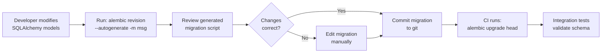
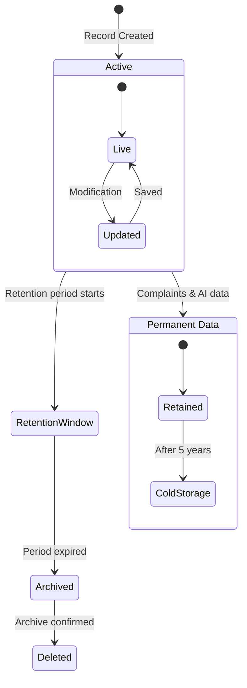

# 4. Database Design — Namma Ooru AI

> **Document Version:** 1.0  
> **Last Updated:** 2026-10-31  
> **Status:** Approved  
> **Owner:** Backend Architecture Team

---

## Table of Contents

1. [Database Overview](#1-database-overview)
2. [Entity Relationship Diagram](#2-entity-relationship-diagram)
3. [Table Definitions](#3-table-definitions)
4. [Indexes](#4-indexes)
5. [Constraints](#5-constraints)
6. [Migration Strategy](#6-migration-strategy)
7. [Data Retention & Lifecycle](#7-data-retention--lifecycle)
8. [Performance Considerations](#8-performance-considerations)

---

## 1. Database Overview

### 1.1 Technology Stack

| Component | Technology | Version | Purpose |
|---|---|---|---|
| **RDBMS** | PostgreSQL | 16.x | Primary relational data store |
| **Spatial Extension** | PostGIS | 3.4 | Geographic/spatial queries, GIST indexes |
| **Migration Tool** | Alembic | 1.13+ | Version-controlled schema migrations |
| **ORM** | SQLAlchemy | 2.0+ | Python object-relational mapping |
| **Connection Pool** | asyncpg + SQLAlchemy async | — | Async connection pooling for FastAPI |

### 1.2 Design Principles

| Principle | Implementation |
|---|---|
| **UUID Primary Keys** | All tables use `UUID v4` as the primary key (`gen_random_uuid()`). Prevents enumeration attacks and simplifies distributed ID generation. |
| **Timestamp Tracking** | Every table includes `created_at` (auto-set) and mutable tables include `updated_at` (auto-updated via trigger). All timestamps are `TIMESTAMPTZ` in UTC. |
| **Normalization** | Schema is in **Third Normal Form (3NF)** minimum. No transitive dependencies. Lookup data is separated into dedicated tables. |
| **Soft References** | Polymorphic references (e.g., `reference_type` + `reference_id` in notifications) are used sparingly and documented explicitly. |
| **Bilingual Support** | Tamil translations are stored in dedicated `*_ta` columns alongside English originals for key user-facing text fields. |
| **Spatial Data** | Geographic coordinates use the `GEOGRAPHY(POINT, 4326)` type (WGS 84 datum) for accurate distance calculations. |
| **JSONB for Flexibility** | Semi-structured data (audit details, target zones) uses `JSONB` with documented schemas. |

### 1.3 Schema Overview

The database is organized into **16 tables** across four logical domains:

```
┌──────────────────────────────────────────────────────────────────┐
│                        NAMMA OORU AI DB                         │
├─────────────────┬─────────────────┬──────────────┬──────────────┤
│   Identity &    │   Complaints &  │ AI & Spatial │   System &   │
│     Access      │   Assignments   │  Analytics   │  Messaging   │
├─────────────────┼─────────────────┼──────────────┼──────────────┤
│ users           │ complaints      │ ai_class...  │ notifications│
│ citizen_profiles│ complaint_      │ geographic_  │ announcements│
│ field_officers  │   attachments   │  issue_      │ audit_logs   │
│ departments     │ complaint_      │  clusters    │ refresh_     │
│ refresh_tokens  │   status_history│              │  tokens      │
│                 │ complaint_      │              │              │
│                 │   assignments   │              │              │
│                 │ resolution_     │              │              │
│                 │   feedback      │              │              │
└─────────────────┴─────────────────┴──────────────┴──────────────┘
```

### 1.4 Enum Types

The following PostgreSQL `ENUM` types are created before table definitions:

| Enum Name | Values |
|---|---|
| `user_role` | `citizen`, `admin`, `field_officer` |
| `supported_language` | `en`, `ta` |
| `complaint_category` | `garbage_collection`, `road_damage`, `water_supply`, `drainage`, `streetlights`, `electricity`, `public_sanitation`, `public_infrastructure`, `illegal_dumping`, `public_safety`, `other` |
| `complaint_priority` | `low`, `medium`, `high`, `critical` |
| `complaint_status` | `submitted`, `under_review`, `assigned`, `in_progress`, `resolved`, `closed`, `reopened` |
| `attachment_file_type` | `image`, `audio`, `document` |
| `upload_phase` | `initial`, `progress`, `resolution` |
| `notification_type` | `complaint_update`, `assignment`, `announcement`, `system` |
| `notification_channel` | `push`, `email`, `sms`, `in_app` |
| `announcement_priority` | `low`, `normal`, `high`, `urgent` |

---

## 2. Entity Relationship Diagram

```mermaid
erDiagram
    users {
        UUID id PK
        VARCHAR email UK "NOT NULL, unique"
        VARCHAR phone UK "NOT NULL, unique"
        VARCHAR password_hash "NOT NULL"
        VARCHAR full_name "NOT NULL"
        user_role role "NOT NULL"
        supported_language preferred_language "NOT NULL, default en"
        VARCHAR avatar_url "nullable"
        BOOLEAN is_active "NOT NULL, default true"
        BOOLEAN is_verified "NOT NULL, default false"
        TIMESTAMPTZ last_login_at "nullable"
        TIMESTAMPTZ created_at "NOT NULL, default now()"
        TIMESTAMPTZ updated_at "NOT NULL, default now()"
    }

    citizen_profiles {
        UUID id PK
        UUID user_id FK "NOT NULL, unique"
        TEXT address "nullable"
        VARCHAR ward_number "nullable"
        VARCHAR zone "nullable"
        VARCHAR city "NOT NULL"
        VARCHAR pincode "nullable"
        GEOGRAPHY location "nullable, POINT 4326"
        TIMESTAMPTZ created_at "NOT NULL, default now()"
        TIMESTAMPTZ updated_at "NOT NULL, default now()"
    }

    departments {
        UUID id PK
        VARCHAR name UK "NOT NULL, unique"
        VARCHAR name_ta "NOT NULL"
        VARCHAR code UK "NOT NULL, unique"
        TEXT description "NOT NULL"
        VARCHAR head_name "nullable"
        VARCHAR contact_email "nullable"
        VARCHAR contact_phone "nullable"
        BOOLEAN is_active "NOT NULL, default true"
        TIMESTAMPTZ created_at "NOT NULL, default now()"
        TIMESTAMPTZ updated_at "NOT NULL, default now()"
    }

    field_officers {
        UUID id PK
        UUID user_id FK "NOT NULL, unique"
        UUID department_id FK "NOT NULL"
        VARCHAR employee_id UK "NOT NULL, unique"
        VARCHAR designation "NOT NULL"
        VARCHAR assigned_zone "nullable"
        BOOLEAN is_available "NOT NULL, default true"
        GEOGRAPHY current_location "nullable, POINT 4326"
        TIMESTAMPTZ created_at "NOT NULL, default now()"
        TIMESTAMPTZ updated_at "NOT NULL, default now()"
    }

    complaints {
        UUID id PK
        VARCHAR complaint_number UK "NOT NULL, unique, auto-gen"
        UUID citizen_id FK "NOT NULL"
        VARCHAR title "NOT NULL"
        TEXT description "NOT NULL"
        TEXT description_ta "nullable"
        complaint_category category "NOT NULL"
        complaint_priority priority "NOT NULL, default medium"
        complaint_status status "NOT NULL, default submitted"
        GEOGRAPHY location "NOT NULL, POINT 4326"
        TEXT address "NOT NULL"
        VARCHAR ward_number "nullable"
        VARCHAR zone "nullable"
        UUID department_id FK "nullable"
        UUID assigned_officer_id FK "nullable"
        VARCHAR language_detected "NOT NULL"
        BOOLEAN is_anonymous "NOT NULL, default false"
        TEXT resolution_notes "nullable"
        TIMESTAMPTZ resolved_at "nullable"
        TIMESTAMPTZ closed_at "nullable"
        TIMESTAMPTZ sla_deadline "nullable"
        TIMESTAMPTZ created_at "NOT NULL, default now()"
        TIMESTAMPTZ updated_at "NOT NULL, default now()"
    }

    complaint_attachments {
        UUID id PK
        UUID complaint_id FK "NOT NULL"
        VARCHAR file_url "NOT NULL"
        attachment_file_type file_type "NOT NULL"
        INTEGER file_size "NOT NULL"
        VARCHAR original_filename "NOT NULL"
        upload_phase upload_phase "NOT NULL"
        UUID uploaded_by FK "NOT NULL"
        TIMESTAMPTZ created_at "NOT NULL, default now()"
    }

    complaint_status_history {
        UUID id PK
        UUID complaint_id FK "NOT NULL"
        VARCHAR previous_status "nullable"
        VARCHAR new_status "NOT NULL"
        UUID changed_by FK "NOT NULL"
        TEXT notes "nullable"
        TIMESTAMPTZ created_at "NOT NULL, default now()"
    }

    complaint_assignments {
        UUID id PK
        UUID complaint_id FK "NOT NULL"
        UUID department_id FK "NOT NULL"
        UUID officer_id FK "nullable"
        UUID assigned_by FK "NOT NULL"
        TIMESTAMPTZ assigned_at "NOT NULL, default now()"
        TIMESTAMPTZ unassigned_at "nullable"
        BOOLEAN is_active "NOT NULL, default true"
    }

    ai_classifications {
        UUID id PK
        UUID complaint_id FK "NOT NULL"
        VARCHAR detected_language "NOT NULL"
        VARCHAR predicted_category "NOT NULL"
        FLOAT category_confidence "NOT NULL"
        VARCHAR predicted_priority "NOT NULL"
        FLOAT priority_confidence "NOT NULL"
        UUID predicted_department_id FK "nullable"
        FLOAT department_confidence "NOT NULL"
        TEXT summary "NOT NULL"
        TEXT summary_ta "nullable"
        VARCHAR model_version "NOT NULL"
        INTEGER processing_time_ms "NOT NULL"
        BOOLEAN is_override "NOT NULL, default false"
        UUID overridden_by FK "nullable"
        TIMESTAMPTZ created_at "NOT NULL, default now()"
    }

    notifications {
        UUID id PK
        UUID user_id FK "NOT NULL"
        VARCHAR title "NOT NULL"
        TEXT body "NOT NULL"
        notification_type notification_type "NOT NULL"
        VARCHAR reference_type "nullable"
        UUID reference_id "nullable"
        BOOLEAN is_read "NOT NULL, default false"
        notification_channel sent_via "NOT NULL"
        TIMESTAMPTZ sent_at "nullable"
        TIMESTAMPTZ created_at "NOT NULL, default now()"
    }

    announcements {
        UUID id PK
        VARCHAR title "NOT NULL"
        VARCHAR title_ta "nullable"
        TEXT content "NOT NULL"
        TEXT content_ta "nullable"
        VARCHAR category "NOT NULL"
        announcement_priority priority "NOT NULL, default normal"
        JSONB target_zones "nullable"
        UUID published_by FK "NOT NULL"
        BOOLEAN is_active "NOT NULL, default true"
        TIMESTAMPTZ published_at "nullable"
        TIMESTAMPTZ expires_at "nullable"
        TIMESTAMPTZ created_at "NOT NULL, default now()"
        TIMESTAMPTZ updated_at "NOT NULL, default now()"
    }

    resolution_feedback {
        UUID id PK
        UUID complaint_id FK "NOT NULL, unique"
        UUID citizen_id FK "NOT NULL"
        INTEGER rating "NOT NULL, 1-5"
        TEXT feedback_text "nullable"
        BOOLEAN is_satisfied "NOT NULL"
        TIMESTAMPTZ created_at "NOT NULL, default now()"
    }

    audit_logs {
        UUID id PK
        UUID user_id FK "nullable"
        VARCHAR action "NOT NULL"
        VARCHAR resource_type "NOT NULL"
        UUID resource_id "nullable"
        JSONB details "NOT NULL, default empty"
        VARCHAR ip_address "nullable"
        VARCHAR user_agent "nullable"
        TIMESTAMPTZ created_at "NOT NULL, default now()"
    }

    refresh_tokens {
        UUID id PK
        UUID user_id FK "NOT NULL"
        VARCHAR token_hash "NOT NULL"
        TIMESTAMPTZ expires_at "NOT NULL"
        BOOLEAN is_revoked "NOT NULL, default false"
        TIMESTAMPTZ revoked_at "nullable"
        TIMESTAMPTZ created_at "NOT NULL, default now()"
    }

    geographic_issue_clusters {
        UUID id PK
        GEOGRAPHY center_point "NOT NULL, POINT 4326"
        FLOAT radius_meters "NOT NULL"
        INTEGER complaint_count "NOT NULL"
        VARCHAR dominant_category "NOT NULL"
        FLOAT severity_score "NOT NULL"
        INTEGER active_complaints "NOT NULL"
        VARCHAR zone "nullable"
        VARCHAR ward_number "nullable"
        TIMESTAMPTZ last_analyzed_at "NOT NULL"
        TIMESTAMPTZ created_at "NOT NULL, default now()"
        TIMESTAMPTZ updated_at "NOT NULL, default now()"
    }

    %% === Relationships ===

    users ||--o| citizen_profiles : "has profile"
    users ||--o| field_officers : "is officer"
    users ||--o{ complaints : "submits"
    users ||--o{ notifications : "receives"
    users ||--o{ refresh_tokens : "authenticates"
    users ||--o{ audit_logs : "generates"

    departments ||--o{ field_officers : "employs"
    departments ||--o{ complaints : "handles"
    departments ||--o{ complaint_assignments : "assigned to"

    field_officers ||--o{ complaints : "works on"
    field_officers ||--o{ complaint_assignments : "receives"

    complaints ||--o{ complaint_attachments : "has files"
    complaints ||--o{ complaint_status_history : "tracks changes"
    complaints ||--o{ complaint_assignments : "assigned via"
    complaints ||--o{ ai_classifications : "classified by"
    complaints ||--o| resolution_feedback : "rated by"

    users ||--o{ complaint_attachments : "uploads"
    users ||--o{ complaint_status_history : "changes status"
    users ||--o{ complaint_assignments : "assigns"
    users ||--o{ announcements : "publishes"
    users ||--o{ ai_classifications : "overrides"
    users ||--o{ resolution_feedback : "gives feedback"

    departments ||--o{ ai_classifications : "predicted dept"
```



---

## 3. Table Definitions

### 3.1 `users`

The central identity table. Every actor in the system (citizen, admin, field officer) has exactly one row here.

| Column | Type | Nullable | Default | Description |
|---|---|---|---|---|
| `id` | `UUID` | NO | `gen_random_uuid()` | Primary key |
| `email` | `VARCHAR(255)` | NO | — | Unique email address |
| `phone` | `VARCHAR(20)` | NO | — | Unique phone number (E.164 format) |
| `password_hash` | `VARCHAR(255)` | NO | — | Argon2id hash |
| `full_name` | `VARCHAR(150)` | NO | — | Display name |
| `role` | `user_role` | NO | — | System role enum |
| `preferred_language` | `supported_language` | NO | `'en'` | UI language preference |
| `avatar_url` | `VARCHAR(500)` | YES | `NULL` | S3/CDN URL to profile image |
| `is_active` | `BOOLEAN` | NO | `TRUE` | Soft-delete / deactivation flag |
| `is_verified` | `BOOLEAN` | NO | `FALSE` | Email/phone verification status |
| `last_login_at` | `TIMESTAMPTZ` | YES | `NULL` | Last successful authentication |
| `created_at` | `TIMESTAMPTZ` | NO | `now()` | Row creation timestamp |
| `updated_at` | `TIMESTAMPTZ` | NO | `now()` | Last modification timestamp |

### 3.2 `citizen_profiles`

Extended profile for users with role `citizen`. One-to-one with `users`.

| Column | Type | Nullable | Default | Description |
|---|---|---|---|---|
| `id` | `UUID` | NO | `gen_random_uuid()` | Primary key |
| `user_id` | `UUID` | NO | — | FK → `users.id` (unique) |
| `address` | `TEXT` | YES | `NULL` | Full street address |
| `ward_number` | `VARCHAR(10)` | YES | `NULL` | Municipal ward number |
| `zone` | `VARCHAR(50)` | YES | `NULL` | City zone name |
| `city` | `VARCHAR(100)` | NO | — | City name |
| `pincode` | `VARCHAR(10)` | YES | `NULL` | Postal code |
| `location` | `GEOGRAPHY(POINT, 4326)` | YES | `NULL` | Home/default location |
| `created_at` | `TIMESTAMPTZ` | NO | `now()` | Row creation timestamp |
| `updated_at` | `TIMESTAMPTZ` | NO | `now()` | Last modification timestamp |

### 3.3 `departments`

Municipal departments that handle complaints.

| Column | Type | Nullable | Default | Description |
|---|---|---|---|---|
| `id` | `UUID` | NO | `gen_random_uuid()` | Primary key |
| `name` | `VARCHAR(150)` | NO | — | English department name (unique) |
| `name_ta` | `VARCHAR(255)` | NO | — | Tamil department name |
| `code` | `VARCHAR(20)` | NO | — | Short code, e.g. `ROAD`, `WATER` (unique) |
| `description` | `TEXT` | NO | — | Department description |
| `head_name` | `VARCHAR(150)` | YES | `NULL` | Department head's name |
| `contact_email` | `VARCHAR(255)` | YES | `NULL` | Department contact email |
| `contact_phone` | `VARCHAR(20)` | YES | `NULL` | Department contact phone |
| `is_active` | `BOOLEAN` | NO | `TRUE` | Active/inactive flag |
| `created_at` | `TIMESTAMPTZ` | NO | `now()` | Row creation timestamp |
| `updated_at` | `TIMESTAMPTZ` | NO | `now()` | Last modification timestamp |

### 3.4 `field_officers`

Extended profile for users with role `field_officer`. Links a user to a department.

| Column | Type | Nullable | Default | Description |
|---|---|---|---|---|
| `id` | `UUID` | NO | `gen_random_uuid()` | Primary key |
| `user_id` | `UUID` | NO | — | FK → `users.id` (unique) |
| `department_id` | `UUID` | NO | — | FK → `departments.id` |
| `employee_id` | `VARCHAR(30)` | NO | — | Government employee ID (unique) |
| `designation` | `VARCHAR(100)` | NO | — | Job title / designation |
| `assigned_zone` | `VARCHAR(50)` | YES | `NULL` | Primary zone of responsibility |
| `is_available` | `BOOLEAN` | NO | `TRUE` | Availability for new assignments |
| `current_location` | `GEOGRAPHY(POINT, 4326)` | YES | `NULL` | Last-known GPS location |
| `created_at` | `TIMESTAMPTZ` | NO | `now()` | Row creation timestamp |
| `updated_at` | `TIMESTAMPTZ` | NO | `now()` | Last modification timestamp |

### 3.5 `complaints`

The core transactional table. Every civic issue reported becomes a complaint.

| Column | Type | Nullable | Default | Description |
|---|---|---|---|---|
| `id` | `UUID` | NO | `gen_random_uuid()` | Primary key |
| `complaint_number` | `VARCHAR(20)` | NO | — | Human-readable ID, e.g. `NOA-2026-00001` (unique, auto-generated) |
| `citizen_id` | `UUID` | NO | — | FK → `users.id` (the reporter) |
| `title` | `VARCHAR(255)` | NO | — | Short summary title |
| `description` | `TEXT` | NO | — | Full description of the issue |
| `description_ta` | `TEXT` | YES | `NULL` | Tamil translation (AI-generated or user-provided) |
| `category` | `complaint_category` | NO | — | Issue category enum |
| `priority` | `complaint_priority` | NO | `'medium'` | Severity level |
| `status` | `complaint_status` | NO | `'submitted'` | Current lifecycle status |
| `location` | `GEOGRAPHY(POINT, 4326)` | NO | — | Issue location (required) |
| `address` | `TEXT` | NO | — | Human-readable address |
| `ward_number` | `VARCHAR(10)` | YES | `NULL` | Ward number (auto-resolved or manual) |
| `zone` | `VARCHAR(50)` | YES | `NULL` | Zone name |
| `department_id` | `UUID` | YES | `NULL` | FK → `departments.id` (assigned department) |
| `assigned_officer_id` | `UUID` | YES | `NULL` | FK → `field_officers.id` |
| `language_detected` | `VARCHAR(10)` | NO | — | ISO 639-1 code of detected language |
| `is_anonymous` | `BOOLEAN` | NO | `FALSE` | Whether citizen identity is hidden publicly |
| `resolution_notes` | `TEXT` | YES | `NULL` | Notes added at resolution |
| `resolved_at` | `TIMESTAMPTZ` | YES | `NULL` | Timestamp when status became `resolved` |
| `closed_at` | `TIMESTAMPTZ` | YES | `NULL` | Timestamp when status became `closed` |
| `sla_deadline` | `TIMESTAMPTZ` | YES | `NULL` | SLA target resolution time |
| `created_at` | `TIMESTAMPTZ` | NO | `now()` | Row creation timestamp |
| `updated_at` | `TIMESTAMPTZ` | NO | `now()` | Last modification timestamp |

> [!IMPORTANT]
> The `complaint_number` is generated by a PostgreSQL function using a sequence: `NOA-YYYY-NNNNN` format. This provides a human-friendly reference for citizens and officers while the `id` UUID remains the internal key.

### 3.6 `complaint_attachments`

Media and documents attached to complaints at various lifecycle phases.

| Column | Type | Nullable | Default | Description |
|---|---|---|---|---|
| `id` | `UUID` | NO | `gen_random_uuid()` | Primary key |
| `complaint_id` | `UUID` | NO | — | FK → `complaints.id` |
| `file_url` | `VARCHAR(500)` | NO | — | S3/CDN URL to the uploaded file |
| `file_type` | `attachment_file_type` | NO | — | Type of file |
| `file_size` | `INTEGER` | NO | — | File size in bytes |
| `original_filename` | `VARCHAR(255)` | NO | — | Original upload filename |
| `upload_phase` | `upload_phase` | NO | — | When in the lifecycle this was uploaded |
| `uploaded_by` | `UUID` | NO | — | FK → `users.id` |
| `created_at` | `TIMESTAMPTZ` | NO | `now()` | Upload timestamp |

### 3.7 `complaint_status_history`

Immutable audit trail of every status transition on a complaint.

| Column | Type | Nullable | Default | Description |
|---|---|---|---|---|
| `id` | `UUID` | NO | `gen_random_uuid()` | Primary key |
| `complaint_id` | `UUID` | NO | — | FK → `complaints.id` |
| `previous_status` | `VARCHAR(30)` | YES | `NULL` | Status before transition (`NULL` on creation) |
| `new_status` | `VARCHAR(30)` | NO | — | Status after transition |
| `changed_by` | `UUID` | NO | — | FK → `users.id` |
| `notes` | `TEXT` | YES | `NULL` | Optional transition notes |
| `created_at` | `TIMESTAMPTZ` | NO | `now()` | Transition timestamp |

### 3.8 `complaint_assignments`

Tracks all department and officer assignments for a complaint, including historical reassignments.

| Column | Type | Nullable | Default | Description |
|---|---|---|---|---|
| `id` | `UUID` | NO | `gen_random_uuid()` | Primary key |
| `complaint_id` | `UUID` | NO | — | FK → `complaints.id` |
| `department_id` | `UUID` | NO | — | FK → `departments.id` |
| `officer_id` | `UUID` | YES | `NULL` | FK → `field_officers.id` |
| `assigned_by` | `UUID` | NO | — | FK → `users.id` (admin who assigned) |
| `assigned_at` | `TIMESTAMPTZ` | NO | `now()` | Assignment timestamp |
| `unassigned_at` | `TIMESTAMPTZ` | YES | `NULL` | When this assignment was superseded |
| `is_active` | `BOOLEAN` | NO | `TRUE` | Whether this is the current assignment |

### 3.9 `ai_classifications`

Stores the AI engine's analysis of each complaint. Multiple classifications may exist per complaint (re-classifications, model upgrades).

| Column | Type | Nullable | Default | Description |
|---|---|---|---|---|
| `id` | `UUID` | NO | `gen_random_uuid()` | Primary key |
| `complaint_id` | `UUID` | NO | — | FK → `complaints.id` |
| `detected_language` | `VARCHAR(10)` | NO | — | ISO 639-1 language code |
| `predicted_category` | `VARCHAR(50)` | NO | — | AI-predicted category |
| `category_confidence` | `FLOAT` | NO | — | Confidence score (0.0–1.0) |
| `predicted_priority` | `VARCHAR(20)` | NO | — | AI-predicted priority |
| `priority_confidence` | `FLOAT` | NO | — | Confidence score (0.0–1.0) |
| `predicted_department_id` | `UUID` | YES | `NULL` | FK → `departments.id` |
| `department_confidence` | `FLOAT` | NO | — | Confidence score (0.0–1.0) |
| `summary` | `TEXT` | NO | — | AI-generated English summary |
| `summary_ta` | `TEXT` | YES | `NULL` | AI-generated Tamil summary |
| `model_version` | `VARCHAR(50)` | NO | — | Model version string, e.g. `gemini-2.0-flash` |
| `processing_time_ms` | `INTEGER` | NO | — | End-to-end inference time |
| `is_override` | `BOOLEAN` | NO | `FALSE` | Whether an admin overrode the AI result |
| `overridden_by` | `UUID` | YES | `NULL` | FK → `users.id` (admin who overrode) |
| `created_at` | `TIMESTAMPTZ` | NO | `now()` | Classification timestamp |

### 3.10 `notifications`

All user-facing notifications across all delivery channels.

| Column | Type | Nullable | Default | Description |
|---|---|---|---|---|
| `id` | `UUID` | NO | `gen_random_uuid()` | Primary key |
| `user_id` | `UUID` | NO | — | FK → `users.id` |
| `title` | `VARCHAR(255)` | NO | — | Notification title |
| `body` | `TEXT` | NO | — | Notification body text |
| `notification_type` | `notification_type` | NO | — | Category of notification |
| `reference_type` | `VARCHAR(50)` | YES | `NULL` | Polymorphic type (e.g. `complaint`, `announcement`) |
| `reference_id` | `UUID` | YES | `NULL` | Polymorphic FK to referenced entity |
| `is_read` | `BOOLEAN` | NO | `FALSE` | Whether the user has read this |
| `sent_via` | `notification_channel` | NO | — | Delivery channel |
| `sent_at` | `TIMESTAMPTZ` | YES | `NULL` | Actual delivery timestamp |
| `created_at` | `TIMESTAMPTZ` | NO | `now()` | Row creation timestamp |

### 3.11 `announcements`

Admin-published public announcements targeted to specific zones or city-wide.

| Column | Type | Nullable | Default | Description |
|---|---|---|---|---|
| `id` | `UUID` | NO | `gen_random_uuid()` | Primary key |
| `title` | `VARCHAR(255)` | NO | — | English title |
| `title_ta` | `VARCHAR(255)` | YES | `NULL` | Tamil title |
| `content` | `TEXT` | NO | — | English content body |
| `content_ta` | `TEXT` | YES | `NULL` | Tamil content body |
| `category` | `VARCHAR(50)` | NO | — | Announcement category |
| `priority` | `announcement_priority` | NO | `'normal'` | Display priority |
| `target_zones` | `JSONB` | YES | `NULL` | Array of zone names, `NULL` = city-wide |
| `published_by` | `UUID` | NO | — | FK → `users.id` (admin) |
| `is_active` | `BOOLEAN` | NO | `TRUE` | Active/inactive flag |
| `published_at` | `TIMESTAMPTZ` | YES | `NULL` | When it was published |
| `expires_at` | `TIMESTAMPTZ` | YES | `NULL` | Auto-expire date |
| `created_at` | `TIMESTAMPTZ` | NO | `now()` | Row creation timestamp |
| `updated_at` | `TIMESTAMPTZ` | NO | `now()` | Last modification timestamp |

> [!NOTE]
> The `target_zones` JSONB column stores an array of zone name strings, e.g. `["Zone 1", "Zone 5"]`. A `NULL` value indicates a city-wide announcement. GIN indexes enable efficient containment queries.

### 3.12 `resolution_feedback`

Citizen satisfaction rating after a complaint is resolved. One feedback per complaint.

| Column | Type | Nullable | Default | Description |
|---|---|---|---|---|
| `id` | `UUID` | NO | `gen_random_uuid()` | Primary key |
| `complaint_id` | `UUID` | NO | — | FK → `complaints.id` (unique) |
| `citizen_id` | `UUID` | NO | — | FK → `users.id` |
| `rating` | `INTEGER` | NO | — | 1–5 star rating |
| `feedback_text` | `TEXT` | YES | `NULL` | Optional written feedback |
| `is_satisfied` | `BOOLEAN` | NO | — | Binary satisfaction indicator |
| `created_at` | `TIMESTAMPTZ` | NO | `now()` | Feedback submission timestamp |

### 3.13 `audit_logs`

Immutable system-wide audit trail for security and compliance.

| Column | Type | Nullable | Default | Description |
|---|---|---|---|---|
| `id` | `UUID` | NO | `gen_random_uuid()` | Primary key |
| `user_id` | `UUID` | YES | `NULL` | FK → `users.id` (`NULL` for system events) |
| `action` | `VARCHAR(100)` | NO | — | Action performed, e.g. `complaint.create`, `user.login` |
| `resource_type` | `VARCHAR(50)` | NO | — | Entity type, e.g. `complaint`, `user` |
| `resource_id` | `UUID` | YES | `NULL` | ID of the affected resource |
| `details` | `JSONB` | NO | `'{}'` | Structured event metadata |
| `ip_address` | `VARCHAR(45)` | YES | `NULL` | Client IP (supports IPv6) |
| `user_agent` | `VARCHAR(500)` | YES | `NULL` | Client user-agent string |
| `created_at` | `TIMESTAMPTZ` | NO | `now()` | Event timestamp |

### 3.14 `refresh_tokens`

JWT refresh token tracking for secure session management.

| Column | Type | Nullable | Default | Description |
|---|---|---|---|---|
| `id` | `UUID` | NO | `gen_random_uuid()` | Primary key |
| `user_id` | `UUID` | NO | — | FK → `users.id` |
| `token_hash` | `VARCHAR(255)` | NO | — | SHA-256 hash of the refresh token |
| `expires_at` | `TIMESTAMPTZ` | NO | — | Token expiry timestamp |
| `is_revoked` | `BOOLEAN` | NO | `FALSE` | Revocation flag |
| `revoked_at` | `TIMESTAMPTZ` | YES | `NULL` | When the token was revoked |
| `created_at` | `TIMESTAMPTZ` | NO | `now()` | Token issuance timestamp |

### 3.15 `geographic_issue_clusters`

Pre-computed spatial clusters of complaints for hotspot visualization on maps. Refreshed periodically by the analytics engine.

| Column | Type | Nullable | Default | Description |
|---|---|---|---|---|
| `id` | `UUID` | NO | `gen_random_uuid()` | Primary key |
| `center_point` | `GEOGRAPHY(POINT, 4326)` | NO | — | Cluster centroid |
| `radius_meters` | `FLOAT` | NO | — | Cluster radius |
| `complaint_count` | `INTEGER` | NO | — | Total complaints in cluster |
| `dominant_category` | `VARCHAR(50)` | NO | — | Most common category |
| `severity_score` | `FLOAT` | NO | — | Computed severity (0.0–10.0) |
| `active_complaints` | `INTEGER` | NO | — | Currently unresolved complaints |
| `zone` | `VARCHAR(50)` | YES | `NULL` | Zone name |
| `ward_number` | `VARCHAR(10)` | YES | `NULL` | Ward number |
| `last_analyzed_at` | `TIMESTAMPTZ` | NO | — | Last cluster computation time |
| `created_at` | `TIMESTAMPTZ` | NO | `now()` | Row creation timestamp |
| `updated_at` | `TIMESTAMPTZ` | NO | `now()` | Last modification timestamp |

---

## 4. Indexes

### 4.1 Primary Key Indexes

All primary keys are automatically indexed by PostgreSQL.

### 4.2 Unique Indexes

| Table | Column(s) | Index Name |
|---|---|---|
| `users` | `email` | `uq_users_email` |
| `users` | `phone` | `uq_users_phone` |
| `departments` | `name` | `uq_departments_name` |
| `departments` | `code` | `uq_departments_code` |
| `field_officers` | `user_id` | `uq_field_officers_user_id` |
| `field_officers` | `employee_id` | `uq_field_officers_employee_id` |
| `citizen_profiles` | `user_id` | `uq_citizen_profiles_user_id` |
| `complaints` | `complaint_number` | `uq_complaints_complaint_number` |
| `resolution_feedback` | `complaint_id` | `uq_resolution_feedback_complaint_id` |

### 4.3 B-Tree Indexes (Lookup & Filter)

| Table | Column(s) | Index Name | Purpose |
|---|---|---|---|
| `users` | `role` | `ix_users_role` | Filter by role |
| `users` | `is_active` | `ix_users_is_active` | Filter active users |
| `complaints` | `citizen_id` | `ix_complaints_citizen_id` | Citizen's complaint list |
| `complaints` | `status` | `ix_complaints_status` | Dashboard status filters |
| `complaints` | `category` | `ix_complaints_category` | Category-based reports |
| `complaints` | `priority` | `ix_complaints_priority` | Priority-based sorting |
| `complaints` | `department_id` | `ix_complaints_department_id` | Department workload queries |
| `complaints` | `assigned_officer_id` | `ix_complaints_assigned_officer_id` | Officer workload queries |
| `complaints` | `created_at` | `ix_complaints_created_at` | Time-range queries, sorting |
| `complaints` | `sla_deadline` | `ix_complaints_sla_deadline` | SLA monitoring queries |
| `complaints` | `status, priority` | `ix_complaints_status_priority` | Composite: dashboard filtering |
| `complaints` | `department_id, status` | `ix_complaints_dept_status` | Composite: department dashboard |
| `complaint_status_history` | `complaint_id` | `ix_csh_complaint_id` | Complaint timeline |
| `complaint_status_history` | `created_at` | `ix_csh_created_at` | Chronological queries |
| `complaint_status_history` | `complaint_id, created_at` | `ix_csh_complaint_timeline` | Composite: ordered history |
| `complaint_attachments` | `complaint_id` | `ix_ca_complaint_id` | Fetch attachments for complaint |
| `complaint_assignments` | `complaint_id` | `ix_cass_complaint_id` | Assignment history |
| `complaint_assignments` | `officer_id, is_active` | `ix_cass_officer_active` | Active officer assignments |
| `complaint_assignments` | `department_id, is_active` | `ix_cass_dept_active` | Active department assignments |
| `ai_classifications` | `complaint_id` | `ix_aic_complaint_id` | Fetch AI results for complaint |
| `ai_classifications` | `model_version` | `ix_aic_model_version` | Model performance analysis |
| `notifications` | `user_id` | `ix_notifications_user_id` | User notification list |
| `notifications` | `user_id, is_read` | `ix_notifications_user_unread` | Unread notification count |
| `notifications` | `created_at` | `ix_notifications_created_at` | Retention policy cleanup |
| `announcements` | `is_active, published_at` | `ix_ann_active_published` | Active announcement feed |
| `announcements` | `expires_at` | `ix_ann_expires_at` | Expiry cleanup job |
| `audit_logs` | `user_id` | `ix_audit_user_id` | User activity trail |
| `audit_logs` | `resource_type` | `ix_audit_resource_type` | Resource-scoped queries |
| `audit_logs` | `resource_type, resource_id` | `ix_audit_resource` | Composite: specific resource audit |
| `audit_logs` | `created_at` | `ix_audit_created_at` | Time-range queries, retention cleanup |
| `audit_logs` | `action` | `ix_audit_action` | Action-type queries |
| `refresh_tokens` | `user_id` | `ix_rt_user_id` | Lookup tokens by user |
| `refresh_tokens` | `token_hash` | `ix_rt_token_hash` | Token lookup on refresh |
| `refresh_tokens` | `expires_at` | `ix_rt_expires_at` | Expired token cleanup |
| `resolution_feedback` | `citizen_id` | `ix_rf_citizen_id` | Citizen's feedback history |
| `field_officers` | `department_id` | `ix_fo_department_id` | Officers by department |
| `field_officers` | `assigned_zone` | `ix_fo_assigned_zone` | Officers by zone |
| `geographic_issue_clusters` | `zone` | `ix_gic_zone` | Zone-based cluster queries |
| `geographic_issue_clusters` | `dominant_category` | `ix_gic_category` | Category-based cluster queries |
| `geographic_issue_clusters` | `last_analyzed_at` | `ix_gic_last_analyzed` | Stale cluster detection |

### 4.4 Spatial Indexes (GIST)

| Table | Column | Index Name | Purpose |
|---|---|---|---|
| `complaints` | `location` | `ix_complaints_location_gist` | Proximity searches, map queries, cluster analysis |
| `citizen_profiles` | `location` | `ix_cp_location_gist` | Zone-based citizen lookup |
| `field_officers` | `current_location` | `ix_fo_location_gist` | Nearest-officer assignment |
| `geographic_issue_clusters` | `center_point` | `ix_gic_center_gist` | Map viewport cluster queries |

### 4.5 GIN Indexes (JSONB)

| Table | Column | Index Name | Purpose |
|---|---|---|---|
| `announcements` | `target_zones` | `ix_ann_target_zones_gin` | Zone containment queries |
| `audit_logs` | `details` | `ix_audit_details_gin` | Structured detail searches |

### 4.6 Partial Indexes

| Table | Condition | Index Name | Purpose |
|---|---|---|---|
| `complaints` | `WHERE status NOT IN ('closed', 'resolved')` | `ix_complaints_active` | Fast active-complaint queries |
| `complaint_assignments` | `WHERE is_active = TRUE` | `ix_cass_active_only` | Current assignments only |
| `refresh_tokens` | `WHERE is_revoked = FALSE AND expires_at > now()` | `ix_rt_valid_tokens` | Valid token lookups |
| `notifications` | `WHERE is_read = FALSE` | `ix_notifications_unread` | Unread notification counts |

---

## 5. Constraints

### 5.1 Primary Key Constraints

Every table has a `PRIMARY KEY (id)` constraint on its `UUID` column.

### 5.2 Foreign Key Constraints

| Table | Column | References | On Delete | On Update |
|---|---|---|---|---|
| `citizen_profiles` | `user_id` | `users(id)` | `CASCADE` | `CASCADE` |
| `field_officers` | `user_id` | `users(id)` | `CASCADE` | `CASCADE` |
| `field_officers` | `department_id` | `departments(id)` | `RESTRICT` | `CASCADE` |
| `complaints` | `citizen_id` | `users(id)` | `RESTRICT` | `CASCADE` |
| `complaints` | `department_id` | `departments(id)` | `SET NULL` | `CASCADE` |
| `complaints` | `assigned_officer_id` | `field_officers(id)` | `SET NULL` | `CASCADE` |
| `complaint_attachments` | `complaint_id` | `complaints(id)` | `CASCADE` | `CASCADE` |
| `complaint_attachments` | `uploaded_by` | `users(id)` | `RESTRICT` | `CASCADE` |
| `complaint_status_history` | `complaint_id` | `complaints(id)` | `CASCADE` | `CASCADE` |
| `complaint_status_history` | `changed_by` | `users(id)` | `RESTRICT` | `CASCADE` |
| `complaint_assignments` | `complaint_id` | `complaints(id)` | `CASCADE` | `CASCADE` |
| `complaint_assignments` | `department_id` | `departments(id)` | `RESTRICT` | `CASCADE` |
| `complaint_assignments` | `officer_id` | `field_officers(id)` | `SET NULL` | `CASCADE` |
| `complaint_assignments` | `assigned_by` | `users(id)` | `RESTRICT` | `CASCADE` |
| `ai_classifications` | `complaint_id` | `complaints(id)` | `CASCADE` | `CASCADE` |
| `ai_classifications` | `predicted_department_id` | `departments(id)` | `SET NULL` | `CASCADE` |
| `ai_classifications` | `overridden_by` | `users(id)` | `SET NULL` | `CASCADE` |
| `notifications` | `user_id` | `users(id)` | `CASCADE` | `CASCADE` |
| `announcements` | `published_by` | `users(id)` | `RESTRICT` | `CASCADE` |
| `resolution_feedback` | `complaint_id` | `complaints(id)` | `CASCADE` | `CASCADE` |
| `resolution_feedback` | `citizen_id` | `users(id)` | `RESTRICT` | `CASCADE` |
| `audit_logs` | `user_id` | `users(id)` | `SET NULL` | `CASCADE` |
| `refresh_tokens` | `user_id` | `users(id)` | `CASCADE` | `CASCADE` |

### 5.3 UNIQUE Constraints

| Table | Column(s) | Constraint Name |
|---|---|---|
| `users` | `email` | `uq_users_email` |
| `users` | `phone` | `uq_users_phone` |
| `departments` | `name` | `uq_departments_name` |
| `departments` | `code` | `uq_departments_code` |
| `field_officers` | `user_id` | `uq_field_officers_user_id` |
| `field_officers` | `employee_id` | `uq_field_officers_employee_id` |
| `citizen_profiles` | `user_id` | `uq_citizen_profiles_user_id` |
| `complaints` | `complaint_number` | `uq_complaints_complaint_number` |
| `resolution_feedback` | `complaint_id` | `uq_resolution_feedback_complaint_id` |

### 5.4 CHECK Constraints

| Table | Column | Constraint Name | Expression |
|---|---|---|---|
| `users` | `email` | `ck_users_email_format` | `email ~* '^[A-Za-z0-9._%+-]+@[A-Za-z0-9.-]+\.[A-Za-z]{2,}$'` |
| `users` | `phone` | `ck_users_phone_format` | `phone ~ '^\+?[1-9]\d{6,14}$'` |
| `complaints` | `resolved_at` | `ck_complaints_resolved_at` | `resolved_at IS NULL OR resolved_at >= created_at` |
| `complaints` | `closed_at` | `ck_complaints_closed_at` | `closed_at IS NULL OR closed_at >= created_at` |
| `complaints` | `sla_deadline` | `ck_complaints_sla_deadline` | `sla_deadline IS NULL OR sla_deadline > created_at` |
| `complaint_attachments` | `file_size` | `ck_ca_file_size` | `file_size > 0 AND file_size <= 52428800` (max 50MB) |
| `complaint_assignments` | `unassigned_at` | `ck_cass_unassigned_at` | `unassigned_at IS NULL OR unassigned_at >= assigned_at` |
| `ai_classifications` | `category_confidence` | `ck_aic_cat_confidence` | `category_confidence >= 0.0 AND category_confidence <= 1.0` |
| `ai_classifications` | `priority_confidence` | `ck_aic_pri_confidence` | `priority_confidence >= 0.0 AND priority_confidence <= 1.0` |
| `ai_classifications` | `department_confidence` | `ck_aic_dept_confidence` | `department_confidence >= 0.0 AND department_confidence <= 1.0` |
| `ai_classifications` | `processing_time_ms` | `ck_aic_processing_time` | `processing_time_ms >= 0` |
| `ai_classifications` | `is_override, overridden_by` | `ck_aic_override_consistency` | `(is_override = FALSE AND overridden_by IS NULL) OR (is_override = TRUE AND overridden_by IS NOT NULL)` |
| `resolution_feedback` | `rating` | `ck_rf_rating_range` | `rating >= 1 AND rating <= 5` |
| `geographic_issue_clusters` | `radius_meters` | `ck_gic_radius` | `radius_meters > 0` |
| `geographic_issue_clusters` | `complaint_count` | `ck_gic_complaint_count` | `complaint_count >= 0` |
| `geographic_issue_clusters` | `severity_score` | `ck_gic_severity` | `severity_score >= 0.0 AND severity_score <= 10.0` |
| `geographic_issue_clusters` | `active_complaints` | `ck_gic_active` | `active_complaints >= 0 AND active_complaints <= complaint_count` |
| `refresh_tokens` | `revoked_at` | `ck_rt_revoked_at` | `revoked_at IS NULL OR (is_revoked = TRUE AND revoked_at IS NOT NULL)` |
| `refresh_tokens` | `expires_at` | `ck_rt_expires_at` | `expires_at > created_at` |
| `announcements` | `expires_at` | `ck_ann_expires_at` | `expires_at IS NULL OR expires_at > created_at` |

### 5.5 NOT NULL Constraints

All columns listed without `nullable` designation in the table definitions have implicit `NOT NULL` constraints. Key non-obvious `NOT NULL` fields:

- `complaints.location` — Every complaint **must** have a geographic location
- `complaints.address` — Human-readable address is required
- `complaints.language_detected` — Language detection is mandatory
- `ai_classifications.department_confidence` — Even if department is `NULL`, confidence must be recorded (can be `0.0`)
- `audit_logs.details` — Defaults to `'{}'` but is never `NULL`

---

## 6. Migration Strategy

### 6.1 Tooling

| Tool | Purpose |
|---|---|
| **Alembic** | Version-controlled, reversible database migrations |
| **SQLAlchemy 2.0** | ORM models that serve as the source of truth for Alembic autogenerate |

### 6.2 Migration Workflow



### 6.3 Migration File Structure

```
backend/
├── alembic.ini
├── alembic/
│   ├── env.py
│   ├── script.py.mako
│   └── versions/
│       ├── 001_initial_schema.py
│       ├── 002_seed_departments.py
│       ├── 003_seed_admin_user.py
│       ├── 004_complaint_number_sequence.py
│       └── ...
```

### 6.4 Initial Migration Sequence

**Migration 001 — Initial Schema:**
1. Enable `uuid-ossp` and `postgis` extensions
2. Create all ENUM types
3. Create all 16 tables with columns, constraints, and defaults
4. Create all indexes (B-Tree, GIST, GIN, partial)
5. Create `updated_at` auto-update trigger function
6. Apply trigger to all mutable tables

**Migration 002 — Seed Departments:**

```python
departments_seed = [
    {"name": "Roads & Infrastructure", "name_ta": "சாலைகள் மற்றும் உள்கட்டமைப்பு", "code": "ROAD"},
    {"name": "Water Supply", "name_ta": "குடிநீர் வழங்கல்", "code": "WATER"},
    {"name": "Drainage & Sewerage", "name_ta": "வடிகால் மற்றும் கழிவுநீர்", "code": "DRAIN"},
    {"name": "Solid Waste Management", "name_ta": "திடக்கழிவு மேலாண்மை", "code": "SWM"},
    {"name": "Street Lighting", "name_ta": "தெரு விளக்குகள்", "code": "LIGHT"},
    {"name": "Electricity", "name_ta": "மின்சாரம்", "code": "ELEC"},
    {"name": "Public Health & Sanitation", "name_ta": "பொது சுகாதாரம் மற்றும் துப்புரவு", "code": "HEALTH"},
    {"name": "Public Safety", "name_ta": "பொது பாதுகாப்பு", "code": "SAFETY"},
    {"name": "General Administration", "name_ta": "பொது நிர்வாகம்", "code": "ADMIN"},
]
```

**Migration 003 — Seed Default Admin User:**

```python
# Default admin (password must be changed on first login)
admin_seed = {
    "email": "admin@nammaooru.ai",
    "phone": "+910000000000",
    "password_hash": "<argon2id hash of temp password>",
    "full_name": "System Administrator",
    "role": "admin",
    "is_active": True,
    "is_verified": True,
}
```

**Migration 004 — Complaint Number Sequence:**

```sql
-- Create sequence for complaint numbering
CREATE SEQUENCE complaint_number_seq START 1;

-- Function to generate complaint numbers
CREATE OR REPLACE FUNCTION generate_complaint_number()
RETURNS TRIGGER AS $$
BEGIN
    NEW.complaint_number := 'NOA-' || EXTRACT(YEAR FROM NOW())::TEXT
        || '-' || LPAD(nextval('complaint_number_seq')::TEXT, 5, '0');
    RETURN NEW;
END;
$$ LANGUAGE plpgsql;

-- Trigger to auto-generate complaint number on insert
CREATE TRIGGER trg_complaint_number
    BEFORE INSERT ON complaints
    FOR EACH ROW
    WHEN (NEW.complaint_number IS NULL)
    EXECUTE FUNCTION generate_complaint_number();
```

### 6.5 Migration Best Practices

> [!WARNING]
> **Never** edit a migration that has been applied to staging or production. Always create a new migration to modify the schema.

- Every migration must have a corresponding **downgrade** path
- Migrations that touch large tables must use `ALTER TABLE ... ADD COLUMN ... DEFAULT` (PostgreSQL 11+ does this without a full table rewrite)
- Data migrations (seed/backfill) are kept in separate files from schema migrations
- All migrations are tested in CI against a clean database before merge

---

## 7. Data Retention & Lifecycle

### 7.1 Retention Policies

| Data Category | Table(s) | Retention Period | Cleanup Strategy |
|---|---|---|---|
| **Complaints** | `complaints`, `complaint_attachments`, `complaint_status_history`, `complaint_assignments`, `resolution_feedback` | **Permanent** | No deletion. Archived to cold storage after 5 years. |
| **AI Classifications** | `ai_classifications` | **Permanent** | Retained for model retraining and accuracy analysis. |
| **Audit Logs** | `audit_logs` | **2 years** | Scheduled job deletes rows where `created_at < now() - interval '2 years'`. Monthly partition pruning. |
| **Notifications** | `notifications` | **90 days after read** | Scheduled job deletes rows where `is_read = TRUE AND created_at < now() - interval '90 days'`. Unread notifications retained indefinitely. |
| **Refresh Tokens** | `refresh_tokens` | **Auto-cleaned on expiry** | Scheduled job deletes rows where `expires_at < now()` or `is_revoked = TRUE AND revoked_at < now() - interval '7 days'`. |
| **Announcements** | `announcements` | **1 year after expiry** | Rows with `expires_at < now() - interval '1 year'` are archived and deleted. |
| **Geographic Clusters** | `geographic_issue_clusters` | **Rolling** | Fully recomputed on each analysis run. Old rows are replaced. |

### 7.2 Cleanup Scheduled Jobs

```sql
-- Run daily at 02:00 UTC via pg_cron or application scheduler

-- 1. Clean expired refresh tokens
DELETE FROM refresh_tokens
WHERE expires_at < NOW()
   OR (is_revoked = TRUE AND revoked_at < NOW() - INTERVAL '7 days');

-- 2. Clean read notifications older than 90 days
DELETE FROM notifications
WHERE is_read = TRUE
  AND created_at < NOW() - INTERVAL '90 days';

-- 3. Archive and clean audit logs older than 2 years
-- (Archive step handled by application before delete)
DELETE FROM audit_logs
WHERE created_at < NOW() - INTERVAL '2 years';
```

### 7.3 Data Lifecycle State Diagram



---

## 8. Performance Considerations

### 8.1 Table Partitioning

> [!TIP]
> For tables expected to grow beyond 10M rows, consider range partitioning by `created_at` to maintain query performance and simplify retention cleanup.

| Table | Partitioning Strategy | Partition Key |
|---|---|---|
| `audit_logs` | Range by month | `created_at` |
| `notifications` | Range by month | `created_at` |
| `complaint_status_history` | Range by quarter | `created_at` |

```sql
-- Example: Partitioned audit_logs
CREATE TABLE audit_logs (
    id UUID NOT NULL DEFAULT gen_random_uuid(),
    -- ... other columns ...
    created_at TIMESTAMPTZ NOT NULL DEFAULT now()
) PARTITION BY RANGE (created_at);

-- Monthly partitions
CREATE TABLE audit_logs_2026_01 PARTITION OF audit_logs
    FOR VALUES FROM ('2026-01-01') TO ('2026-02-01');
CREATE TABLE audit_logs_2026_02 PARTITION OF audit_logs
    FOR VALUES FROM ('2026-02-01') TO ('2026-03-01');
-- ... auto-created by pg_partman or application scheduler
```

### 8.2 Connection Pooling

| Parameter | Value | Rationale |
|---|---|---|
| `pool_size` | 20 | Base connections per worker |
| `max_overflow` | 10 | Burst capacity |
| `pool_timeout` | 30s | Connection wait timeout |
| `pool_recycle` | 1800s | Prevent stale connections |
| `pool_pre_ping` | `True` | Validate connections before use |

### 8.3 Query Optimization Guidelines

1. **Complaint Listing** — Always filter by `status` and paginate using keyset pagination (`WHERE created_at < :cursor ORDER BY created_at DESC LIMIT 20`) instead of `OFFSET`
2. **Spatial Queries** — Use `ST_DWithin(location, ST_MakePoint(:lng, :lat)::geography, :radius_meters)` for proximity searches; GIST index will be used
3. **Dashboard Aggregations** — Use materialized views refreshed every 5 minutes for admin dashboard stats rather than live `COUNT(*)` queries
4. **Notification Counts** — Maintain a denormalized `unread_count` in a Redis cache, updated via triggers or application events
5. **Audit Log Queries** — Always include `created_at` range conditions to enable partition pruning

### 8.4 Estimated Table Growth

| Table | Estimated Monthly Growth | Year 1 Estimate |
|---|---|---|
| `complaints` | 5,000–15,000 rows | ~120,000 rows |
| `complaint_status_history` | 15,000–60,000 rows | ~450,000 rows |
| `complaint_attachments` | 10,000–30,000 rows | ~240,000 rows |
| `notifications` | 50,000–150,000 rows | ~1,200,000 rows |
| `audit_logs` | 100,000–500,000 rows | ~3,600,000 rows |
| `ai_classifications` | 5,000–15,000 rows | ~120,000 rows |
| `users` | 500–2,000 rows | ~15,000 rows |

---

> [!NOTE]
> This document is the single source of truth for the Namma Ooru AI database schema. All schema changes must be reflected here before implementation. The Alembic migrations and SQLAlchemy models must stay synchronized with this document.
