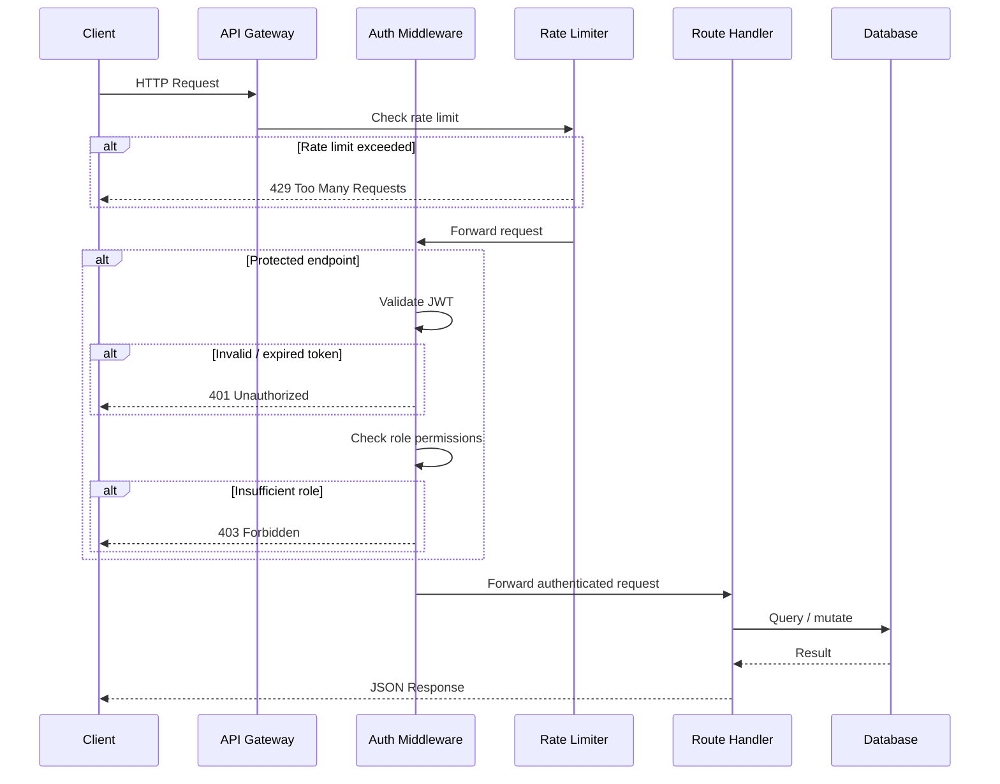
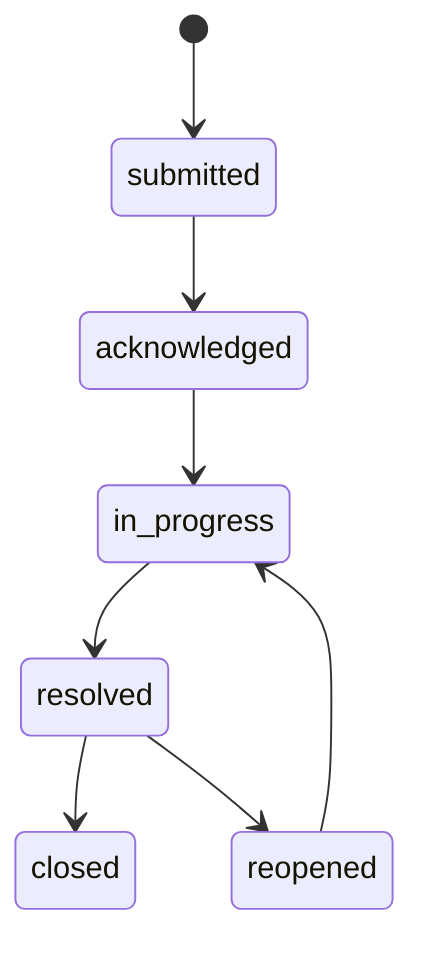
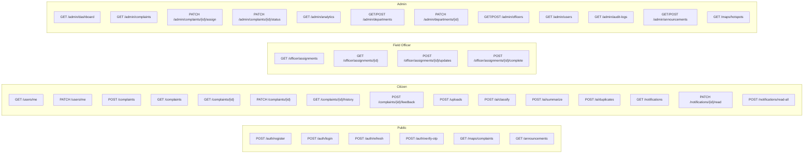
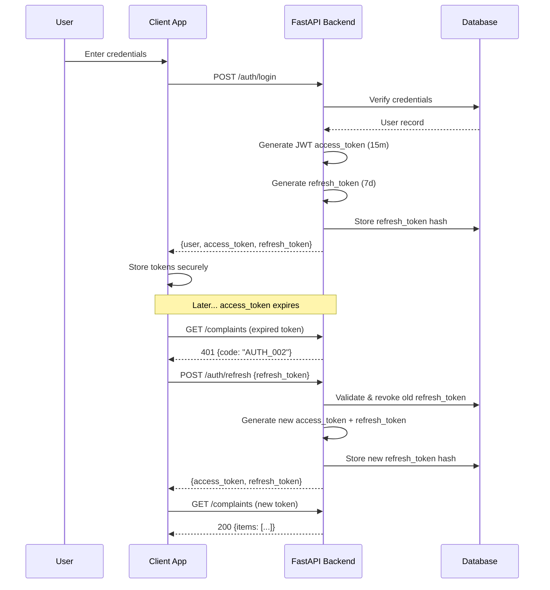
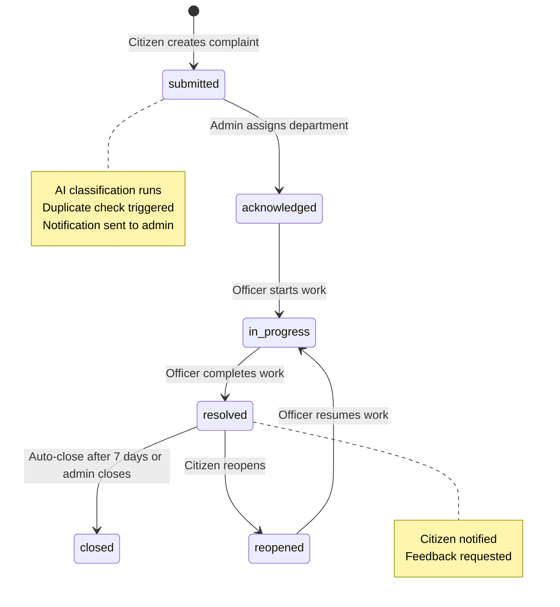

# 5. API Specification — Namma Ooru AI

> **Version:** 1.0.0
> **Last Updated:** 2025-07-15
> **Protocol:** REST over HTTPS
> **Framework:** FastAPI (Python 3.11+)

---

## Table of Contents

1. [API Overview](#1-api-overview)
2. [Authentication Endpoints](#2-authentication-endpoints)
3. [User Endpoints](#3-user-endpoints)
4. [Complaint Endpoints](#4-complaint-endpoints)
5. [File Upload Endpoints](#5-file-upload-endpoints)
6. [AI Endpoints](#6-ai-endpoints)
7. [Admin Endpoints](#7-admin-endpoints)
8. [Field Officer Endpoints](#8-field-officer-endpoints)
9. [Map Endpoints](#9-map-endpoints)
10. [Notification Endpoints](#10-notification-endpoints)
11. [Announcements (Public)](#11-announcements-public)
12. [Error Codes](#12-error-codes)
13. [Rate Limiting](#13-rate-limiting)
14. [Pagination Format](#14-pagination-format)

---

## 1. API Overview

### Base URL

```
https://<domain>/api/v1
```

All endpoints documented below are relative to this base URL unless explicitly stated otherwise.

### Content Types

| Scenario | Content-Type |
|---|---|
| Standard requests | `application/json` |
| File uploads | `multipart/form-data` |
| All responses | `application/json` |

### Authentication

All protected endpoints require a JWT Bearer token in the `Authorization` header:

```
Authorization: Bearer <access_token>
```

- **Access tokens** expire after **15 minutes**.
- **Refresh tokens** expire after **7 days** and support **token rotation** (each refresh invalidates the previous refresh token).

### Roles

| Role | Code | Description |
|---|---|---|
| Citizen | `citizen` | Default role for registered users. Can file and track complaints. |
| Field Officer | `field_officer` | Municipal worker assigned to resolve complaints in the field. |
| Admin | `admin` | Full administrative access to the platform. |

### Standard Error Response

Every error response follows a consistent envelope:

```json
{
  "detail": "Human-readable error message",
  "code": "ERROR_CODE"
}
```

For validation errors (HTTP `422`), FastAPI returns an extended body:

```json
{
  "detail": [
    {
      "loc": ["body", "email"],
      "msg": "field required",
      "type": "value_error.missing"
    }
  ],
  "code": "VALIDATION_001"
}
```

### Common HTTP Status Codes

| Code | Meaning |
|---|---|
| `200` | Success |
| `201` | Resource created |
| `204` | Success, no content |
| `400` | Bad request / business-rule violation |
| `401` | Authentication required or token invalid |
| `403` | Insufficient permissions |
| `404` | Resource not found |
| `409` | Conflict (e.g., duplicate email) |
| `422` | Validation error |
| `429` | Rate limit exceeded |
| `500` | Internal server error |

### Request Flow



---

## 2. Authentication Endpoints

### 2.1 Register

Creates a new citizen account.

| | |
|---|---|
| **Method** | `POST` |
| **Path** | `/api/v1/auth/register` |
| **Auth** | None (public) |
| **Rate Limit** | 5 req/min |

**Request Body**

```json
{
  "email": "rajesh@example.com",
  "phone": "+919876543210",
  "password": "SecureP@ss123",
  "full_name": "Rajesh Kumar",
  "preferred_language": "ta",
  "city": "Chennai"
}
```

| Field | Type | Required | Constraints |
|---|---|---|---|
| `email` | `string` | Yes | Valid email, unique |
| `phone` | `string` | Yes | E.164 format, unique |
| `password` | `string` | Yes | Min 8 chars, must include uppercase, lowercase, digit, special char |
| `full_name` | `string` | Yes | 2–100 chars |
| `preferred_language` | `string` | No | `en` (default) or `ta` |
| `city` | `string` | No | City name, defaults to `Chennai` |

**Response — `201 Created`**

```json
{
  "user": {
    "id": "usr_a1b2c3d4",
    "email": "rajesh@example.com",
    "phone": "+919876543210",
    "full_name": "Rajesh Kumar",
    "preferred_language": "ta",
    "city": "Chennai",
    "role": "citizen",
    "is_verified": false,
    "created_at": "2025-07-15T10:30:00Z"
  },
  "access_token": "eyJhbGciOiJIUzI1NiIs...",
  "refresh_token": "dGhpcyBpcyBhIHJlZnJl..."
}
```

**Error Responses**

| Code | HTTP | Condition |
|---|---|---|
| `VALIDATION_001` | `422` | Missing or invalid fields |
| `AUTH_005` | `409` | Email or phone already registered |

---

### 2.2 Login

Authenticates a user with email/phone and password.

| | |
|---|---|
| **Method** | `POST` |
| **Path** | `/api/v1/auth/login` |
| **Auth** | None (public) |
| **Rate Limit** | 5 req/min |

**Request Body**

```json
{
  "email_or_phone": "rajesh@example.com",
  "password": "SecureP@ss123"
}
```

| Field | Type | Required | Constraints |
|---|---|---|---|
| `email_or_phone` | `string` | Yes | Valid email or E.164 phone |
| `password` | `string` | Yes | — |

**Response — `200 OK`**

```json
{
  "user": {
    "id": "usr_a1b2c3d4",
    "email": "rajesh@example.com",
    "phone": "+919876543210",
    "full_name": "Rajesh Kumar",
    "preferred_language": "ta",
    "city": "Chennai",
    "role": "citizen",
    "is_verified": true,
    "created_at": "2025-07-15T10:30:00Z"
  },
  "access_token": "eyJhbGciOiJIUzI1NiIs...",
  "refresh_token": "dGhpcyBpcyBhIHJlZnJl..."
}
```

**Error Responses**

| Code | HTTP | Condition |
|---|---|---|
| `AUTH_001` | `401` | Invalid email/phone or password |
| `VALIDATION_001` | `422` | Missing fields |

---

### 2.3 Refresh Token

Exchanges a valid refresh token for a new access/refresh token pair. Implements **token rotation**: the consumed refresh token is immediately revoked.

| | |
|---|---|
| **Method** | `POST` |
| **Path** | `/api/v1/auth/refresh` |
| **Auth** | None (public) |
| **Rate Limit** | 5 req/min |

**Request Body**

```json
{
  "refresh_token": "dGhpcyBpcyBhIHJlZnJl..."
}
```

| Field | Type | Required | Constraints |
|---|---|---|---|
| `refresh_token` | `string` | Yes | Previously issued refresh token |

**Response — `200 OK`**

```json
{
  "access_token": "eyJhbGciOiJIUzI1NiIs...",
  "refresh_token": "bmV3IHJlZnJlc2ggdG9r..."
}
```

**Error Responses**

| Code | HTTP | Condition |
|---|---|---|
| `AUTH_002` | `401` | Refresh token expired |
| `AUTH_003` | `401` | Refresh token revoked (potential reuse detected) |

> [!IMPORTANT]
> If a revoked refresh token is presented, **all** refresh tokens for that user are immediately invalidated (reuse detection) to mitigate token theft.

---

### 2.4 Logout

Revokes the specified refresh token, ending the session.

| | |
|---|---|
| **Method** | `POST` |
| **Path** | `/api/v1/auth/logout` |
| **Auth** | Required (any role) |
| **Rate Limit** | 5 req/min |

**Request Headers**

```
Authorization: Bearer <access_token>
```

**Request Body**

```json
{
  "refresh_token": "dGhpcyBpcyBhIHJlZnJl..."
}
```

| Field | Type | Required | Constraints |
|---|---|---|---|
| `refresh_token` | `string` | Yes | The refresh token to revoke |

**Response — `200 OK`**

```json
{
  "detail": "Successfully logged out"
}
```

**Error Responses**

| Code | HTTP | Condition |
|---|---|---|
| `AUTH_002` | `401` | Access token expired |
| `VALIDATION_001` | `422` | Missing refresh_token |

---

### 2.5 Verify OTP

Verifies a one-time password sent to the user's phone number for account verification.

| | |
|---|---|
| **Method** | `POST` |
| **Path** | `/api/v1/auth/verify-otp` |
| **Auth** | None (public) |
| **Rate Limit** | 5 req/min |

**Request Body**

```json
{
  "phone": "+919876543210",
  "otp_code": "482917"
}
```

| Field | Type | Required | Constraints |
|---|---|---|---|
| `phone` | `string` | Yes | E.164 format |
| `otp_code` | `string` | Yes | 6-digit numeric code |

**Response — `200 OK`**

```json
{
  "verified": true
}
```

**Error Responses**

| Code | HTTP | Condition |
|---|---|---|
| `AUTH_006` | `400` | Invalid or expired OTP |
| `AUTH_007` | `429` | Too many OTP attempts |
| `VALIDATION_001` | `422` | Missing or malformed fields |

---

## 3. User Endpoints

### 3.1 Get Current User Profile

Returns the full profile of the currently authenticated user.

| | |
|---|---|
| **Method** | `GET` |
| **Path** | `/api/v1/users/me` |
| **Auth** | Required (any role) |
| **Rate Limit** | 60 req/min |

**Request Headers**

```
Authorization: Bearer <access_token>
```

**Response — `200 OK`**

```json
{
  "id": "usr_a1b2c3d4",
  "email": "rajesh@example.com",
  "phone": "+919876543210",
  "full_name": "Rajesh Kumar",
  "preferred_language": "ta",
  "city": "Chennai",
  "role": "citizen",
  "is_verified": true,
  "avatar_url": "https://storage.nammaooru.ai/avatars/usr_a1b2c3d4.jpg",
  "ward_number": 12,
  "zone": "Adyar",
  "total_complaints": 5,
  "created_at": "2025-07-15T10:30:00Z",
  "updated_at": "2025-07-15T12:00:00Z"
}
```

**Error Responses**

| Code | HTTP | Condition |
|---|---|---|
| `AUTH_002` | `401` | Token expired |
| `AUTH_004` | `403` | Token invalid |

---

### 3.2 Update Current User Profile

Updates fields on the authenticated user's profile.

| | |
|---|---|
| **Method** | `PATCH` |
| **Path** | `/api/v1/users/me` |
| **Auth** | Required (any role) |
| **Rate Limit** | 60 req/min |

**Request Headers**

```
Authorization: Bearer <access_token>
```

**Request Body** *(all fields optional)*

```json
{
  "full_name": "Rajesh K.",
  "preferred_language": "en",
  "city": "Coimbatore",
  "ward_number": 15,
  "zone": "Teynampet",
  "avatar_url": "https://storage.nammaooru.ai/avatars/new.jpg"
}
```

| Field | Type | Required | Constraints |
|---|---|---|---|
| `full_name` | `string` | No | 2–100 chars |
| `preferred_language` | `string` | No | `en` or `ta` |
| `city` | `string` | No | — |
| `ward_number` | `integer` | No | Valid ward number |
| `zone` | `string` | No | Valid zone name |
| `avatar_url` | `string` | No | Valid URL |

> [!NOTE]
> Users **cannot** update `email`, `phone`, or `role` through this endpoint. Email/phone changes require a separate verification flow. Role changes are admin-only operations.

**Response — `200 OK`**

```json
{
  "id": "usr_a1b2c3d4",
  "email": "rajesh@example.com",
  "phone": "+919876543210",
  "full_name": "Rajesh K.",
  "preferred_language": "en",
  "city": "Coimbatore",
  "role": "citizen",
  "is_verified": true,
  "avatar_url": "https://storage.nammaooru.ai/avatars/new.jpg",
  "ward_number": 15,
  "zone": "Teynampet",
  "total_complaints": 5,
  "created_at": "2025-07-15T10:30:00Z",
  "updated_at": "2025-07-15T14:00:00Z"
}
```

**Error Responses**

| Code | HTTP | Condition |
|---|---|---|
| `AUTH_002` | `401` | Token expired |
| `VALIDATION_001` | `422` | Invalid field values |

---

## 4. Complaint Endpoints

### 4.1 Create Complaint

Files a new civic complaint. The system automatically triggers AI classification upon creation.

| | |
|---|---|
| **Method** | `POST` |
| **Path** | `/api/v1/complaints` |
| **Auth** | Required (`citizen`) |
| **Rate Limit** | 60 req/min |

**Request Headers**

```
Authorization: Bearer <access_token>
```

**Request Body**

```json
{
  "title": "Broken street light on Anna Nagar 2nd Street",
  "description": "The street light near house #42 on Anna Nagar 2nd Street has been broken for the past 2 weeks. It is very dark and unsafe at night.",
  "category": "street_lighting",
  "location": {
    "lat": 13.0827,
    "lng": 80.2707
  },
  "address": "42, 2nd Street, Anna Nagar, Chennai 600040",
  "ward_number": 98,
  "zone": "Anna Nagar",
  "is_anonymous": false,
  "attachment_ids": [
    "att_x1y2z3",
    "att_a4b5c6"
  ]
}
```

| Field | Type | Required | Constraints |
|---|---|---|---|
| `title` | `string` | Yes | 10–200 chars |
| `description` | `string` | Yes | 20–5000 chars |
| `category` | `string` | No | Valid category enum; if omitted, AI auto-classifies |
| `location` | `object` | Yes | `lat` (-90 to 90), `lng` (-180 to 180) |
| `address` | `string` | No | Free-text address |
| `ward_number` | `integer` | No | Valid ward number |
| `zone` | `string` | No | Valid zone name |
| `is_anonymous` | `boolean` | No | Defaults to `false` |
| `attachment_ids` | `string[]` | No | Array of previously uploaded file IDs (max 5) |

**Valid Categories**

```
road_damage, street_lighting, water_supply, sewage_drainage,
garbage_waste, public_health, noise_pollution, encroachment,
building_violation, traffic, public_transport, parks_playgrounds,
stray_animals, other
```

**Response — `201 Created`**

```json
{
  "id": "cmp_r7s8t9u0",
  "title": "Broken street light on Anna Nagar 2nd Street",
  "description": "The street light near house #42 on Anna Nagar 2nd Street has been broken for the past 2 weeks. It is very dark and unsafe at night.",
  "category": "street_lighting",
  "status": "submitted",
  "priority": "medium",
  "location": {
    "lat": 13.0827,
    "lng": 80.2707
  },
  "address": "42, 2nd Street, Anna Nagar, Chennai 600040",
  "ward_number": 98,
  "zone": "Anna Nagar",
  "is_anonymous": false,
  "citizen_id": "usr_a1b2c3d4",
  "attachments": [
    {
      "id": "att_x1y2z3",
      "url": "https://storage.nammaooru.ai/uploads/att_x1y2z3.jpg",
      "file_type": "image/jpeg",
      "file_size": 245760
    }
  ],
  "ai_classification": {
    "detected_language": "en",
    "category": "street_lighting",
    "category_confidence": 0.94,
    "priority": "medium",
    "priority_confidence": 0.87,
    "department_id": "dept_elec01",
    "department_name": "Electrical Maintenance",
    "summary": "Broken street light at Anna Nagar 2nd Street causing safety concern for 2 weeks.",
    "model_version": "v2.1.0"
  },
  "created_at": "2025-07-15T10:30:00Z",
  "updated_at": "2025-07-15T10:30:00Z"
}
```

> [!NOTE]
> The `ai_classification` block contains real model confidence scores (not fabricated). If the citizen provides a `category`, it is used as-is and the AI classification is returned alongside for comparison.

**Error Responses**

| Code | HTTP | Condition |
|---|---|---|
| `AUTH_004` | `403` | Non-citizen role attempting to file |
| `VALIDATION_001` | `422` | Invalid or missing required fields |
| `UPLOAD_003` | `400` | One or more `attachment_ids` not found or not owned by user |
| `AI_001` | `500` | AI classification failed (complaint is still created with `category=uncategorized`) |

---

### 4.2 List Complaints

Returns a paginated list of complaints. Citizens see their own complaints; admins see all.

| | |
|---|---|
| **Method** | `GET` |
| **Path** | `/api/v1/complaints` |
| **Auth** | Required (any role) |
| **Rate Limit** | 60 req/min |

**Query Parameters**

| Param | Type | Default | Description |
|---|---|---|---|
| `page` | `integer` | `1` | Page number (1-indexed) |
| `page_size` | `integer` | `20` | Items per page (max 100) |
| `status` | `string` | — | Filter by status: `submitted`, `acknowledged`, `in_progress`, `resolved`, `closed`, `reopened` |
| `category` | `string` | — | Filter by category enum |
| `priority` | `string` | — | Filter by priority: `low`, `medium`, `high`, `critical` |
| `sort_by` | `string` | `created_at` | Sort field: `created_at`, `updated_at`, `priority`, `status` |
| `sort_order` | `string` | `desc` | `asc` or `desc` |

**Response — `200 OK`**

```json
{
  "items": [
    {
      "id": "cmp_r7s8t9u0",
      "title": "Broken street light on Anna Nagar 2nd Street",
      "category": "street_lighting",
      "status": "submitted",
      "priority": "medium",
      "location": {
        "lat": 13.0827,
        "lng": 80.2707
      },
      "zone": "Anna Nagar",
      "ward_number": 98,
      "is_anonymous": false,
      "created_at": "2025-07-15T10:30:00Z",
      "updated_at": "2025-07-15T10:30:00Z"
    }
  ],
  "total": 42,
  "page": 1,
  "page_size": 20,
  "total_pages": 3
}
```

---

### 4.3 Get Complaint Details

Returns the full details of a specific complaint including attachments, status history, and AI classification.

| | |
|---|---|
| **Method** | `GET` |
| **Path** | `/api/v1/complaints/{id}` |
| **Auth** | Required (owner, admin, assigned officer) |
| **Rate Limit** | 60 req/min |

**Path Parameters**

| Param | Type | Description |
|---|---|---|
| `id` | `string` | Complaint ID (e.g., `cmp_r7s8t9u0`) |

**Response — `200 OK`**

```json
{
  "id": "cmp_r7s8t9u0",
  "title": "Broken street light on Anna Nagar 2nd Street",
  "description": "The street light near house #42 on Anna Nagar 2nd Street has been broken for the past 2 weeks. It is very dark and unsafe at night.",
  "category": "street_lighting",
  "status": "in_progress",
  "priority": "medium",
  "location": {
    "lat": 13.0827,
    "lng": 80.2707
  },
  "address": "42, 2nd Street, Anna Nagar, Chennai 600040",
  "ward_number": 98,
  "zone": "Anna Nagar",
  "is_anonymous": false,
  "citizen_id": "usr_a1b2c3d4",
  "citizen_name": "Rajesh Kumar",
  "assigned_department": {
    "id": "dept_elec01",
    "name": "Electrical Maintenance"
  },
  "assigned_officer": {
    "id": "usr_off_m1n2",
    "name": "Suresh Babu",
    "phone": "+919876500001"
  },
  "attachments": [
    {
      "id": "att_x1y2z3",
      "url": "https://storage.nammaooru.ai/uploads/att_x1y2z3.jpg",
      "file_type": "image/jpeg",
      "file_size": 245760,
      "uploaded_at": "2025-07-15T10:28:00Z"
    }
  ],
  "ai_classification": {
    "detected_language": "en",
    "category": "street_lighting",
    "category_confidence": 0.94,
    "priority": "medium",
    "priority_confidence": 0.87,
    "department_id": "dept_elec01",
    "department_name": "Electrical Maintenance",
    "summary": "Broken street light at Anna Nagar 2nd Street causing safety concern for 2 weeks.",
    "model_version": "v2.1.0"
  },
  "status_history": [
    {
      "status": "submitted",
      "changed_by": "usr_a1b2c3d4",
      "changed_by_name": "Rajesh Kumar",
      "notes": null,
      "changed_at": "2025-07-15T10:30:00Z"
    },
    {
      "status": "acknowledged",
      "changed_by": "usr_admin01",
      "changed_by_name": "Admin User",
      "notes": "Complaint received and assigned to Electrical dept.",
      "changed_at": "2025-07-15T11:00:00Z"
    },
    {
      "status": "in_progress",
      "changed_by": "usr_off_m1n2",
      "changed_by_name": "Suresh Babu",
      "notes": "Technician dispatched to location.",
      "changed_at": "2025-07-15T14:00:00Z"
    }
  ],
  "feedback": null,
  "created_at": "2025-07-15T10:30:00Z",
  "updated_at": "2025-07-15T14:00:00Z"
}
```

**Error Responses**

| Code | HTTP | Condition |
|---|---|---|
| `COMPLAINT_001` | `404` | Complaint not found |
| `AUTH_004` | `403` | User is not the owner, admin, or assigned officer |

---

### 4.4 Update Complaint

Partially updates a complaint. The set of updatable fields depends on the caller's role and the current complaint status.

| | |
|---|---|
| **Method** | `PATCH` |
| **Path** | `/api/v1/complaints/{id}` |
| **Auth** | Required (owner for limited fields, admin for all) |
| **Rate Limit** | 60 req/min |

**Path Parameters**

| Param | Type | Description |
|---|---|---|
| `id` | `string` | Complaint ID |

**Request Body — Citizen (owner)**

Citizens may only update the following, with restrictions:

| Field | Allowed When |
|---|---|
| `description` | `status = submitted` |
| `status` (to `reopened`) | `status = resolved` |

```json
{
  "description": "Updated description with more details about the broken light."
}
```

Or to reopen a resolved complaint:

```json
{
  "status": "reopened",
  "reopen_reason": "The street light was fixed but broke again within 2 days."
}
```

**Request Body — Admin**

Admins can update any mutable field:

```json
{
  "priority": "high",
  "category": "electrical",
  "status": "in_progress",
  "department_id": "dept_elec01",
  "assigned_officer_id": "usr_off_m1n2"
}
```

| Field | Type | Description |
|---|---|---|
| `title` | `string` | Updated title |
| `description` | `string` | Updated description |
| `category` | `string` | Re-classify category |
| `priority` | `string` | `low`, `medium`, `high`, `critical` |
| `status` | `string` | New status (must follow valid transitions) |
| `department_id` | `string` | Assign/reassign department |
| `assigned_officer_id` | `string` | Assign/reassign field officer |

**Response — `200 OK`**

Returns the full updated complaint object (same schema as [4.3](#43-get-complaint-details)).

**Error Responses**

| Code | HTTP | Condition |
|---|---|---|
| `COMPLAINT_001` | `404` | Complaint not found |
| `COMPLAINT_002` | `400` | Invalid status transition |
| `AUTH_004` | `403` | Citizen attempting to update restricted fields |
| `VALIDATION_001` | `422` | Invalid field values |

**Valid Status Transitions**



---

### 4.5 Get Complaint Status History

Returns the full status change history for a complaint.

| | |
|---|---|
| **Method** | `GET` |
| **Path** | `/api/v1/complaints/{id}/history` |
| **Auth** | Required (owner, admin, assigned officer) |
| **Rate Limit** | 60 req/min |

**Path Parameters**

| Param | Type | Description |
|---|---|---|
| `id` | `string` | Complaint ID |

**Response — `200 OK`**

```json
[
  {
    "id": "hist_001",
    "complaint_id": "cmp_r7s8t9u0",
    "status": "submitted",
    "changed_by": "usr_a1b2c3d4",
    "changed_by_name": "Rajesh Kumar",
    "changed_by_role": "citizen",
    "notes": null,
    "changed_at": "2025-07-15T10:30:00Z"
  },
  {
    "id": "hist_002",
    "complaint_id": "cmp_r7s8t9u0",
    "status": "acknowledged",
    "changed_by": "usr_admin01",
    "changed_by_name": "Admin User",
    "changed_by_role": "admin",
    "notes": "Complaint received and assigned to Electrical dept.",
    "changed_at": "2025-07-15T11:00:00Z"
  },
  {
    "id": "hist_003",
    "complaint_id": "cmp_r7s8t9u0",
    "status": "in_progress",
    "changed_by": "usr_off_m1n2",
    "changed_by_name": "Suresh Babu",
    "changed_by_role": "field_officer",
    "notes": "Technician dispatched to location.",
    "changed_at": "2025-07-15T14:00:00Z"
  }
]
```

**Error Responses**

| Code | HTTP | Condition |
|---|---|---|
| `COMPLAINT_001` | `404` | Complaint not found |
| `AUTH_004` | `403` | Not authorized to view this complaint |

---

### 4.6 Submit Complaint Feedback

Allows the complaint owner to rate the resolution after a complaint is resolved or closed.

| | |
|---|---|
| **Method** | `POST` |
| **Path** | `/api/v1/complaints/{id}/feedback` |
| **Auth** | Required (`citizen`, must be complaint owner) |
| **Rate Limit** | 60 req/min |

**Path Parameters**

| Param | Type | Description |
|---|---|---|
| `id` | `string` | Complaint ID |

**Preconditions**

- Caller must be the complaint owner.
- Complaint status must be `resolved` or `closed`.
- Feedback has not already been submitted for this complaint.

**Request Body**

```json
{
  "rating": 4,
  "feedback_text": "The street light was fixed promptly. Thank you!",
  "is_satisfied": true
}
```

| Field | Type | Required | Constraints |
|---|---|---|---|
| `rating` | `integer` | Yes | 1–5 |
| `feedback_text` | `string` | No | Max 2000 chars |
| `is_satisfied` | `boolean` | Yes | — |

**Response — `201 Created`**

```json
{
  "id": "fb_p1q2r3",
  "complaint_id": "cmp_r7s8t9u0",
  "rating": 4,
  "feedback_text": "The street light was fixed promptly. Thank you!",
  "is_satisfied": true,
  "created_at": "2025-07-20T09:00:00Z"
}
```

**Error Responses**

| Code | HTTP | Condition |
|---|---|---|
| `COMPLAINT_001` | `404` | Complaint not found |
| `COMPLAINT_002` | `400` | Complaint is not in `resolved` or `closed` status |
| `COMPLAINT_003` | `409` | Feedback already submitted |
| `AUTH_004` | `403` | Caller is not the complaint owner |

---

## 5. File Upload Endpoints

### 5.1 Upload File

Uploads a file (image or audio) for use as a complaint attachment.

| | |
|---|---|
| **Method** | `POST` |
| **Path** | `/api/v1/uploads` |
| **Auth** | Required (any role) |
| **Content-Type** | `multipart/form-data` |
| **Rate Limit** | 20 req/hour |

**Request Body (form-data)**

| Field | Type | Required | Constraints |
|---|---|---|---|
| `file` | `binary` | Yes | Max 10 MB |

**Allowed MIME Types**

| Extension | MIME Type |
|---|---|
| `.jpg`, `.jpeg` | `image/jpeg` |
| `.png` | `image/png` |
| `.webp` | `image/webp` |
| `.mp3` | `audio/mpeg` |
| `.wav` | `audio/wav` |
| `.ogg` | `audio/ogg` |

**Response — `201 Created`**

```json
{
  "id": "att_x1y2z3",
  "url": "https://storage.nammaooru.ai/uploads/att_x1y2z3.jpg",
  "file_type": "image/jpeg",
  "file_size": 245760
}
```

**Error Responses**

| Code | HTTP | Condition |
|---|---|---|
| `UPLOAD_001` | `400` | File exceeds 10 MB |
| `UPLOAD_002` | `400` | Unsupported file type |
| `RATE_001` | `429` | Upload rate limit exceeded |

> [!TIP]
> Upload files **before** creating a complaint. The returned `id` values are then passed in the `attachment_ids` array of the complaint creation request. Uploaded files not attached to a complaint within 24 hours are automatically cleaned up.

---

## 6. AI Endpoints

### 6.1 Classify Text

Runs the AI classification pipeline on the given text, returning predicted category, priority, department, and a summary.

| | |
|---|---|
| **Method** | `POST` |
| **Path** | `/api/v1/ai/classify` |
| **Auth** | Required (`citizen`, `admin`) |
| **Rate Limit** | 10 req/min |

**Request Body**

```json
{
  "text": "சாலையில் பெரிய குழி உள்ளது, பல வாகனங்கள் சேதமடைந்துள்ளன",
  "language_hint": "ta"
}
```

| Field | Type | Required | Constraints |
|---|---|---|---|
| `text` | `string` | Yes | 10–5000 chars |
| `language_hint` | `string` | No | `en` or `ta`; helps the model if text is mixed-language |

**Response — `200 OK`**

```json
{
  "detected_language": "ta",
  "category": "road_damage",
  "category_confidence": 0.92,
  "priority": "high",
  "priority_confidence": 0.85,
  "department_id": "dept_roads01",
  "department_name": "Roads & Infrastructure",
  "summary": "Large pothole on road causing vehicle damage.",
  "model_version": "v2.1.0"
}
```

> [!IMPORTANT]
> The `category_confidence` and `priority_confidence` values are **real model output probabilities** (0.0–1.0), not fabricated heuristics. They represent the softmax probability of the predicted class.

**Error Responses**

| Code | HTTP | Condition |
|---|---|---|
| `AI_001` | `500` | Classification model unavailable or failed |
| `VALIDATION_001` | `422` | Text too short or missing |
| `RATE_001` | `429` | AI rate limit exceeded |

---

### 6.2 Summarize Text

Generates a concise summary of the input text, optionally in a target language.

| | |
|---|---|
| **Method** | `POST` |
| **Path** | `/api/v1/ai/summarize` |
| **Auth** | Required (any role) |
| **Rate Limit** | 10 req/min |

**Request Body**

```json
{
  "text": "The street light near house #42 on Anna Nagar 2nd Street has been broken for the past 2 weeks. It is very dark and unsafe at night. Multiple residents have complained about this issue. There was almost an accident last week because of poor visibility.",
  "target_language": "ta"
}
```

| Field | Type | Required | Constraints |
|---|---|---|---|
| `text` | `string` | Yes | 20–10000 chars |
| `target_language` | `string` | No | `en` or `ta`; defaults to same language as input |

**Response — `200 OK`**

```json
{
  "summary": "Broken street light at Anna Nagar 2nd Street for 2 weeks, causing safety hazards and near-accidents.",
  "summary_ta": "அண்ணா நகர் 2வது தெருவில் 2 வாரங்களாக தெரு விளக்கு உடைந்துள்ளது, பாதுகாப்பு அபாயங்கள் மற்றும் விபத்துக்கள் ஏற்பட்டுள்ளன."
}
```

**Error Responses**

| Code | HTTP | Condition |
|---|---|---|
| `AI_001` | `500` | Summarization model unavailable |
| `VALIDATION_001` | `422` | Text too short or missing |

---

### 6.3 Find Duplicate Complaints

Searches for existing complaints that may be duplicates of the provided text, optionally filtered by location proximity.

| | |
|---|---|
| **Method** | `POST` |
| **Path** | `/api/v1/ai/duplicates` |
| **Auth** | Required (any role) |
| **Rate Limit** | 10 req/min |

**Request Body**

```json
{
  "text": "Broken street light on Anna Nagar 2nd Street",
  "location": {
    "lat": 13.0827,
    "lng": 80.2707
  },
  "category": "street_lighting",
  "radius_km": 1.0
}
```

| Field | Type | Required | Constraints |
|---|---|---|---|
| `text` | `string` | Yes | 10–5000 chars |
| `location` | `object` | No | `lat` (-90 to 90), `lng` (-180 to 180) |
| `category` | `string` | No | Narrows search to specific category |
| `radius_km` | `float` | No | Defaults to `2.0`, max `10.0` |

**Response — `200 OK`**

```json
{
  "duplicates": [
    {
      "complaint_id": "cmp_d4e5f6",
      "similarity_score": 0.89,
      "title": "Street light not working on Anna Nagar 2nd Street",
      "distance_km": 0.12
    },
    {
      "complaint_id": "cmp_g7h8i9",
      "similarity_score": 0.72,
      "title": "Dark street near Anna Nagar main road",
      "distance_km": 0.85
    }
  ]
}
```

| Response Field | Type | Description |
|---|---|---|
| `complaint_id` | `string` | ID of the potential duplicate complaint |
| `similarity_score` | `float` | Semantic similarity (0.0–1.0); only results ≥ 0.65 are returned |
| `title` | `string` | Title of the matching complaint |
| `distance_km` | `float` | Geographic distance from the provided location (null if no location given) |

**Error Responses**

| Code | HTTP | Condition |
|---|---|---|
| `AI_001` | `500` | Embedding model unavailable |
| `VALIDATION_001` | `422` | Text too short or missing |

---

## 7. Admin Endpoints

> [!CAUTION]
> All endpoints in this section require the `admin` role. Requests from `citizen` or `field_officer` roles will receive a `403 Forbidden` response.

### 7.1 Dashboard Summary

Returns aggregate statistics for the admin dashboard.

| | |
|---|---|
| **Method** | `GET` |
| **Path** | `/api/v1/admin/dashboard` |
| **Auth** | Required (`admin`) |
| **Rate Limit** | 60 req/min |

**Response — `200 OK`**

```json
{
  "total_complaints": 1247,
  "pending": 89,
  "in_progress": 156,
  "resolved": 892,
  "high_priority": 23,
  "avg_resolution_hours": 48.5,
  "department_stats": [
    {
      "department_id": "dept_roads01",
      "department_name": "Roads & Infrastructure",
      "total": 312,
      "pending": 28,
      "in_progress": 45,
      "resolved": 234,
      "avg_resolution_hours": 52.3
    },
    {
      "department_id": "dept_elec01",
      "department_name": "Electrical Maintenance",
      "total": 198,
      "pending": 15,
      "in_progress": 22,
      "resolved": 158,
      "avg_resolution_hours": 36.7
    }
  ],
  "trend_data": [
    {
      "date": "2025-07-01",
      "submitted": 12,
      "resolved": 8
    },
    {
      "date": "2025-07-02",
      "submitted": 15,
      "resolved": 11
    }
  ],
  "recent_complaints": [
    {
      "id": "cmp_r7s8t9u0",
      "title": "Broken street light on Anna Nagar 2nd Street",
      "category": "street_lighting",
      "priority": "medium",
      "status": "submitted",
      "created_at": "2025-07-15T10:30:00Z"
    }
  ]
}
```

---

### 7.2 List All Complaints (Admin)

Returns a paginated, filterable list of all complaints in the system.

| | |
|---|---|
| **Method** | `GET` |
| **Path** | `/api/v1/admin/complaints` |
| **Auth** | Required (`admin`) |
| **Rate Limit** | 60 req/min |

**Query Parameters**

| Param | Type | Default | Description |
|---|---|---|---|
| `page` | `integer` | `1` | Page number |
| `page_size` | `integer` | `20` | Items per page (max 100) |
| `status` | `string` | — | Filter by status |
| `category` | `string` | — | Filter by category |
| `priority` | `string` | — | Filter by priority |
| `department_id` | `string` | — | Filter by assigned department |
| `officer_id` | `string` | — | Filter by assigned officer |
| `date_from` | `string` | — | ISO 8601 date, inclusive |
| `date_to` | `string` | — | ISO 8601 date, inclusive |
| `search` | `string` | — | Full-text search on title and description |
| `zone` | `string` | — | Filter by zone |
| `ward` | `integer` | — | Filter by ward number |

**Response — `200 OK`**

```json
{
  "items": [
    {
      "id": "cmp_r7s8t9u0",
      "title": "Broken street light on Anna Nagar 2nd Street",
      "description": "The street light near house #42...",
      "category": "street_lighting",
      "status": "in_progress",
      "priority": "medium",
      "location": {
        "lat": 13.0827,
        "lng": 80.2707
      },
      "zone": "Anna Nagar",
      "ward_number": 98,
      "citizen_id": "usr_a1b2c3d4",
      "citizen_name": "Rajesh Kumar",
      "assigned_department": {
        "id": "dept_elec01",
        "name": "Electrical Maintenance"
      },
      "assigned_officer": {
        "id": "usr_off_m1n2",
        "name": "Suresh Babu"
      },
      "created_at": "2025-07-15T10:30:00Z",
      "updated_at": "2025-07-15T14:00:00Z"
    }
  ],
  "total": 1247,
  "page": 1,
  "page_size": 20,
  "total_pages": 63
}
```

---

### 7.3 Assign Complaint

Assigns a complaint to a specific department and/or field officer.

| | |
|---|---|
| **Method** | `PATCH` |
| **Path** | `/api/v1/admin/complaints/{id}/assign` |
| **Auth** | Required (`admin`) |
| **Rate Limit** | 60 req/min |

**Path Parameters**

| Param | Type | Description |
|---|---|---|
| `id` | `string` | Complaint ID |

**Request Body**

```json
{
  "department_id": "dept_elec01",
  "officer_id": "usr_off_m1n2"
}
```

| Field | Type | Required | Constraints |
|---|---|---|---|
| `department_id` | `string` | Yes | Must reference an existing department |
| `officer_id` | `string` | No | Must be a `field_officer` in the specified department |

**Side Effects**

- Creates a `complaint_assignment` record with timestamp and assigning admin.
- If the complaint status is `submitted`, it is automatically transitioned to `acknowledged`.
- A notification is sent to the assigned officer.

**Response — `200 OK`**

Returns the full updated complaint object (same schema as [4.3](#43-get-complaint-details)).

**Error Responses**

| Code | HTTP | Condition |
|---|---|---|
| `COMPLAINT_001` | `404` | Complaint not found |
| `VALIDATION_001` | `422` | Invalid department_id or officer_id |

---

### 7.4 Update Complaint Status (Admin)

Administratively updates the status of a complaint with notes.

| | |
|---|---|
| **Method** | `PATCH` |
| **Path** | `/api/v1/admin/complaints/{id}/status` |
| **Auth** | Required (`admin`) |
| **Rate Limit** | 60 req/min |

**Path Parameters**

| Param | Type | Description |
|---|---|---|
| `id` | `string` | Complaint ID |

**Request Body**

```json
{
  "status": "in_progress",
  "notes": "Technician has been dispatched to the location."
}
```

| Field | Type | Required | Constraints |
|---|---|---|---|
| `status` | `string` | Yes | Must be a valid status transition from current status |
| `notes` | `string` | No | Max 2000 chars |

**Side Effects**

- Creates a `status_history` record with the new status, admin ID, notes, and timestamp.
- Sends a notification to the complaint owner.

**Response — `200 OK`**

Returns the full updated complaint object.

**Error Responses**

| Code | HTTP | Condition |
|---|---|---|
| `COMPLAINT_001` | `404` | Complaint not found |
| `COMPLAINT_002` | `400` | Invalid status transition |

---

### 7.5 Analytics

Returns comprehensive analytics data for complaints, filterable by date range and grouping.

| | |
|---|---|
| **Method** | `GET` |
| **Path** | `/api/v1/admin/analytics` |
| **Auth** | Required (`admin`) |
| **Rate Limit** | 60 req/min |

**Query Parameters**

| Param | Type | Default | Description |
|---|---|---|---|
| `date_from` | `string` | 30 days ago | ISO 8601 date |
| `date_to` | `string` | Today | ISO 8601 date |
| `group_by` | `string` | `day` | `day`, `week`, or `month` |

**Response — `200 OK`**

```json
{
  "complaints_by_category": [
    { "category": "road_damage", "count": 312 },
    { "category": "street_lighting", "count": 198 },
    { "category": "water_supply", "count": 156 },
    { "category": "garbage_waste", "count": 142 }
  ],
  "complaints_by_status": [
    { "status": "submitted", "count": 89 },
    { "status": "acknowledged", "count": 45 },
    { "status": "in_progress", "count": 156 },
    { "status": "resolved", "count": 892 },
    { "status": "closed", "count": 65 }
  ],
  "complaints_by_priority": [
    { "priority": "low", "count": 234 },
    { "priority": "medium", "count": 678 },
    { "priority": "high", "count": 312 },
    { "priority": "critical", "count": 23 }
  ],
  "resolution_time_trend": [
    { "period": "2025-07-01", "avg_hours": 45.2, "median_hours": 38.0 },
    { "period": "2025-07-08", "avg_hours": 42.1, "median_hours": 35.5 }
  ],
  "department_performance": [
    {
      "department_id": "dept_roads01",
      "department_name": "Roads & Infrastructure",
      "total_assigned": 312,
      "resolved": 234,
      "avg_resolution_hours": 52.3,
      "satisfaction_avg": 3.8
    }
  ],
  "zone_stats": [
    {
      "zone": "Anna Nagar",
      "total": 89,
      "resolved": 67,
      "pending": 22,
      "dominant_category": "road_damage"
    }
  ]
}
```

---

### 7.6 List Departments

Returns all departments in the system.

| | |
|---|---|
| **Method** | `GET` |
| **Path** | `/api/v1/admin/departments` |
| **Auth** | Required (`admin`) |
| **Rate Limit** | 60 req/min |

**Response — `200 OK`**

```json
[
  {
    "id": "dept_roads01",
    "name": "Roads & Infrastructure",
    "name_ta": "சாலைகள் & உள்கட்டமைப்பு",
    "head_officer": "Murugan K.",
    "contact_email": "roads@chennai.gov.in",
    "contact_phone": "+914425671234",
    "active_complaints": 73,
    "total_officers": 12,
    "is_active": true,
    "created_at": "2025-01-01T00:00:00Z"
  },
  {
    "id": "dept_elec01",
    "name": "Electrical Maintenance",
    "name_ta": "மின்சார பராமரிப்பு",
    "head_officer": "Lakshmi S.",
    "contact_email": "electrical@chennai.gov.in",
    "contact_phone": "+914425675678",
    "active_complaints": 37,
    "total_officers": 8,
    "is_active": true,
    "created_at": "2025-01-01T00:00:00Z"
  }
]
```

---

### 7.7 Create Department

Creates a new department.

| | |
|---|---|
| **Method** | `POST` |
| **Path** | `/api/v1/admin/departments` |
| **Auth** | Required (`admin`) |
| **Rate Limit** | 60 req/min |

**Request Body**

```json
{
  "name": "Parks & Recreation",
  "name_ta": "பூங்காக்கள் & பொழுதுபோக்கு",
  "head_officer": "Anand R.",
  "contact_email": "parks@chennai.gov.in",
  "contact_phone": "+914425679012",
  "categories": ["parks_playgrounds"]
}
```

| Field | Type | Required | Constraints |
|---|---|---|---|
| `name` | `string` | Yes | 2–100 chars, unique |
| `name_ta` | `string` | No | Tamil name |
| `head_officer` | `string` | No | Name of department head |
| `contact_email` | `string` | No | Valid email |
| `contact_phone` | `string` | No | Valid phone |
| `categories` | `string[]` | No | List of complaint categories this department handles |

**Response — `201 Created`**

```json
{
  "id": "dept_parks01",
  "name": "Parks & Recreation",
  "name_ta": "பூங்காக்கள் & பொழுதுபோக்கு",
  "head_officer": "Anand R.",
  "contact_email": "parks@chennai.gov.in",
  "contact_phone": "+914425679012",
  "categories": ["parks_playgrounds"],
  "active_complaints": 0,
  "total_officers": 0,
  "is_active": true,
  "created_at": "2025-07-15T10:00:00Z"
}
```

---

### 7.8 Update Department

Updates an existing department's details.

| | |
|---|---|
| **Method** | `PATCH` |
| **Path** | `/api/v1/admin/departments/{id}` |
| **Auth** | Required (`admin`) |
| **Rate Limit** | 60 req/min |

**Path Parameters**

| Param | Type | Description |
|---|---|---|
| `id` | `string` | Department ID |

**Request Body** *(all fields optional)*

```json
{
  "name": "Parks, Recreation & Greenery",
  "head_officer": "Priya M.",
  "is_active": false
}
```

| Field | Type | Description |
|---|---|---|
| `name` | `string` | Updated name |
| `name_ta` | `string` | Updated Tamil name |
| `head_officer` | `string` | New department head name |
| `contact_email` | `string` | Updated email |
| `contact_phone` | `string` | Updated phone |
| `categories` | `string[]` | Updated category list |
| `is_active` | `boolean` | Enable/disable department |

**Response — `200 OK`**

Returns the full updated department object.

---

### 7.9 List Field Officers

Returns a list of field officers, optionally filtered by department or availability.

| | |
|---|---|
| **Method** | `GET` |
| **Path** | `/api/v1/admin/officers` |
| **Auth** | Required (`admin`) |
| **Rate Limit** | 60 req/min |

**Query Parameters**

| Param | Type | Default | Description |
|---|---|---|---|
| `department_id` | `string` | — | Filter by department |
| `is_available` | `boolean` | — | Filter by availability status |

**Response — `200 OK`**

```json
[
  {
    "id": "usr_off_m1n2",
    "user_id": "usr_off_m1n2",
    "full_name": "Suresh Babu",
    "phone": "+919876500001",
    "email": "suresh.babu@chennai.gov.in",
    "department_id": "dept_elec01",
    "department_name": "Electrical Maintenance",
    "badge_number": "FO-2025-042",
    "is_available": true,
    "active_assignments": 3,
    "total_resolved": 89,
    "avg_resolution_hours": 24.5,
    "created_at": "2025-02-01T00:00:00Z"
  }
]
```

---

### 7.10 Create Field Officer

Creates a new user with the `field_officer` role and an associated `field_officer` record.

| | |
|---|---|
| **Method** | `POST` |
| **Path** | `/api/v1/admin/officers` |
| **Auth** | Required (`admin`) |
| **Rate Limit** | 60 req/min |

**Request Body**

```json
{
  "full_name": "Kavitha N.",
  "email": "kavitha.n@chennai.gov.in",
  "phone": "+919876500042",
  "password": "TempP@ss123",
  "department_id": "dept_roads01",
  "badge_number": "FO-2025-043"
}
```

| Field | Type | Required | Constraints |
|---|---|---|---|
| `full_name` | `string` | Yes | 2–100 chars |
| `email` | `string` | Yes | Valid email, unique |
| `phone` | `string` | Yes | E.164 format, unique |
| `password` | `string` | Yes | Min 8 chars, meets password policy |
| `department_id` | `string` | Yes | Must reference an existing department |
| `badge_number` | `string` | No | Unique badge identifier |

**Side Effects**

- Creates a new user record with `role = field_officer`.
- Creates an associated `field_officer` record linked to the department.

**Response — `201 Created`**

```json
{
  "id": "usr_off_k3l4",
  "user_id": "usr_off_k3l4",
  "full_name": "Kavitha N.",
  "email": "kavitha.n@chennai.gov.in",
  "phone": "+919876500042",
  "department_id": "dept_roads01",
  "department_name": "Roads & Infrastructure",
  "badge_number": "FO-2025-043",
  "is_available": true,
  "active_assignments": 0,
  "total_resolved": 0,
  "created_at": "2025-07-15T10:00:00Z"
}
```

---

### 7.11 List Users

Returns a paginated list of all users in the system.

| | |
|---|---|
| **Method** | `GET` |
| **Path** | `/api/v1/admin/users` |
| **Auth** | Required (`admin`) |
| **Rate Limit** | 60 req/min |

**Query Parameters**

| Param | Type | Default | Description |
|---|---|---|---|
| `role` | `string` | — | Filter by role: `citizen`, `field_officer`, `admin` |
| `search` | `string` | — | Search by name, email, or phone |
| `page` | `integer` | `1` | Page number |
| `page_size` | `integer` | `20` | Items per page (max 100) |

**Response — `200 OK`**

```json
{
  "items": [
    {
      "id": "usr_a1b2c3d4",
      "email": "rajesh@example.com",
      "phone": "+919876543210",
      "full_name": "Rajesh Kumar",
      "role": "citizen",
      "is_verified": true,
      "city": "Chennai",
      "total_complaints": 5,
      "created_at": "2025-07-15T10:30:00Z"
    }
  ],
  "total": 3456,
  "page": 1,
  "page_size": 20,
  "total_pages": 173
}
```

---

### 7.12 Audit Logs

Returns a paginated, filterable log of all administrative actions taken in the system.

| | |
|---|---|
| **Method** | `GET` |
| **Path** | `/api/v1/admin/audit-logs` |
| **Auth** | Required (`admin`) |
| **Rate Limit** | 60 req/min |

**Query Parameters**

| Param | Type | Default | Description |
|---|---|---|---|
| `user_id` | `string` | — | Filter by acting user |
| `action` | `string` | — | Filter by action type (e.g., `create`, `update`, `delete`, `assign`, `status_change`) |
| `resource_type` | `string` | — | Filter by resource type (e.g., `complaint`, `department`, `officer`, `user`) |
| `date_from` | `string` | — | ISO 8601 date, inclusive |
| `date_to` | `string` | — | ISO 8601 date, inclusive |
| `page` | `integer` | `1` | Page number |
| `page_size` | `integer` | `20` | Items per page (max 100) |

**Response — `200 OK`**

```json
{
  "items": [
    {
      "id": "log_w1x2y3",
      "user_id": "usr_admin01",
      "user_name": "Admin User",
      "action": "assign",
      "resource_type": "complaint",
      "resource_id": "cmp_r7s8t9u0",
      "details": {
        "department_id": "dept_elec01",
        "officer_id": "usr_off_m1n2"
      },
      "ip_address": "203.0.113.42",
      "user_agent": "Mozilla/5.0...",
      "created_at": "2025-07-15T11:00:00Z"
    }
  ],
  "total": 892,
  "page": 1,
  "page_size": 20,
  "total_pages": 45
}
```

---

### 7.13 Create Announcement

Creates a new announcement visible to citizens.

| | |
|---|---|
| **Method** | `POST` |
| **Path** | `/api/v1/admin/announcements` |
| **Auth** | Required (`admin`) |
| **Rate Limit** | 60 req/min |

**Request Body**

```json
{
  "title": "Water Supply Disruption Notice",
  "title_ta": "குடிநீர் விநியோக இடையூறு அறிவிப்பு",
  "content": "Water supply will be disrupted in Anna Nagar Zone on July 20, 2025, from 10:00 AM to 4:00 PM due to pipeline maintenance work.",
  "content_ta": "குழாய் பராமரிப்பு பணியின் காரணமாக ஜூலை 20, 2025 அன்று காலை 10:00 மணி முதல் மாலை 4:00 மணி வரை அண்ணா நகர் மண்டலத்தில் குடிநீர் விநியோகம் தடைபடும்.",
  "category": "water_supply",
  "priority": "high",
  "target_zones": ["Anna Nagar", "Kilpauk"],
  "expires_at": "2025-07-21T00:00:00Z"
}
```

| Field | Type | Required | Constraints |
|---|---|---|---|
| `title` | `string` | Yes | 5–200 chars |
| `title_ta` | `string` | No | Tamil title |
| `content` | `string` | Yes | 10–5000 chars |
| `content_ta` | `string` | No | Tamil content |
| `category` | `string` | No | Valid complaint category or general category |
| `priority` | `string` | No | `low`, `medium`, `high`; defaults to `medium` |
| `target_zones` | `string[]` | No | List of zones; empty means all zones |
| `expires_at` | `string` | No | ISO 8601 datetime; null means no expiry |

**Response — `201 Created`**

```json
{
  "id": "ann_j1k2l3",
  "title": "Water Supply Disruption Notice",
  "title_ta": "குடிநீர் விநியோக இடையூறு அறிவிப்பு",
  "content": "Water supply will be disrupted in Anna Nagar Zone on July 20, 2025...",
  "content_ta": "குழாய் பராமரிப்பு பணியின் காரணமாக...",
  "category": "water_supply",
  "priority": "high",
  "target_zones": ["Anna Nagar", "Kilpauk"],
  "is_active": true,
  "created_by": "usr_admin01",
  "expires_at": "2025-07-21T00:00:00Z",
  "created_at": "2025-07-15T10:00:00Z"
}
```

---

### 7.14 List Announcements (Admin)

Returns all announcements, including expired and inactive ones.

| | |
|---|---|
| **Method** | `GET` |
| **Path** | `/api/v1/admin/announcements` |
| **Auth** | Required (`admin`) |
| **Rate Limit** | 60 req/min |

**Response — `200 OK`**

```json
[
  {
    "id": "ann_j1k2l3",
    "title": "Water Supply Disruption Notice",
    "title_ta": "குடிநீர் விநியோக இடையூறு அறிவிப்பு",
    "content": "Water supply will be disrupted...",
    "content_ta": "குழாய் பராமரிப்பு பணியின்...",
    "category": "water_supply",
    "priority": "high",
    "target_zones": ["Anna Nagar", "Kilpauk"],
    "is_active": true,
    "created_by": "usr_admin01",
    "expires_at": "2025-07-21T00:00:00Z",
    "created_at": "2025-07-15T10:00:00Z"
  }
]
```

---

## 8. Field Officer Endpoints

> [!NOTE]
> All endpoints in this section require the `field_officer` role and are scoped to assignments belonging to the authenticated officer only.

### 8.1 List Assignments

Returns the list of complaints assigned to the authenticated field officer.

| | |
|---|---|
| **Method** | `GET` |
| **Path** | `/api/v1/officer/assignments` |
| **Auth** | Required (`field_officer`) |
| **Rate Limit** | 60 req/min |

**Query Parameters**

| Param | Type | Default | Description |
|---|---|---|---|
| `status` | `string` | `active` | `active` (in_progress/acknowledged), `completed` (resolved/closed), or `all` |

**Response — `200 OK`**

```json
[
  {
    "id": "asgn_n1o2p3",
    "complaint_id": "cmp_r7s8t9u0",
    "complaint_title": "Broken street light on Anna Nagar 2nd Street",
    "category": "street_lighting",
    "priority": "medium",
    "status": "in_progress",
    "location": {
      "lat": 13.0827,
      "lng": 80.2707
    },
    "address": "42, 2nd Street, Anna Nagar, Chennai 600040",
    "zone": "Anna Nagar",
    "ward_number": 98,
    "assigned_at": "2025-07-15T11:00:00Z",
    "last_update_at": "2025-07-15T14:00:00Z"
  }
]
```

---

### 8.2 Get Assignment Details

Returns full details of a specific assignment.

| | |
|---|---|
| **Method** | `GET` |
| **Path** | `/api/v1/officer/assignments/{id}` |
| **Auth** | Required (`field_officer`, must be assigned) |
| **Rate Limit** | 60 req/min |

**Path Parameters**

| Param | Type | Description |
|---|---|---|
| `id` | `string` | Assignment ID |

**Response — `200 OK`**

```json
{
  "id": "asgn_n1o2p3",
  "complaint": {
    "id": "cmp_r7s8t9u0",
    "title": "Broken street light on Anna Nagar 2nd Street",
    "description": "The street light near house #42 on Anna Nagar 2nd Street has been broken for the past 2 weeks.",
    "category": "street_lighting",
    "priority": "medium",
    "status": "in_progress",
    "location": {
      "lat": 13.0827,
      "lng": 80.2707
    },
    "address": "42, 2nd Street, Anna Nagar, Chennai 600040",
    "zone": "Anna Nagar",
    "ward_number": 98,
    "citizen_name": "Rajesh Kumar",
    "citizen_phone": "+919876543210",
    "attachments": [
      {
        "id": "att_x1y2z3",
        "url": "https://storage.nammaooru.ai/uploads/att_x1y2z3.jpg",
        "file_type": "image/jpeg"
      }
    ],
    "ai_classification": {
      "summary": "Broken street light at Anna Nagar 2nd Street causing safety concern for 2 weeks.",
      "department_name": "Electrical Maintenance"
    },
    "created_at": "2025-07-15T10:30:00Z"
  },
  "updates": [
    {
      "id": "upd_q1r2s3",
      "notes": "Visited location and confirmed the light is non-functional.",
      "attachments": [],
      "created_at": "2025-07-15T15:00:00Z"
    }
  ],
  "assigned_at": "2025-07-15T11:00:00Z",
  "assigned_by": "usr_admin01"
}
```

**Error Responses**

| Code | HTTP | Condition |
|---|---|---|
| `COMPLAINT_001` | `404` | Assignment not found |
| `AUTH_004` | `403` | Officer is not assigned to this complaint |

---

### 8.3 Post Assignment Update

Adds a progress update to an active assignment.

| | |
|---|---|
| **Method** | `POST` |
| **Path** | `/api/v1/officer/assignments/{id}/updates` |
| **Auth** | Required (`field_officer`, must be assigned) |
| **Rate Limit** | 60 req/min |

**Path Parameters**

| Param | Type | Description |
|---|---|---|
| `id` | `string` | Assignment ID |

**Request Body**

```json
{
  "notes": "Replacement bulb installed. Testing the light now.",
  "attachment_ids": ["att_b7c8d9"]
}
```

| Field | Type | Required | Constraints |
|---|---|---|---|
| `notes` | `string` | Yes | 5–2000 chars |
| `attachment_ids` | `string[]` | No | Previously uploaded file IDs (max 3) |

**Response — `201 Created`**

```json
{
  "id": "upd_t4u5v6",
  "assignment_id": "asgn_n1o2p3",
  "notes": "Replacement bulb installed. Testing the light now.",
  "attachments": [
    {
      "id": "att_b7c8d9",
      "url": "https://storage.nammaooru.ai/uploads/att_b7c8d9.jpg",
      "file_type": "image/jpeg"
    }
  ],
  "created_at": "2025-07-16T10:00:00Z"
}
```

**Error Responses**

| Code | HTTP | Condition |
|---|---|---|
| `COMPLAINT_001` | `404` | Assignment not found |
| `AUTH_004` | `403` | Officer is not assigned to this complaint |

---

### 8.4 Complete Assignment

Marks an assignment as resolved with resolution notes.

| | |
|---|---|
| **Method** | `POST` |
| **Path** | `/api/v1/officer/assignments/{id}/complete` |
| **Auth** | Required (`field_officer`, must be assigned) |
| **Rate Limit** | 60 req/min |

**Path Parameters**

| Param | Type | Description |
|---|---|---|
| `id` | `string` | Assignment ID |

**Request Body**

```json
{
  "resolution_notes": "Street light repaired successfully. New LED bulb installed and tested. Light is now fully functional.",
  "attachment_ids": ["att_e1f2g3"]
}
```

| Field | Type | Required | Constraints |
|---|---|---|---|
| `resolution_notes` | `string` | Yes | 10–5000 chars |
| `attachment_ids` | `string[]` | No | Evidence photos (max 5) |

**Side Effects**

- Complaint status is changed to `resolved`.
- A `status_history` record is created.
- A notification is sent to the complaint owner asking for feedback.

**Response — `200 OK`**

```json
{
  "id": "asgn_n1o2p3",
  "complaint_id": "cmp_r7s8t9u0",
  "status": "resolved",
  "resolution_notes": "Street light repaired successfully. New LED bulb installed and tested. Light is now fully functional.",
  "attachments": [
    {
      "id": "att_e1f2g3",
      "url": "https://storage.nammaooru.ai/uploads/att_e1f2g3.jpg",
      "file_type": "image/jpeg"
    }
  ],
  "resolved_at": "2025-07-16T16:00:00Z",
  "assigned_at": "2025-07-15T11:00:00Z"
}
```

**Error Responses**

| Code | HTTP | Condition |
|---|---|---|
| `COMPLAINT_001` | `404` | Assignment not found |
| `COMPLAINT_002` | `400` | Complaint is not in an active status |
| `AUTH_004` | `403` | Officer is not assigned to this complaint |

---

## 9. Map Endpoints

### 9.1 Get Complaints on Map

Returns geo-located complaint data for map rendering. Publicly accessible with limited data; authenticated users see full details.

| | |
|---|---|
| **Method** | `GET` |
| **Path** | `/api/v1/maps/complaints` |
| **Auth** | Optional |
| **Rate Limit** | 60 req/min |

**Query Parameters**

| Param | Type | Default | Description |
|---|---|---|---|
| `bounds` | `string` | — | Bounding box: `lat1,lng1,lat2,lng2` (SW corner, NE corner) |
| `category` | `string` | — | Filter by category |
| `status` | `string` | — | Filter by status |
| `date_from` | `string` | — | ISO 8601 date |
| `date_to` | `string` | — | ISO 8601 date |

**Example Request**

```
GET /api/v1/maps/complaints?bounds=12.9,80.1,13.2,80.3&category=road_damage&status=submitted
```

**Response — `200 OK`**

```json
[
  {
    "id": "cmp_r7s8t9u0",
    "lat": 13.0827,
    "lng": 80.2707,
    "category": "street_lighting",
    "priority": "medium",
    "status": "in_progress",
    "title": "Broken street light on Anna Nagar 2nd Street",
    "created_at": "2025-07-15T10:30:00Z"
  },
  {
    "id": "cmp_a2b3c4",
    "lat": 13.0601,
    "lng": 80.2494,
    "category": "road_damage",
    "priority": "high",
    "status": "submitted",
    "title": "Large pothole on T. Nagar main road",
    "created_at": "2025-07-14T08:00:00Z"
  }
]
```

> [!NOTE]
> When accessed without authentication, `title` is truncated to 50 characters and `priority` is omitted. For anonymous complaints, `citizen_name` is never returned regardless of auth status.

---

### 9.2 Get Complaint Hotspots

Returns geographic clusters of complaints for heatmap visualization.

| | |
|---|---|
| **Method** | `GET` |
| **Path** | `/api/v1/maps/hotspots` |
| **Auth** | Required (`admin`) |
| **Rate Limit** | 60 req/min |

**Query Parameters**

| Param | Type | Default | Description |
|---|---|---|---|
| `date_from` | `string` | 30 days ago | ISO 8601 date |
| `date_to` | `string` | Today | ISO 8601 date |
| `min_complaints` | `integer` | `5` | Minimum complaints to form a hotspot |

**Response — `200 OK`**

```json
[
  {
    "center_lat": 13.0827,
    "center_lng": 80.2707,
    "radius_m": 500,
    "complaint_count": 23,
    "dominant_category": "road_damage",
    "severity_score": 8.7
  },
  {
    "center_lat": 13.0401,
    "center_lng": 80.2341,
    "radius_m": 750,
    "complaint_count": 15,
    "dominant_category": "garbage_waste",
    "severity_score": 6.2
  }
]
```

| Response Field | Type | Description |
|---|---|---|
| `center_lat` | `float` | Latitude of cluster centroid |
| `center_lng` | `float` | Longitude of cluster centroid |
| `radius_m` | `integer` | Approximate cluster radius in meters |
| `complaint_count` | `integer` | Number of complaints in this cluster |
| `dominant_category` | `string` | Most common category in the cluster |
| `severity_score` | `float` | Weighted score (0–10) based on priority and count |

---

## 10. Notification Endpoints

### 10.1 List Notifications

Returns the authenticated user's notifications.

| | |
|---|---|
| **Method** | `GET` |
| **Path** | `/api/v1/notifications` |
| **Auth** | Required (any role) |
| **Rate Limit** | 60 req/min |

**Query Parameters**

| Param | Type | Default | Description |
|---|---|---|---|
| `is_read` | `boolean` | — | Filter by read status |
| `page` | `integer` | `1` | Page number |
| `page_size` | `integer` | `20` | Items per page (max 100) |

**Response — `200 OK`**

```json
{
  "items": [
    {
      "id": "notif_w1x2y3",
      "type": "complaint_status_changed",
      "title": "Complaint Status Updated",
      "message": "Your complaint 'Broken street light on Anna Nagar 2nd Street' has been moved to 'in_progress'.",
      "data": {
        "complaint_id": "cmp_r7s8t9u0",
        "new_status": "in_progress"
      },
      "is_read": false,
      "created_at": "2025-07-15T14:00:00Z"
    },
    {
      "id": "notif_z4a5b6",
      "type": "complaint_resolved",
      "title": "Complaint Resolved",
      "message": "Your complaint 'Broken street light on Anna Nagar 2nd Street' has been resolved. Please provide your feedback.",
      "data": {
        "complaint_id": "cmp_r7s8t9u0",
        "new_status": "resolved"
      },
      "is_read": false,
      "created_at": "2025-07-16T16:00:00Z"
    }
  ],
  "total": 12,
  "page": 1,
  "page_size": 20,
  "total_pages": 1
}
```

**Notification Types**

| Type | Triggered When |
|---|---|
| `complaint_status_changed` | Complaint status is updated |
| `complaint_resolved` | Complaint is marked resolved |
| `complaint_assigned` | Complaint is assigned to an officer (officer notification) |
| `complaint_feedback_requested` | Resolution awaiting feedback (citizen notification) |
| `announcement_new` | New announcement for the user's zone |
| `officer_update` | Field officer posts progress update (citizen notification) |

---

### 10.2 Mark Notification as Read

Marks a single notification as read.

| | |
|---|---|
| **Method** | `PATCH` |
| **Path** | `/api/v1/notifications/{id}/read` |
| **Auth** | Required (notification owner) |
| **Rate Limit** | 60 req/min |

**Path Parameters**

| Param | Type | Description |
|---|---|---|
| `id` | `string` | Notification ID |

**Response — `200 OK`**

```json
{
  "id": "notif_w1x2y3",
  "is_read": true,
  "read_at": "2025-07-15T15:00:00Z"
}
```

**Error Responses**

| Code | HTTP | Condition |
|---|---|---|
| `AUTH_004` | `403` | Notification does not belong to the current user |

---

### 10.3 Mark All Notifications as Read

Marks all unread notifications for the current user as read.

| | |
|---|---|
| **Method** | `POST` |
| **Path** | `/api/v1/notifications/read-all` |
| **Auth** | Required (any role) |
| **Rate Limit** | 60 req/min |

**Response — `200 OK`**

```json
{
  "marked_count": 7
}
```

---

## 11. Announcements (Public)

### 11.1 List Active Announcements

Returns currently active (non-expired) announcements, optionally filtered by zone and category. Accessible without authentication.

| | |
|---|---|
| **Method** | `GET` |
| **Path** | `/api/v1/announcements` |
| **Auth** | Optional |
| **Rate Limit** | 60 req/min |

**Query Parameters**

| Param | Type | Default | Description |
|---|---|---|---|
| `zone` | `string` | — | Filter by target zone |
| `category` | `string` | — | Filter by category |

**Response — `200 OK`**

```json
[
  {
    "id": "ann_j1k2l3",
    "title": "Water Supply Disruption Notice",
    "title_ta": "குடிநீர் விநியோக இடையூறு அறிவிப்பு",
    "content": "Water supply will be disrupted in Anna Nagar Zone on July 20, 2025, from 10:00 AM to 4:00 PM due to pipeline maintenance work.",
    "content_ta": "குழாய் பராமரிப்பு பணியின் காரணமாக ஜூலை 20, 2025 அன்று காலை 10:00 மணி முதல் மாலை 4:00 மணி வரை அண்ணா நகர் மண்டலத்தில் குடிநீர் விநியோகம் தடைபடும்.",
    "category": "water_supply",
    "priority": "high",
    "target_zones": ["Anna Nagar", "Kilpauk"],
    "expires_at": "2025-07-21T00:00:00Z",
    "created_at": "2025-07-15T10:00:00Z"
  }
]
```

> [!NOTE]
> Only announcements where `is_active = true` and (`expires_at` is null or `expires_at > now()`) are returned. The response language fields allow clients to display either English or Tamil based on user preference.

---

## 12. Error Codes

The following table defines all application-specific error codes returned in the `code` field of error responses.

### Authentication Errors

| Code | HTTP Status | Description |
|---|---|---|
| `AUTH_001` | `401` | Invalid credentials — email/phone or password is incorrect |
| `AUTH_002` | `401` | Token expired — access or refresh token has expired |
| `AUTH_003` | `401` | Token revoked — refresh token has been revoked (possible reuse detected) |
| `AUTH_004` | `403` | Insufficient permissions — user's role does not allow this action |
| `AUTH_005` | `409` | Duplicate registration — email or phone already exists |
| `AUTH_006` | `400` | Invalid OTP — the OTP code is incorrect or has expired |
| `AUTH_007` | `429` | Too many OTP attempts — account temporarily locked |

### Complaint Errors

| Code | HTTP Status | Description |
|---|---|---|
| `COMPLAINT_001` | `404` | Complaint not found |
| `COMPLAINT_002` | `400` | Invalid status transition — the requested status change is not allowed from the current status |
| `COMPLAINT_003` | `409` | Duplicate feedback — feedback has already been submitted for this complaint |

### Upload Errors

| Code | HTTP Status | Description |
|---|---|---|
| `UPLOAD_001` | `400` | File too large — exceeds the 10 MB maximum |
| `UPLOAD_002` | `400` | Invalid file type — file extension or MIME type not in the allowed list |
| `UPLOAD_003` | `400` | Attachment not found — referenced attachment ID does not exist or is not owned by the user |

### AI Errors

| Code | HTTP Status | Description |
|---|---|---|
| `AI_001` | `500` | Classification/AI operation failed — the ML model is unavailable or returned an error |

### Validation Errors

| Code | HTTP Status | Description |
|---|---|---|
| `VALIDATION_001` | `422` | Invalid input — request body failed schema validation |

### Rate Limiting Errors

| Code | HTTP Status | Description |
|---|---|---|
| `RATE_001` | `429` | Rate limit exceeded — too many requests; retry after the `Retry-After` header value |

---

## 13. Rate Limiting

Rate limits are applied per-user (authenticated) or per-IP (unauthenticated) using a sliding window algorithm.

| Endpoint Group | Limit | Window |
|---|---|---|
| Auth endpoints (`/auth/*`) | 5 requests | 1 minute |
| AI endpoints (`/ai/*`) | 10 requests | 1 minute |
| File uploads (`/uploads`) | 20 requests | 1 hour |
| General endpoints (all others) | 60 requests | 1 minute |

### Rate Limit Response Headers

Every response includes rate-limit headers:

```
X-RateLimit-Limit: 60
X-RateLimit-Remaining: 57
X-RateLimit-Reset: 1721042460
```

### Rate Limit Exceeded Response — `429 Too Many Requests`

```json
{
  "detail": "Rate limit exceeded. Try again in 45 seconds.",
  "code": "RATE_001"
}
```

```
Retry-After: 45
```

---

## 14. Pagination Format

All list endpoints that support pagination return responses in the following envelope:

```json
{
  "items": [
    { "...": "..." }
  ],
  "total": 100,
  "page": 1,
  "page_size": 20,
  "total_pages": 5
}
```

| Field | Type | Description |
|---|---|---|
| `items` | `array` | The page of results |
| `total` | `integer` | Total number of records matching the query |
| `page` | `integer` | Current page number (1-indexed) |
| `page_size` | `integer` | Number of items per page |
| `total_pages` | `integer` | Total number of pages (`ceil(total / page_size)`) |

### Default Pagination Parameters

| Param | Default | Min | Max |
|---|---|---|---|
| `page` | `1` | `1` | — |
| `page_size` | `20` | `1` | `100` |

> [!TIP]
> For mobile clients or scenarios where total count is expensive, consider using the `total_pages` field to determine if more pages exist rather than making a separate count query.

---

## Appendix A: Endpoint Summary Matrix



---

## Appendix B: Authentication Flow



---

## Appendix C: Complaint Lifecycle


