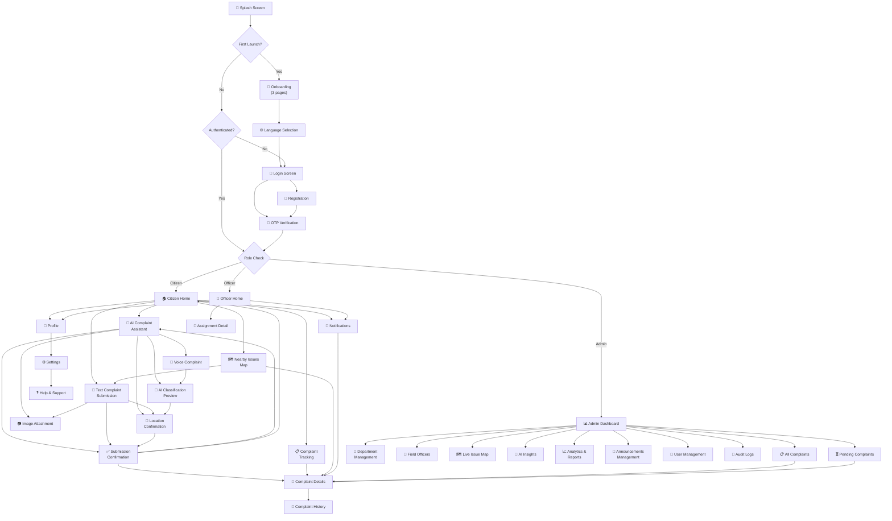

# 06 — UI/UX Plan: Screen-by-Screen Blueprint

> **Document Version**: 1.0
> **Last Updated**: 2026-10-31
> **Status**: Approved for Implementation

---

## Table of Contents

1. [Design System Summary](#1-design-system-summary)
2. [Screen-by-Screen Plan](#2-screen-by-screen-plan)
   - [Citizen Screens](#citizen-screens)
   - [Admin Dashboard Screens](#admin-dashboard-screens)
   - [Field Officer Screens](#field-officer-screens)
3. [Navigation Flow](#3-navigation-flow)
4. [Responsive Breakpoints](#4-responsive-breakpoints)
5. [Animation and Transitions](#5-animation-and-transitions)
6. [Accessibility](#6-accessibility)

---

## 1. Design System Summary

### 1.1 Color Palette

| Token              | Hex       | Usage                                          |
| ------------------- | --------- | ---------------------------------------------- |
| **Primary Deep Teal** | `#0F766E` | Buttons, active nav, links, primary actions     |
| **Secondary Navy**    | `#16324F` | Headers, sidebar background, emphasis text      |
| **Accent Mint**       | `#DDF5EE` | Success backgrounds, highlight rows, chips      |
| **Background**        | `#F5F8FA` | Page/scaffold background                        |
| **Surface**           | `#FFFFFF` | Cards, dialogs, input fields                    |
| **Primary Text**      | `#172B3A` | Body text, headings                              |
| **Secondary Text**    | `#64748B` | Captions, placeholders, timestamps              |
| **Success**           | `#16865B` | Resolved badges, success toasts, positive stats |
| **Warning**           | `#D99A27` | SLA warnings, medium priority, pending states   |
| **Error**             | `#D94B4B` | Validation errors, high priority, failure toasts |

### 1.2 Typography

| Context         | Font Family        | Notes                                  |
| --------------- | ------------------ | -------------------------------------- |
| English text    | **Inter**          | Variable weight, excellent screen legibility |
| Tamil text      | **Noto Sans Tamil** | Full Tamil Unicode coverage             |

**Type Scale (px):** `12 · 14 · 16 · 18 · 20 · 24 · 28 · 32 · 40`

| Style          | Size | Weight   | Line Height | Usage                    |
| -------------- | ---- | -------- | ----------- | ------------------------ |
| Caption        | 12   | Regular  | 16          | Timestamps, labels       |
| Body Small     | 14   | Regular  | 20          | Secondary body text      |
| Body           | 16   | Regular  | 24          | Primary body text        |
| Body Large     | 18   | Regular  | 28          | Emphasized body          |
| Subtitle       | 20   | SemiBold | 28          | Card titles              |
| Title          | 24   | SemiBold | 32          | Section headings         |
| Headline       | 28   | Bold     | 36          | Page titles              |
| Display Small  | 32   | Bold     | 40          | Dashboard metric values  |
| Display        | 40   | Bold     | 48          | Splash/hero text         |

### 1.3 Spacing Scale

| Token | Value |
| ----- | ----- |
| xs    | 4px   |
| sm    | 8px   |
| md    | 12px  |
| base  | 16px  |
| lg    | 20px  |
| xl    | 24px  |
| 2xl   | 32px  |
| 3xl   | 40px  |
| 4xl   | 48px  |
| 5xl   | 64px  |

### 1.4 Corner Radius

| Token  | Value | Usage                              |
| ------ | ----- | ---------------------------------- |
| Small  | 8px   | Chips, badges, small buttons       |
| Medium | 12px  | Cards, input fields, dropdowns     |
| Large  | 16px  | Bottom sheets, image containers    |
| XLarge | 24px  | Floating action buttons, modals    |

### 1.5 Elevation

| Level  | Shadow              | Usage                                 |
| ------ | -------------------- | ------------------------------------- |
| None   | No shadow, 1px border `#E2E8F0` | Flat cards, list items       |
| Low    | `0 1dp 2dp rgba(0,0,0,0.08)`    | Hovered cards, raised inputs |
| Medium | `0 4dp 8dp rgba(0,0,0,0.12)`    | Floating buttons, dropdowns  |
| High   | `0 8dp 16dp rgba(0,0,0,0.16)`   | Dialogs, bottom sheets, modals |

---

## 2. Screen-by-Screen Plan

---

### Citizen Screens

---

#### 2.1 Splash Screen

**Purpose:** Brand impression and session bootstrap.

**Layout:**
- Full-screen teal gradient background (`#0F766E` → `#16324F`, top-left to bottom-right)
- App logo centered vertically and horizontally (120×120dp)
- App name "Namma Ooru AI" below logo in Display style, white
- Tagline "Your AI-Powered Civic Companion" in Body style, white at 80% opacity
- Circular progress indicator 32dp below tagline, white

**Responsive Differences:**

| Breakpoint | Behavior                                  |
| ---------- | ----------------------------------------- |
| Mobile     | Logo 120dp, name in Display Small (32px)  |
| Tablet     | Logo 160dp, name in Display (40px)        |
| Desktop    | Logo 200dp, name in Display (40px), centered in viewport |

**Key Interactions:**
- No user interaction — purely passive
- Auto-navigates after 2 seconds (or when auth check completes, whichever is later)

**State Variations:**

| State               | Behavior                                      |
| -------------------- | --------------------------------------------- |
| First launch         | → Onboarding Screen                           |
| Authenticated user   | → Citizen Home / Admin Dashboard / Officer Home (role-based) |
| Unauthenticated user | → Login Screen                                |
| Network error        | → Login Screen with offline banner             |

**Navigation:**
- **Comes from:** App launch
- **Goes to:** Onboarding (first launch) · Login (unauthenticated) · Home/Dashboard (authenticated)

---

#### 2.2 Onboarding (3 Pages)

**Purpose:** First-time user education on app value proposition.

**Layout (per page):**
- Top 60% — full-bleed illustration (SVG/Lottie animation, aspect 4:3)
- Bottom 40% — white rounded card (top corners XLarge radius)
  - Headline text (Title, 24px, bold)
  - Description text (Body, 16px, secondary color)
  - Page indicator dots (3 dots, 8dp each, 12dp gap)
  - Buttons row: "Skip" (text button, left) · "Next" / "Get Started" (primary button, right)

**Page Content:**

| Page | Headline                  | Description                                                                    |
| ---- | ------------------------- | ------------------------------------------------------------------------------ |
| 1    | Report Issues Easily      | Snap a photo, record your voice, or type — report civic issues in Tamil or English |
| 2    | AI-Powered Classification | Our AI automatically categorizes your complaint and routes it to the right department |
| 3    | Track Resolution          | Follow your complaint's journey from submission to resolution in real time       |

**Responsive Differences:**

| Breakpoint | Behavior                                              |
| ---------- | ----------------------------------------------------- |
| Mobile     | Full-screen pages, swipeable horizontally              |
| Tablet     | Illustration left (50%), text right (50%), landscape   |
| Desktop    | Centered card (max-width 720px), illustration + text side-by-side |

**Key Interactions:**
- Horizontal swipe to navigate between pages
- "Skip" → Language Selection
- "Next" → next onboarding page
- "Get Started" (page 3 only) → Language Selection
- Page indicator dots are tappable

**State Variations:**

| State    | Behavior                                     |
| -------- | -------------------------------------------- |
| Default  | Page 1 displayed                              |
| Last page | "Next" becomes "Get Started" (filled button) |

**Navigation:**
- **Comes from:** Splash Screen (first launch only)
- **Goes to:** Language Selection

---

#### 2.3 Language Selection

**Purpose:** Set preferred language for the app interface and complaint submission.

**Layout:**
- Centered content (max-width 400px)
- Headline: "Choose Your Language" (Title, 24px)
- Subtext: "நீங்கள் விரும்பும் மொழியை தேர்ந்தெடுக்கவும்" (bilingual prompt)
- Two language cards in vertical stack (16px gap):
  - **Tamil Card:** Tamil script sample "தமிழ்", flag/script icon, radio indicator
  - **English Card:** "English" label, flag/script icon, radio indicator
- Each card: Surface color, Medium radius, border `#E2E8F0`, 64dp height
- Selected card: Accent Mint background, Primary Teal border (2px), checkmark icon
- "Continue" primary button (full width, below cards, 48dp height)

**Responsive Differences:**

| Breakpoint | Behavior                            |
| ---------- | ----------------------------------- |
| Mobile     | Full-screen, cards full width       |
| Tablet     | Centered card (max-width 400px)     |
| Desktop    | Centered card (max-width 400px)     |

**Key Interactions:**
- Tap card to select language (visual toggle with ripple)
- "Continue" → Login Screen
- Default selection: Tamil (pre-selected)

**State Variations:**

| State     | Behavior                                     |
| --------- | -------------------------------------------- |
| Default   | Tamil pre-selected                           |
| Selected  | Selected card highlighted, Continue enabled  |

**Navigation:**
- **Comes from:** Onboarding (page 3) or Settings (change language)
- **Goes to:** Login Screen

---

#### 2.4 Login Screen

**Purpose:** User authentication via phone/email + password.

**Layout:**
- Scrollable single-column form
- **Top:** App logo (64dp), centered
- **Language toggle:** Top-right, small text button ("தமிழ்" / "EN")
- **Form fields (vertical stack, 16px gap):**
  - Phone number / Email — text input with leading icon (phone/mail), helper text
  - Password — text input with leading lock icon, trailing visibility toggle icon
- **"Forgot Password?"** — text link, right-aligned below password field
- **"Login"** — primary button, full width, 48dp, Primary Teal
- **Divider** — "or" text centered on a line
- **Social login buttons** (future) — Google, Apple icons in outlined buttons (disabled/hidden for MVP)
- **"Don't have an account? Register"** — text link, centered at bottom

**Responsive Differences:**

| Breakpoint | Behavior                                          |
| ---------- | ------------------------------------------------- |
| Mobile     | Full-screen, form fills width with 16px padding   |
| Tablet     | Centered card (max-width 420px), Medium elevation  |
| Desktop    | Split layout: left illustration panel (60%), right form panel (40%) |

**Key Interactions:**
- Phone/Email field validates format on blur
- Password visibility toggle (eye icon)
- "Login" button triggers auth → shows loading spinner inside button
- "Forgot Password?" → Forgot Password flow (modal or new screen)
- "Register" → Registration Screen
- Language toggle switches all labels/placeholders instantly

**State Variations:**

| State          | Behavior                                                          |
| -------------- | ----------------------------------------------------------------- |
| Default        | Empty form, Login button disabled                                 |
| Filled         | Login button enabled (Primary Teal)                               |
| Loading        | Login button shows circular progress, fields disabled             |
| Validation Error | Red border on invalid field, error text below field              |
| Auth Error     | Error banner at top: "Invalid credentials. Please try again."     |
| Network Error  | Error banner: "No internet connection. Please check and retry."   |

**Navigation:**
- **Comes from:** Splash (unauthenticated) · Language Selection · Registration
- **Goes to:** OTP Verification · Registration · Forgot Password · Home (on success, role-based)

---

#### 2.5 Registration Screen

**Purpose:** New user account creation.

**Layout:**
- Scrollable single-column form (max-width 420px on tablet/desktop)
- **Top:** "Create Account" headline (Title, 24px)
- **Form fields (vertical stack, 16px gap):**
  - Full Name — text input, required
  - Phone Number — text input with country code prefix (+91), required
  - Email — text input, optional
  - Password — text input with strength indicator bar below (4 segments: weak/fair/good/strong, colored red → orange → yellow → green)
  - City Selector — dropdown/bottom sheet picker, searchable
  - Preferred Language — toggle switch (Tamil / English)
- **Terms checkbox:** "I agree to the [Terms of Service] and [Privacy Policy]" — links open in-app browser
- **"Register"** — primary button, full width, 48dp
- **"Already have an account? Login"** — text link, centered at bottom

**Responsive Differences:**

| Breakpoint | Behavior                                          |
| ---------- | ------------------------------------------------- |
| Mobile     | Full-screen scrollable form                        |
| Tablet     | Centered card (max-width 420px)                    |
| Desktop    | Split layout: left illustration, right form        |

**Key Interactions:**
- Inline validation on each field blur
- Password strength updates in real-time as user types
- City selector shows searchable list with popular cities first
- Register button disabled until all required fields valid + terms checked
- On submit → loading state → OTP Verification

**State Variations:**

| State           | Behavior                                                       |
| --------------- | -------------------------------------------------------------- |
| Default         | Empty form, Register button disabled                           |
| Filling         | Fields validate on blur, strength indicator updates            |
| Valid           | Register button enabled                                         |
| Loading         | Button shows progress, fields disabled                          |
| Error (field)   | Red border + error message per field                            |
| Error (server)  | Banner: "Phone number already registered" or similar           |

**Navigation:**
- **Comes from:** Login Screen
- **Goes to:** OTP Verification · Login Screen (link)

---

#### 2.6 OTP Verification Screen

**Purpose:** Phone number verification via one-time password.

**Layout:**
- Centered content (max-width 400px)
- **Shield/lock icon** at top (48dp, teal)
- **Headline:** "Verify Your Phone Number" (Title, 24px)
- **Subtext:** "We've sent a 6-digit code to +91 ●●●●●●7890" (Body, secondary text)
- **6-digit OTP input:** 6 individual square boxes (48×48dp each, 8px gap), auto-focus first, auto-advance on input
- **Resend section:** "Didn't receive the code?" + "Resend OTP" text link
  - Timer: "Resend in 00:47" (disabled state, countdown from 60s)
  - After timer: "Resend OTP" becomes active (Primary Teal text)
- **"Verify"** — primary button, full width, 48dp
- **"Change phone number"** — text link, centered at bottom

**Responsive Differences:**

| Breakpoint | Behavior                         |
| ---------- | -------------------------------- |
| Mobile     | Full-screen, boxes 48dp          |
| Tablet     | Centered card (max-width 400px)  |
| Desktop    | Centered card (max-width 400px)  |

**Key Interactions:**
- Auto-focus on first OTP box on mount
- Numeric keyboard presented (mobile)
- Auto-advance cursor to next box on digit entry
- Backspace moves to previous box
- Paste support: pasting 6 digits fills all boxes
- "Verify" triggers verification → loading state
- "Resend OTP" triggers new OTP send, resets timer to 60s
- "Change phone number" → back to Registration/Login

**State Variations:**

| State            | Behavior                                                     |
| ---------------- | ------------------------------------------------------------ |
| Default          | Empty boxes, Verify disabled, timer counting down            |
| Filling          | Boxes fill left to right, Verify enables when all 6 filled   |
| Loading          | Verify button shows progress                                  |
| Success          | Green checkmark animation → auto-navigate to Home            |
| Invalid OTP      | Boxes shake animation, red border, error text "Invalid code" |
| Expired OTP      | Error: "Code expired. Please request a new one."             |
| Resend available | "Resend OTP" becomes teal/clickable                          |

**Navigation:**
- **Comes from:** Registration · Login (if 2FA enabled)
- **Goes to:** Citizen Home (citizen role) · Admin Dashboard (admin role) · Officer Home (officer role)

---

#### 2.7 Citizen Home Dashboard

**Purpose:** Central hub for citizens — quick access to all primary actions.

**Layout:**

```
┌─────────────────────────────────────────┐
│  Good morning, Priya!    📍 Chennai     │  ← Top greeting bar
├─────────────────────────────────────────┤
│  [🚨 Report Issue]  [🤖 AI]  [📋 My]  │  ← Quick actions row
├─────────────────────────────────────────┤
│  ┌─────────────────────────────────────┐│
│  │ 2 Active  │ 1 In Progress │ 5 Done ││  ← Summary card
│  └─────────────────────────────────────┘│
├─────────────────────────────────────────┤
│  Recent Complaints          View All → ││
│  [Card 1] [Card 2] [Card 3] ←scroll→  ││  ← Horizontal list
├─────────────────────────────────────────┤
│  Nearby Issues              View Map → ││
│  ┌─────────────────────────────────────┐│
│  │         Mini Map Preview            ││  ← Map thumbnail
│  └─────────────────────────────────────┘│
├─────────────────────────────────────────┤
│  Announcements                         ││
│  [Announce 1] [Announce 2]  ←scroll→   ││  ← Horizontal list
├─────────────────────────────────────────┤
│  🏠  📋  🗺️  🔔  👤                    │  ← Bottom navigation
└─────────────────────────────────────────┘
```

**Element Details:**

- **Top Section:**
  - Left: Greeting text ("Good morning/afternoon/evening, {Name}!") — Subtitle, 20px
  - Right: Location pill — chip with map-pin icon + city name, tappable → city change
  - Background: subtle gradient or solid Background color

- **Quick Actions Row (3 items, equal width):**
  - "Report Issue" — prominent CTA, Primary Teal background, white text, large icon, Medium radius
  - "AI Assistant" — Surface card, teal icon, teal text
  - "My Complaints" — Surface card, teal icon, teal text

- **Active Complaints Summary Card:**
  - Horizontal 3-segment card (Surface, Medium radius, Low elevation)
  - Each segment: count (Display Small, 32px, bold) + label (Caption, 12px, secondary)
  - Active = Warning color, In Progress = Primary Teal, Resolved = Success

- **Recent Complaints (horizontal scroll):**
  - Section header: "Recent Complaints" (Subtitle) + "View All →" link
  - Horizontal scrollable row of complaint cards (width 260dp each)
  - Each card: complaint title (truncated 2 lines), category icon, status badge, priority dot, date
  - Card: Surface, Medium radius, None elevation, 1px border

- **Nearby Issues Map Preview:**
  - Section header: "Nearby Issues" + "View Map →" link
  - Map thumbnail (OpenStreetMap, 180dp height, Large radius)
  - Shows 3-5 nearest complaint pins
  - Tap → full Nearby Civic Issues Map

- **Announcements (horizontal scroll):**
  - Announcement cards (width 300dp): title, body preview (2 lines), category badge, time ago
  - Card: Accent Mint background, Medium radius

- **Bottom Navigation Bar:**
  - 5 items: Home | My Complaints | Map | Notifications | Profile
  - Each: icon (24dp) + label (Caption, 12px)
  - Active: Primary Teal, inactive: Secondary Text
  - Notification badge (red dot with count) on Notifications icon
  - Height: 64dp, Surface background, top border 1px

**Responsive Differences:**

| Breakpoint | Behavior                                                   |
| ---------- | ---------------------------------------------------------- |
| Mobile     | Single column, bottom nav, horizontal scroll sections      |
| Tablet     | 2-column grid for summary + quick actions; bottom nav or rail nav |
| Desktop    | 3-column layout; left sidebar nav replaces bottom nav; summary cards in row |

**Key Interactions:**
- Pull to refresh (mobile) — refreshes all data sections
- Tap "Report Issue" → AI Complaint Assistant (default) or Text Complaint Submission
- Tap "AI Assistant" → AI Complaint Assistant
- Tap "My Complaints" → Complaint Tracking
- Tap complaint card → Complaint Details
- Tap "View Map" → Nearby Civic Issues Map
- Tap announcement → Announcement detail (modal or screen)
- Bottom nav items switch screens with fade transition

**State Variations:**

| State    | Behavior                                                        |
| -------- | --------------------------------------------------------------- |
| Loading  | Shimmer skeletons for all cards and sections                    |
| Empty    | No complaints: illustration + "No complaints yet. Report your first issue!" CTA |
| Populated | Full dashboard with real data                                  |
| Error    | Error banner at top with retry button; cached data shown if available |
| Offline  | Offline banner, cached data shown, "Report Issue" still available (queued) |

**Navigation:**
- **Comes from:** Splash (authenticated citizen) · OTP Verification · Bottom nav
- **Goes to:** AI Complaint Assistant · Text Complaint · Complaint Tracking · Map · Notifications · Profile

---

#### 2.8 AI Complaint Assistant

**Purpose:** Conversational interface for guided complaint submission with AI-powered classification.

**Layout:**

```
┌─────────────────────────────────────┐
│  ← Back     AI Assistant     ⋮     │  ← App bar
├─────────────────────────────────────┤
│                                     │
│  🤖 Hi! I'm your civic assistant.  │  ← Bot greeting bubble
│     Describe your issue or use      │
│     voice/image to get started.     │
│                                     │
│                   User message  👤  │  ← User message bubble
│                                     │
│  🤖 Analyzing...                   │  ← Typing indicator
│  ···                                │
│                                     │
│  🤖 ┌──────────────────────┐       │  ← Classification card
│     │ Category: Roads       │       │
│     │ Department: PWD       │       │
│     │ Priority: High        │       │
│     │ Confidence: 94%       │       │
│     └──────────────────────┘       │
│                                     │
│  🤖 Is this correct?               │
│     [✅ Yes]  [✏️ Edit]             │  ← Action buttons
│                                     │
├─────────────────────────────────────┤
│  📎  🎤  [  Type a message...  ] ➤ │  ← Input bar
└─────────────────────────────────────┘
```

**Element Details:**

- **App Bar:** Back arrow (left), "AI Assistant" title (center), overflow menu (right)
- **Chat Area:** Scrollable, bottom-anchored (newest messages at bottom)
  - Bot messages: left-aligned, Accent Mint background, Medium radius (top-left square)
  - User messages: right-aligned, Primary Teal background, white text, Medium radius (top-right square)
  - Timestamps: Caption, secondary text, below each message group
- **Input Bar (fixed at bottom):**
  - Image attach button (camera icon, 40dp)
  - Voice record button (mic icon, 40dp)
  - Text input field (flex, Medium radius, 44dp height)
  - Send button (arrow-up icon, Primary Teal, 40dp circle)
  - Background: Surface, top border 1px

**Chat Flow (step-by-step):**

| Step | Actor | Content                                                    |
| ---- | ----- | ---------------------------------------------------------- |
| 1    | Bot   | Greeting message with capabilities                          |
| 2    | User  | Describes issue (text, voice transcription, or image)       |
| 3    | Bot   | "Analyzing your complaint..." with typing indicator (1-3s)  |
| 4    | Bot   | Classification card (category, department, priority, confidence) |
| 5    | Bot   | "Is this correct?" with Yes / Edit buttons                  |
| 6a   | User  | Taps "Yes" → proceeds to location                          |
| 6b   | User  | Taps "Edit" → correction flow                              |
| 7    | Bot   | "Please confirm the location" + map picker inline card      |
| 8    | User  | Confirms location                                           |
| 9    | Bot   | Final summary card with all details                         |
| 10   | User  | Taps "Submit Complaint"                                     |
| 11   | Bot   | Success message with complaint number                       |

**Responsive Differences:**

| Breakpoint | Behavior                                                     |
| ---------- | ------------------------------------------------------------ |
| Mobile     | Full-screen chat, input bar at bottom with keyboard avoidance |
| Tablet     | Centered chat area (max-width 640px), floating input bar     |
| Desktop    | Right panel chat (max-width 480px), or centered (max-width 640px) |

**Key Interactions:**
- Text input sends on Enter (desktop) or Send button tap
- Mic button: tap-and-hold to record, release to stop (or tap to toggle)
- Camera button: opens image attachment flow (camera or gallery)
- Classification card buttons (Yes/Edit) are inline, tappable
- Map picker inline: small map with pin, "Open Full Map" link
- Auto-scroll to bottom on new messages
- Long-press message to copy text

**State Variations:**

| State          | Behavior                                                  |
| -------------- | --------------------------------------------------------- |
| Initial        | Bot greeting displayed, empty input                       |
| Typing         | User typing, send button activates                        |
| Analyzing      | Typing indicator with shimmer dots (bot)                  |
| Classification | Classification card displayed with action buttons          |
| Location       | Map picker card displayed                                  |
| Summary        | Final summary card with Submit button                      |
| Submitting     | Submit button shows progress, input disabled               |
| Success        | Checkmark animation, complaint number card                 |
| Error          | Error message in chat: "Something went wrong. Try again." |
| Offline        | Banner: "You're offline. Message will be sent when connected." |

**Navigation:**
- **Comes from:** Citizen Home (Quick Actions) · Bottom nav
- **Goes to:** Complaint Submission Confirmation · Location Confirmation (full screen) · Complaint Details

---

#### 2.9 Text Complaint Submission (Direct Form)

**Purpose:** Traditional form-based complaint submission without AI chat flow.

**Layout:**

```
┌──────────────────────────────────────┐
│  ← Back    Submit Complaint          │
├──────────────────────────────────────┤
│                                      │
│  Title *                             │
│  ┌──────────────────────────────────┐│
│  │                                  ││
│  └──────────────────────────────────┘│
│                                      │
│  Description *                       │
│  ┌──────────────────────────────────┐│
│  │                                  ││
│  │                                  ││
│  │                                  ││
│  └──────────────────────────────────┘│
│                                      │
│  Category *                          │
│  ┌───────────────────────────── ▾ ┐ │
│  │ Select category                 │ │
│  └─────────────────────────────────┘ │
│                                      │
│  📷 Attach Images (max 5)           │
│  ┌────┐ ┌────┐ ┌────┐              │
│  │ +  │ │img1│ │img2│              │
│  └────┘ └────┘ └────┘              │
│                                      │
│  📍 Location *                      │
│  ┌──────────────────────────────────┐│
│  │      [Map Preview]              ││
│  │      📍 Tap to set location     ││
│  └──────────────────────────────────┘│
│                                      │
│  Priority (AI Suggested: High 🔴)   │
│  ┌───────────────────────────── ▾ ┐ │
│  │ High                           │ │
│  └─────────────────────────────────┘ │
│                                      │
│  ┌──────────────────────────────────┐│
│  │          Submit                  ││
│  └──────────────────────────────────┘│
└──────────────────────────────────────┘
```

**Element Details:**

- **Title Field:** Single-line text input, max 120 chars, counter visible, required
- **Description Textarea:** Multi-line, min 3 rows / max 10 rows auto-grow, supports Tamil input (IME), max 2000 chars, required
- **Category Dropdown:** Searchable dropdown or bottom sheet with category list (icons + labels); includes: Roads, Water Supply, Sewage, Street Lights, Garbage, Parks, Buildings, Traffic, Noise, Other
- **Image Attachment Area:** Grid of thumbnails (80×80dp) with "+" add button; tap existing image to preview or remove (X icon overlay)
- **Location Picker:** Map thumbnail (160dp height, Large radius), address text auto-filled; tap to open full-screen Location Confirmation
- **Priority Dropdown:** AI-suggested value pre-selected, editable; options: Low, Medium, High, Critical; color-coded indicator dot
- **Submit Button:** Full-width, 48dp, Primary Teal; disabled until required fields valid

**Responsive Differences:**

| Breakpoint | Behavior                                          |
| ---------- | ------------------------------------------------- |
| Mobile     | Full-screen scrollable form, fields full width     |
| Tablet     | Centered form (max-width 600px), 2-column for images + location |
| Desktop    | Centered form (max-width 720px), side-by-side sections |

**Key Interactions:**
- Inline validation on blur for each field
- Tamil keyboard/IME support for title and description
- Category selection triggers AI priority suggestion (async, shows shimmer while loading)
- Image tap → full preview with pinch-to-zoom
- Location tap → full-screen Location Confirmation → returns with coordinates and address
- Submit → loading state → Confirmation Screen

**State Variations:**

| State          | Behavior                                                    |
| -------------- | ----------------------------------------------------------- |
| Empty          | All fields empty, Submit disabled                           |
| Filling        | Partial data, Submit disabled, validated fields show green checks |
| Valid          | All required fields filled and valid, Submit enabled         |
| AI Processing  | Priority field shows shimmer while AI suggests               |
| Submitting     | Button progress, fields disabled, back navigation blocked    |
| Validation Error | Red borders on invalid fields, error messages inline       |
| Server Error   | Error banner at top with retry                               |

**Navigation:**
- **Comes from:** Citizen Home · AI Assistant (edit flow)
- **Goes to:** Location Confirmation · Image Attachment · Complaint Submission Confirmation

---

#### 2.10 Voice Complaint Submission

**Purpose:** Record voice complaint in Tamil or English, transcribed by AI.

**Layout:**

```
┌────────────────────────────────────┐
│  ← Back    Voice Complaint         │
├────────────────────────────────────┤
│                                    │
│     Speak your complaint clearly   │  ← Instruction text
│                                    │
│     ┌────────────────────────┐     │
│     │  ∿∿∿ Waveform ∿∿∿     │     │  ← Audio waveform
│     └────────────────────────┘     │
│                                    │
│           01:23                    │  ← Timer
│                                    │
│         ┌──────┐                   │
│         │  🎤  │                   │  ← Mic button (80dp)
│         └──────┘                   │
│     [Tamil detected 🇮🇳]          │  ← Language indicator
│                                    │
│  ┌────────────────────────────────┐│
│  │ Transcription preview text...  ││  ← Editable textarea
│  │                                ││
│  └────────────────────────────────┘│
│                                    │
│  ┌────────────────────────────────┐│
│  │        Use This Text           ││  ← Primary button
│  └────────────────────────────────┘│
│  ┌────────────────────────────────┐│
│  │        Record Again            ││  ← Secondary button
│  └────────────────────────────────┘│
└────────────────────────────────────┘
```

**Element Details:**

- **Instruction Text:** "Speak your complaint clearly" — Body Large, centered, secondary text
- **Mic Button:** 80dp circle, Primary Teal background, white mic icon (32dp)
  - Idle: static icon
  - Recording: pulsing red ring animation, red background
  - Processing: spinner overlay
- **Waveform Visualization:** Real-time audio waveform (teal bars, 120dp height), hidden when idle
- **Timer:** "MM:SS" format, Body Large, centered, visible during recording
- **Language Indicator:** Chip showing detected language, auto-detected after 2-3 seconds of speech
- **Transcription Preview:** Multi-line textarea, pre-filled with AI transcription, editable by user
- **"Use This Text"** — primary button → routes to AI classification
- **"Record Again"** — outlined secondary button → clears transcription, resets mic

**Responsive Differences:**

| Breakpoint | Behavior                                              |
| ---------- | ----------------------------------------------------- |
| Mobile     | Full-screen, mic button centered prominently          |
| Tablet     | Centered content (max-width 480px)                    |
| Desktop    | Centered content (max-width 480px)                    |

**Key Interactions:**
- Tap mic to start recording, tap again (or "Stop" button appears) to stop
- Waveform animates in real-time during recording
- After stop: processing spinner (1-5s) → transcription appears
- User can edit transcription text
- "Use This Text" → AI Classification Preview
- "Record Again" → clear all, reset to idle state
- Max recording duration: 120 seconds (auto-stop with notification)
- Microphone permission prompt on first use

**State Variations:**

| State        | Behavior                                                        |
| ------------ | --------------------------------------------------------------- |
| Idle         | Mic button static, instruction visible, waveform hidden         |
| Recording    | Mic pulsing red, waveform active, timer counting, "Stop" visible |
| Processing   | Mic disabled, spinner, "Transcribing..." text                   |
| Transcribed  | Transcription textarea visible, "Use This Text" + "Record Again" |
| Error        | "Could not transcribe. Please try again or type manually." + retry |
| No Mic       | "Microphone permission required" with settings link              |

**Navigation:**
- **Comes from:** Citizen Home · AI Complaint Assistant (mic button)
- **Goes to:** AI Classification Preview · Text Complaint Submission (fallback)

---

#### 2.11 Image Attachment

**Purpose:** Capture or select images to attach to a complaint.

**Layout:**

```
┌────────────────────────────────────┐
│  ← Back     Attach Images          │
├────────────────────────────────────┤
│                                    │
│  ┌──────────┐  ┌──────────┐       │
│  │  📷      │  │  🖼️      │       │
│  │  Camera  │  │  Gallery  │       │
│  └──────────┘  └──────────┘       │
│                                    │
│  Attached (2/5)                    │
│  ┌─────┐ ┌─────┐ ┌─────┐         │
│  │ img │ │ img │ │  +  │         │
│  │  ✕  │ │  ✕  │ │     │         │
│  └─────┘ └─────┘ └─────┘         │
│                                    │
│  ┌────────────────────────────────┐│
│  │          Done (2)              ││
│  └────────────────────────────────┘│
└────────────────────────────────────┘
```

**Element Details:**

- **Camera Capture Button:** Large card (48% width), camera icon + "Take Photo" label, taps opens device camera
- **Gallery Picker Button:** Large card (48% width), gallery icon + "Choose from Gallery" label, opens device gallery (multi-select)
- **Attached Images Grid:** 3-column grid of thumbnails (equal width, 1:1 aspect)
  - Each: image thumbnail, "✕" remove button (top-right, 24dp circle, Error red)
  - "+" add more button (dotted border, teal icon)
  - Count indicator: "Attached (N/5)"
- **Upload Progress:** Per-image progress bar overlay on thumbnail during upload
- **"Done"** button: full width, shows count of attached images

**Constraints:**
- Max 5 images total
- Max 10MB per image
- Accepted formats: JPEG, PNG, HEIC (auto-converted)
- Images auto-compressed to max 2048px on longest side

**Responsive Differences:**

| Breakpoint | Behavior                              |
| ---------- | ------------------------------------- |
| Mobile     | Full-screen, 3-column thumbnail grid  |
| Tablet     | Modal/bottom sheet, 4-column grid     |
| Desktop    | Modal dialog, drag-and-drop support, 5-column grid |

**Key Interactions:**
- Tap Camera → opens device camera → captured image added to grid
- Tap Gallery → opens gallery picker (multi-select up to remaining slots)
- Tap thumbnail → full-screen image preview with pinch-to-zoom
- Tap "✕" → remove image (no confirmation needed)
- Tap "+" → shows Camera/Gallery choice again
- Drag-and-drop on desktop
- "Done" → returns to calling screen with image paths

**State Variations:**

| State         | Behavior                                             |
| ------------- | ---------------------------------------------------- |
| Empty         | Camera + Gallery buttons prominent, Done disabled    |
| Has images    | Grid shows thumbnails, "+" visible if < 5, Done enabled |
| Full (5)      | "+" hidden, "Maximum images reached" note            |
| Uploading     | Progress bars on thumbnails, Done disabled            |
| Error (size)  | Toast: "Image too large. Maximum 10MB allowed."       |
| Permission    | Camera/storage permission prompts                     |

**Navigation:**
- **Comes from:** Text Complaint Submission · AI Complaint Assistant
- **Goes to:** Returns to calling screen (with attached images)

---

#### 2.12 Location Confirmation

**Purpose:** Pinpoint the exact location of the civic issue on a map.

**Layout:**

```
┌──────────────────────────────────────┐
│  ← Back    Confirm Location          │
├──────────────────────────────────────┤
│                                      │
│  ┌──────────────────────────────────┐│
│  │                                  ││
│  │                                  ││
│  │          OpenStreetMap           ││
│  │            📍 (pin)              ││  ← Full map area (70% height)
│  │                                  ││
│  │                                  ││
│  │                ┌──────────────┐  ││
│  │                │ 📍 Use My    │  ││  ← FAB
│  │                │   Location   │  ││
│  │                └──────────────┘  ││
│  └──────────────────────────────────┘│
│                                      │
│  ┌──────────────────────────────────┐│
│  │ 📍 23, Anna Nagar Main Road,    ││  ← Address field
│  │    Chennai, Tamil Nadu 600040    ││
│  └──────────────────────────────────┘│
│                                      │
│  Ward: Ward 12  │  Zone: Zone 5     │  ← Auto-detected badges
│                                      │
│  ┌──────────────────────────────────┐│
│  │       Confirm Location           ││  ← Primary button
│  └──────────────────────────────────┘│
└──────────────────────────────────────┘
```

**Element Details:**

- **Map (OpenStreetMap):** Takes 65-70% of screen height; interactive pan/zoom
- **Draggable Pin:** Centered on map; pin icon lifts with shadow when dragged; drops with bounce
- **"Use Current Location" FAB:** Bottom-right of map, Surface background, Medium elevation, GPS icon
- **Address Field:** Text input, auto-populated by reverse geocoding when pin moves; user-editable with search autocomplete
- **Ward/Zone Badges:** Auto-detected from coordinates, displayed as read-only chips
- **"Confirm Location" Button:** Full width, 48dp, Primary Teal

**Responsive Differences:**

| Breakpoint | Behavior                                               |
| ---------- | ------------------------------------------------------ |
| Mobile     | Full-screen map (70%), bottom card with address + button (30%) |
| Tablet     | Map takes 60%, larger bottom panel                      |
| Desktop    | Split view: map left (65%), address panel right (35%)   |

**Key Interactions:**
- Pan map to move pin (pin stays centered, map moves underneath)
- "Use Current Location" → GPS permission → animates map to current location
- Pin drop → reverse geocoding API call → address auto-fills (shimmer while loading)
- Edit address field → forward geocoding → map pans to matched location
- Ward/Zone auto-update when pin position changes
- "Confirm Location" → returns coordinates + address to calling screen

**State Variations:**

| State           | Behavior                                                  |
| --------------- | --------------------------------------------------------- |
| Default         | Map centered on user's city, pin in center                |
| GPS locating    | FAB shows spinner, "Locating..." text                     |
| GPS found       | Map animates to location, address fills                   |
| Geocoding       | Address field shows shimmer/skeleton                      |
| Geocoded        | Address, ward, zone all populated                         |
| GPS denied      | Toast: "Location permission needed" + manual pin placement |
| Geocode error   | Address field: "Could not determine address" — manual entry |
| Offline         | Cached map tiles (if available), offline banner           |

**Navigation:**
- **Comes from:** Text Complaint Submission · AI Complaint Assistant
- **Goes to:** Returns to calling screen (with location data)

---

#### 2.13 AI Classification Preview

**Purpose:** Show the AI's classification result and allow user to confirm or edit.

**Layout:**

```
┌──────────────────────────────────────┐
│  ← Back     AI Classification        │
├──────────────────────────────────────┤
│                                      │
│  ┌──────────────────────────────────┐│
│  │  🌐 Detected: Tamil              ││  ← Language badge
│  ├──────────────────────────────────┤│
│  │                                  ││
│  │  🏷️ Category                     ││
│  │     Roads & Pavements            ││
│  │                                  ││
│  │  🏢 Department                   ││
│  │     Public Works Department      ││
│  │                                  ││
│  │  ⚡ Priority                     ││
│  │     🔴 High                      ││
│  │                                  ││
│  │  📊 Confidence                   ││
│  │     ████████░░ 94%               ││  ← Progress bar
│  │                                  ││
│  │  💡 AI Explanation               ││
│  │  "Complaint mentions 'pothole'   ││
│  │   and 'road damage' — matched    ││
│  │   Roads category with high       ││
│  │   confidence."                   ││
│  │                                  ││
│  └──────────────────────────────────┘│
│                                      │
│  ⚠️ Similar Complaint Found          │  ← Duplicate warning
│  ┌──────────────────────────────────┐│
│  │ NOA-2026-04821: "Pothole on..."  ││
│  │ Status: In Progress  View →      ││
│  └──────────────────────────────────┘│
│                                      │
│  ┌──────────────┐ ┌────────────────┐│
│  │   Confirm    │ │ Edit Category  ││  ← Action buttons
│  └──────────────┘ └────────────────┘│
└──────────────────────────────────────┘
```

**Element Details:**

- **Language Badge:** Chip at top of card, flag icon + language name
- **Classification Card (Surface, Medium radius, Low elevation):**
  - Category: Icon + category name (Subtitle, bold)
  - Department: Building icon + department name
  - Priority: Colored dot (🔴🟡🟢) + priority label, color matches severity
  - Confidence: Progress bar (teal fill) + percentage, green if ≥80%, yellow if 50-79%, red if <50%
  - AI Explanation: Italic body text explaining the reasoning
- **Duplicate Warning (conditional):**
  - Warning card (Warning background tint)
  - Shows similar complaint number, title preview, status
  - "View" link → opens that complaint's details
  - Only shown if AI detected potential duplicate (similarity > 85%)
- **Action Buttons (row):**
  - "Confirm" — Primary Teal, filled
  - "Edit Classification" — Outlined, teal border

**Responsive Differences:**

| Breakpoint | Behavior                                |
| ---------- | --------------------------------------- |
| Mobile     | Full-screen, vertical layout            |
| Tablet     | Centered card (max-width 560px)         |
| Desktop    | Centered card (max-width 560px)         |

**Key Interactions:**
- "Confirm" → proceed to Location Confirmation (or Submission Confirmation if location already set)
- "Edit Classification" → category/department/priority become editable dropdowns inline
- Tap duplicate complaint link → Complaint Details (of the existing complaint)
- If confidence < 50%: warning text "Low confidence — please verify the category"

**State Variations:**

| State          | Behavior                                           |
| -------------- | -------------------------------------------------- |
| Loading        | Card with shimmer skeletons                        |
| High confidence | Green confidence bar, no warnings                 |
| Low confidence  | Red/yellow confidence bar, verification prompt    |
| Duplicate found | Duplicate warning card visible                    |
| No duplicate    | Duplicate section hidden                          |
| Edit mode       | Fields become dropdowns, Save/Cancel buttons      |

**Navigation:**
- **Comes from:** AI Complaint Assistant · Voice Complaint (after transcription)
- **Goes to:** Location Confirmation · Complaint Submission Confirmation · Complaint Details (duplicate link)

---

#### 2.14 Complaint Submission Confirmation

**Purpose:** Confirm successful complaint submission and provide next steps.

**Layout:**

```
┌──────────────────────────────────────┐
│                                      │
│            ✅ (animated)             │  ← Success animation
│                                      │
│     Complaint Submitted              │  ← Headline
│       Successfully!                  │
│                                      │
│  ┌──────────────────────────────────┐│
│  │  Complaint #: NOA-2026-04892    ││
│  │                                  ││
│  │  Title: Pothole on Main Road    ││
│  │  Category: Roads & Pavements    ││
│  │  Priority: High                  ││
│  │  Department: PWD                 ││
│  │  Location: Anna Nagar, Chennai  ││
│  │  Date: 31 Oct 2026              ││
│  └──────────────────────────────────┘│
│                                      │
│  ┌──────────────────────────────────┐│
│  │       Track Complaint            ││  ← Primary button
│  └──────────────────────────────────┘│
│  ┌──────────────────────────────────┐│
│  │       Submit Another             ││  ← Secondary button
│  └──────────────────────────────────┘│
│                                      │
│        Go Home                       │  ← Text link
└──────────────────────────────────────┘
```

**Element Details:**

- **Success Animation:** Animated checkmark (Lottie/CSS), green circle expanding with white check, 120dp
- **Headline:** "Complaint Submitted Successfully!" — Title, 24px, centered
- **Summary Card (Surface, Medium radius, Low elevation):**
  - Complaint number: Bold, Primary Teal, copyable (tap to copy with toast feedback)
  - Key details: Title, Category, Priority (color-coded), Department, Location, Date
- **"Track Complaint"** — Primary button, full width → Complaint Details for this complaint
- **"Submit Another"** — Outlined button, full width → AI Complaint Assistant (fresh session)
- **"Go Home"** — Text link, centered → Citizen Home

**Responsive Differences:**

| Breakpoint | Behavior                       |
| ---------- | ------------------------------ |
| Mobile     | Full-screen, centered content  |
| Tablet     | Centered card (max-width 480px)|
| Desktop    | Centered card (max-width 480px)|

**Key Interactions:**
- Checkmark animation plays once on mount
- Tap complaint number to copy to clipboard (toast: "Copied!")
- "Track Complaint" → Complaint Details
- "Submit Another" → AI Complaint Assistant (new)
- "Go Home" → Citizen Home
- Back button → Citizen Home (prevent going back to form)

**State Variations:**

| State   | Behavior                   |
| ------- | -------------------------- |
| Success | Full layout as described   |

**Navigation:**
- **Comes from:** Text Complaint Submission · AI Complaint Assistant (final step)
- **Goes to:** Complaint Details · AI Complaint Assistant (new) · Citizen Home

---

#### 2.15 Complaint Tracking (My Complaints)

**Purpose:** List all complaints submitted by the citizen, filterable and sortable.

**Layout:**

```
┌──────────────────────────────────────┐
│  My Complaints              🔍      │  ← App bar with search
├──────────────────────────────────────┤
│  All | Active | Resolved | Closed   │  ← Filter tabs
├──────────────────────────────────────┤
│  Sort: Newest ▾                     │  ← Sort control
├──────────────────────────────────────┤
│  ┌──────────────────────────────────┐│
│  │ NOA-2026-04892                   ││
│  │ 🛣️ Pothole on Main Road         ││
│  │ 🔴 High  │ ⏳ In Progress       ││
│  │ 31 Oct 2026                      ││
│  └──────────────────────────────────┘│
│                                      │
│  ┌──────────────────────────────────┐│
│  │ NOA-2026-04756                   ││
│  │ 💡 Street Light Not Working      ││
│  │ 🟡 Medium │ ✅ Resolved          ││
│  │ 28 Oct 2026                      ││
│  └──────────────────────────────────┘│
│                                      │
│  ... more cards ...                  │
│                                      │
├──────────────────────────────────────┤
│  🏠  📋  🗺️  🔔  👤                 │  ← Bottom nav
└──────────────────────────────────────┘
```

**Element Details:**

- **Search Bar:** Expandable from icon; searches title, complaint number, description
- **Filter Tabs:** Horizontal scrollable tabs: All, Active, Resolved, Closed; count badges
- **Sort Control:** Dropdown: Newest first, Oldest first, Priority (high to low)
- **Complaint Cards (vertical list):**
  - Complaint number (Caption, secondary text)
  - Category icon (24dp) + title (Subtitle, truncated 1 line)
  - Priority dot + label | Status badge (colored chip)
  - Date (Caption, secondary text)
  - Card: Surface, Medium radius, None elevation, 1px border
  - Tap → Complaint Details
- **Pull to Refresh:** Overscroll triggers data refresh

**Responsive Differences:**

| Breakpoint | Behavior                                      |
| ---------- | --------------------------------------------- |
| Mobile     | Full-screen list, single column, bottom nav   |
| Tablet     | 2-column card grid                             |
| Desktop    | 3-column card grid or table view toggle        |

**Key Interactions:**
- Tab switching filters list instantly (client-side or API)
- Sort changes re-order list
- Search filters in real-time (debounced 300ms)
- Pull to refresh (mobile)
- Tap card → Complaint Details
- Infinite scroll / pagination (20 per page)

**State Variations:**

| State    | Behavior                                                     |
| -------- | ------------------------------------------------------------ |
| Loading  | Shimmer skeleton cards (3-5 placeholders)                    |
| Empty    | Illustration + "No complaints yet" + "Report Your First Issue" CTA |
| Empty (filtered) | "No {status} complaints found"                        |
| Populated | Card list with real data                                    |
| Error    | Error state with retry button                                |
| Offline  | Cached data shown, offline banner                            |

**Navigation:**
- **Comes from:** Citizen Home · Bottom nav
- **Goes to:** Complaint Details

---

#### 2.16 Complaint Details

**Purpose:** Full detail view of a single complaint with status timeline.

**Layout:**

```
┌──────────────────────────────────────┐
│  ← Back    Complaint Details    ⋮   │
├──────────────────────────────────────┤
│                                      │
│  NOA-2026-04892                      │  ← Complaint number
│  ┌──────────────┐                    │
│  │ ⏳ In Progress│                   │  ← Status badge (prominent)
│  └──────────────┘                    │
│                                      │
│  Pothole on Main Road               │  ← Title (Headline)
│  31 October 2026, 10:42 AM          │  ← Date
│                                      │
│  Large pothole on Anna Nagar Main   │  ← Description
│  Road near the junction...          │
│                                      │
│  🏷️ Roads & Pavements  ⚡ High       │  ← Category + Priority
│  🏢 Public Works Department         │  ← Department
│                                      │
│  📍 Location                        │
│  ┌──────────────────────────────────┐│
│  │        Mini Map                  ││
│  └──────────────────────────────────┘│
│  23, Anna Nagar Main Road, Chennai  │
│                                      │
│  🖼️ Images (2)                       │
│  ┌─────┐ ┌─────┐                    │
│  │ img │ │ img │                    │
│  └─────┘ └─────┘                    │
│                                      │
│  🤖 AI Classification               │
│  Category: Roads (94% confidence)   │
│                                      │
│  ═══════════════════════════════════ │
│  📋 Status Timeline                 │
│  ═══════════════════════════════════ │
│                                      │
│  🟢 Submitted              10:42 AM │
│  │  31 Oct 2026                     │
│  │  Complaint filed by citizen      │
│  │                                  │
│  🔵 Under Review           11:15 AM │
│  │  31 Oct 2026                     │
│  │  Reviewed by Admin               │
│  │                                  │
│  🟡 Assigned               11:30 AM │
│  │  31 Oct 2026                     │
│  │  Assigned to: Ravi Kumar (PWD)   │
│  │                                  │
│  ◯ In Progress (current)           │
│                                      │
│  👷 Assigned Officer                 │
│  Ravi Kumar — PWD                   │
│                                      │
│  ┌───────────┐  ┌─────────────────┐ │
│  │  Reopen   │  │ Give Feedback   │ │  ← Action buttons (conditional)
│  └───────────┘  └─────────────────┘ │
└──────────────────────────────────────┘
```

**Element Details:**

- **Complaint Number:** Caption, secondary text, copyable
- **Status Badge:** Large chip, colored by status:
  - Submitted: `#64748B` (grey)
  - Under Review: `#3B82F6` (blue)
  - Assigned: `#8B5CF6` (purple)
  - In Progress: `#D99A27` (warning/yellow)
  - Resolved: `#16865B` (green)
  - Closed: `#172B3A` (dark)
  - Reopened: `#D94B4B` (red)
- **Title:** Headline, 28px
- **Description:** Body, 16px, expandable ("Show more" if > 4 lines)
- **Category + Priority + Department:** Row of labeled items with icons
- **Mini Map:** Non-interactive map thumbnail (120dp height), tap to open full map
- **Image Gallery:** Horizontal row of thumbnails, tap for full-screen viewer with swipe navigation
- **AI Classification:** Summary of AI result with confidence score
- **Status Timeline (vertical):**
  - Vertical line with colored dots for each status change
  - Each entry: status label, timestamp, date, actor/notes
  - Current status: pulsing dot indicator
  - Future statuses: grey dots with dashed line
- **Assigned Officer:** Name and department (visible only if assigned)
- **Resolution Notes:** Displayed when status is Resolved/Closed
- **Action Buttons (conditional):**
  - "Reopen" — visible if Resolved + within 7 days; outlined, Error color
  - "Give Feedback" — visible if Resolved; Primary Teal filled

**Responsive Differences:**

| Breakpoint | Behavior                                               |
| ---------- | ------------------------------------------------------ |
| Mobile     | Full-screen scrollable, single column                   |
| Tablet     | 2-column: left (details + images), right (timeline)     |
| Desktop    | 2-column: left (details, 60%), right (timeline, 40%)    |

**Key Interactions:**
- Tap image → full-screen image viewer
- Tap map → full-screen map (read-only)
- "Reopen" → confirmation dialog → creates reopen request
- "Give Feedback" → feedback form (rating + text) bottom sheet
- Pull to refresh for latest status
- Long-press complaint number to copy

**State Variations:**

| State       | Behavior                                              |
| ----------- | ----------------------------------------------------- |
| Loading     | Shimmer skeleton for all sections                     |
| Populated   | Full data displayed                                    |
| Resolved    | "Reopen" and "Give Feedback" buttons visible           |
| Closed      | Read-only, no action buttons                           |
| Error       | Error state with retry                                 |

**Navigation:**
- **Comes from:** Complaint Tracking · Notifications · Submission Confirmation · Map (marker tap)
- **Goes to:** Feedback form · Full-screen map · Full-screen image viewer

---

#### 2.17 Complaint History

**Purpose:** Detailed timeline/audit log of all status changes for a complaint.

**Layout:**
- **Header:** "Complaint History — NOA-2026-XXXXX"
- **Full timeline view (vertical):**
  - Grouped by date (date header: "31 October 2026")
  - Each entry:
    - Time (Caption, "10:42 AM")
    - Status change label: "Status changed to **In Progress**"
    - Actor: "By: Ravi Kumar (Field Officer)"
    - Notes: Optional text note/comment
    - Dot color matches status color

**Responsive Differences:**

| Breakpoint | Behavior                          |
| ---------- | --------------------------------- |
| Mobile     | Full-screen vertical timeline     |
| Tablet     | Centered (max-width 640px)        |
| Desktop    | Centered (max-width 640px)        |

**Key Interactions:**
- Scroll through all entries
- Timeline entries are read-only

**Navigation:**
- **Comes from:** Complaint Details (timeline "View All" link)
- **Goes to:** Back to Complaint Details

---

#### 2.18 Notifications Screen

**Purpose:** Centralized notification feed for all updates.

**Layout:**

```
┌──────────────────────────────────────┐
│  Notifications        Mark All Read  │
├──────────────────────────────────────┤
│                                      │
│  Today                               │  ← Date group header
│  ┌──────────────────────────────────┐│
│  │ 🔵 ⏳ Complaint #04892 updated   ││  ← Unread (blue dot)
│  │     Status: In Progress          ││
│  │     2 hours ago                  ││
│  └──────────────────────────────────┘│
│  ┌──────────────────────────────────┐│
│  │    👷 Officer assigned           ││  ← Read (no dot)
│  │     Ravi Kumar assigned to #04892││
│  │     3 hours ago                  ││
│  └──────────────────────────────────┘│
│                                      │
│  Yesterday                           │
│  ┌──────────────────────────────────┐│
│  │    📢 New Announcement           ││
│  │     Water supply maintenance...  ││
│  │     1 day ago                    ││
│  └──────────────────────────────────┘│
│                                      │
├──────────────────────────────────────┤
│  🏠  📋  🗺️  🔔  👤                 │
└──────────────────────────────────────┘
```

**Element Details:**

- **"Mark All Read":** Text button, top-right
- **Date Group Headers:** "Today", "Yesterday", or date string
- **Notification Items:**
  - Blue dot (8dp) for unread, left side
  - Type icon (24dp): status update, assignment, announcement, feedback
  - Title: Bold, 1 line
  - Body: Secondary text, 2 lines max
  - Time ago: Caption, right-aligned or below body
  - Background: Accent Mint tint for unread, Surface for read
  - Card: full width, no border/shadow, divider between items

**Responsive Differences:**

| Breakpoint | Behavior                          |
| ---------- | --------------------------------- |
| Mobile     | Full-screen list, bottom nav      |
| Tablet     | Centered list (max-width 640px)   |
| Desktop    | Panel or centered (max-width 640px)|

**Key Interactions:**
- Tap notification → navigates to relevant screen (Complaint Details, Announcement)
- Swipe left → "Mark as read" action (mobile)
- "Mark All Read" → clears all unread indicators
- Pull to refresh
- Infinite scroll / pagination

**State Variations:**

| State    | Behavior                                       |
| -------- | ---------------------------------------------- |
| Loading  | Shimmer skeleton items                         |
| Empty    | Illustration + "No notifications yet"          |
| Has unread | Badge count on bottom nav, blue dots on items |
| All read | No blue dots, badge cleared                    |
| Error    | Error state with retry                         |

**Navigation:**
- **Comes from:** Bottom nav · Push notification tap
- **Goes to:** Complaint Details · Announcement Detail

---

#### 2.19 Nearby Civic Issues Map

**Purpose:** Geographic view of all reported issues in the user's area.

**Layout:**

```
┌──────────────────────────────────────┐
│  ← Back    Nearby Issues    🔍 🎛️   │  ← App bar with search + filter
├──────────────────────────────────────┤
│                                      │
│  ┌──────────────────────────────────┐│
│  │                                  ││
│  │                                  ││
│  │        OpenStreetMap             ││
│  │    📍  📍                        ││
│  │       📍📍📍 (cluster)          ││  ← Full map area
│  │  📍                              ││
│  │                                  ││
│  │                                  ││
│  │                                  ││
│  │               [🚨 Report Here]   ││  ← FAB
│  └──────────────────────────────────┘│
│                                      │
│  ┌──────────────────────────────────┐│
│  │ 🟢Roads 🔵Water 🟡Lights 🟤...  ││  ← Legend bar
│  └──────────────────────────────────┘│
│                                      │
├──────────────────────────────────────┤
│  🏠  📋  🗺️  🔔  👤                 │
└──────────────────────────────────────┘
```

**Element Details:**

- **Map (OpenStreetMap):** Full-screen minus app bar and bottom nav; interactive pan/zoom
- **Complaint Markers:** Category-colored pins:
  - 🟢 Roads: `#16865B`
  - 🔵 Water: `#3B82F6`
  - 🟡 Street Lights: `#D99A27`
  - 🟤 Sewage: `#92400E`
  - 🟣 Garbage: `#7C3AED`
  - ⚫ Other: `#64748B`
- **Marker Clustering:** Groups of nearby markers → cluster circle with count (e.g., "12")
- **Filter Bottom Sheet (triggered by 🎛️ icon):**
  - Category checkboxes (multi-select)
  - Status filter: All, Active, Resolved
  - Date range picker
  - "Apply Filters" + "Reset" buttons
- **Marker Tap → Popup Card:**
  - Mini card above marker: complaint title, category, status badge, date
  - "View Details →" link
- **"Report Here" FAB:** Bottom-right, Primary Teal, white icon
- **Legend Bar:** Bottom, horizontal scroll of color-coded category labels

**Responsive Differences:**

| Breakpoint | Behavior                                          |
| ---------- | ------------------------------------------------- |
| Mobile     | Full-screen map, bottom nav, filter as bottom sheet |
| Tablet     | Full-screen map, filter as side panel (left)       |
| Desktop    | Map (70%) + side panel with list + filters (30%)   |

**Key Interactions:**
- Pan/zoom map with gestures
- Tap marker → popup card
- Tap cluster → zoom in to split markers
- Tap "View Details" on popup → Complaint Details
- "Report Here" → Text Complaint Submission (with current map center as location)
- Filter icon → filter bottom sheet/panel
- Search → search complaints by title/number, pan to result

**State Variations:**

| State    | Behavior                                    |
| -------- | ------------------------------------------- |
| Loading  | Map loads tiles progressively, markers shimmer |
| Populated | All markers displayed with clustering       |
| Empty (filtered) | "No issues found in this area" overlay |
| Error    | Map loads, markers fail: "Could not load issues" banner |
| Offline  | Cached tiles, "Offline — showing cached data" banner |

**Navigation:**
- **Comes from:** Citizen Home · Bottom nav
- **Goes to:** Complaint Details · Text Complaint Submission

---

#### 2.20 Profile Screen

**Purpose:** View and manage user profile and statistics.

**Layout:**

```
┌──────────────────────────────────────┐
│  ← Back        Profile              │
├──────────────────────────────────────┤
│                                      │
│         ┌──────┐                     │
│         │ 👤   │  ✏️                 │  ← Avatar with edit icon
│         └──────┘                     │
│         Priya Sharma                 │  ← Name (Headline)
│         priya@email.com             │  ← Email (Body, secondary)
│                                      │
├──────────────────────────────────────┤
│                                      │
│  📱 +91 98765 43210                  │  ← Phone
│  📧 priya@email.com                 │  ← Email
│  🏙️ Chennai                          │  ← City
│  📍 Ward 12, Zone 5                 │  ← Ward/Zone
│  🌐 Tamil                           │  ← Preferred language
│                                      │
├──────────────────────────────────────┤
│                                      │
│  ┌──────────┐┌──────────┐┌─────────┐│
│  │   12     ││    8     ││   4     ││  ← Complaint stats
│  │  Total   ││ Resolved ││ Pending ││
│  └──────────┘└──────────┘└─────────┘│
│                                      │
│  ┌──────────────────────────────────┐│
│  │       Edit Profile               ││  ← Primary button
│  └──────────────────────────────────┘│
│                                      │
│  📋 Complaint History →              │  ← Link to full history
│                                      │
├──────────────────────────────────────┤
│  🏠  📋  🗺️  🔔  👤                 │
└──────────────────────────────────────┘
```

**Element Details:**

- **Avatar:** 80dp circle, user photo or initials fallback (Primary Teal background, white text)
  - Edit icon (small pencil, 24dp) overlapping bottom-right
  - Tap edit → image picker (camera/gallery)
- **User Info Section:** Labeled rows with icons
- **Statistics Cards:** 3-segment row, same style as Home summary card
- **"Edit Profile"** — primary button, opens editable form (inline or new screen)
- **"Complaint History"** — text link → Complaint Tracking (All tab)

**Responsive Differences:**

| Breakpoint | Behavior                          |
| ---------- | --------------------------------- |
| Mobile     | Full-screen, single column        |
| Tablet     | Centered card (max-width 480px)   |
| Desktop    | Centered card (max-width 480px)   |

**Key Interactions:**
- Tap avatar edit → image picker
- "Edit Profile" → fields become editable with Save/Cancel
- Tap complaint history → Complaint Tracking

**Navigation:**
- **Comes from:** Bottom nav
- **Goes to:** Edit Profile · Complaint Tracking · Settings

---

#### 2.21 Settings Screen

**Purpose:** App preferences and account settings.

**Layout:**
- Scrollable list of setting groups

**Setting Groups:**

| Group          | Items                                                  |
| -------------- | ------------------------------------------------------ |
| **Preferences** | Language preference (Tamil/English toggle), Theme (Light/Dark/System radio) |
| **Notifications** | Push notifications (toggle), Email notifications (toggle), SMS notifications (toggle) |
| **Privacy**    | Privacy settings → sub-screen                          |
| **About**      | About the app → version + description, Terms of Service → in-app browser, Privacy Policy → in-app browser |
| **Help**       | App usage guide → Help screen, FAQ → accordion screen  |
| **Account**    | Logout button (Error red text, with confirmation dialog) |
| **App Info**   | Version: "v1.0.0 (Build 42)" — Caption, secondary text |

**Responsive Differences:**

| Breakpoint | Behavior                          |
| ---------- | --------------------------------- |
| Mobile     | Full-screen list                  |
| Tablet     | Centered list (max-width 560px)   |
| Desktop    | Centered list (max-width 560px)   |

**Key Interactions:**
- Toggles update preferences immediately (optimistic update)
- Language change triggers full app re-render in new language
- Theme change applies immediately
- Logout → confirmation dialog → clears session → Login Screen

**Navigation:**
- **Comes from:** Profile Screen · Bottom nav (Profile)
- **Goes to:** Sub-settings screens · Login (on logout)

---

#### 2.22 Help and Support

**Purpose:** Self-service help and support contact.

**Layout:**
- **FAQ Accordion:** Expandable sections with common questions and answers
  - Questions in Subtitle style, tappable to expand
  - Answers in Body style, with links where applicable
- **Contact Form:**
  - Subject field
  - Message textarea
  - "Send" button
- **Emergency Contacts:**
  - Police: 100 (tap to call)
  - Fire: 101 (tap to call)
  - Ambulance: 108 (tap to call)
  - Municipal: local number (tap to call)
- **App Usage Guide:** Step-by-step walkthrough cards (how to report, how to track, etc.)

**Responsive Differences:**

| Breakpoint | Behavior                          |
| ---------- | --------------------------------- |
| Mobile     | Full-screen, sections stacked     |
| Tablet     | Centered (max-width 640px)        |
| Desktop    | 2-column: FAQ left, contact right |

**Navigation:**
- **Comes from:** Settings Screen
- **Goes to:** Phone dialer (emergency contacts)

---

### Admin Dashboard Screens

---

#### 2.23 Admin Shell (Desktop Layout)

**Purpose:** App shell with persistent sidebar navigation for admin users.

**Layout:**

```
┌──────────────────────────────────────────────────────────────┐
│  🔍 Search...                          🔔(3)  👤 Admin Name │  ← Top bar
├────────────┬─────────────────────────────────────────────────┤
│            │                                                 │
│  NOA       │                                                 │
│            │                                                 │
│  📊 Overview│         Content Area                           │
│  📋 All    │                                                 │
│  ⏳ Pending │         (changes per route)                    │
│  🏢 Depts  │                                                 │
│  👷 Officers│                                                │
│  🗺️ Live Map│                                                │
│  🧠 AI     │                                                 │
│  📈 Analytics│                                               │
│  📢 Announce│                                                │
│  👥 Users  │                                                 │
│  📜 Audit  │                                                 │
│            │                                                 │
│  ⚙️ Settings│                                                │
│            │                                                 │
└────────────┴─────────────────────────────────────────────────┘
```

**Element Details:**

- **Left Sidebar (240px width, collapsible to 64px icon-only):**
  - App logo/name at top (NOA)
  - Navigation items, each: icon (24dp) + label (Body, 16px)
  - Active item: Accent Mint background, Primary Teal text/icon
  - Hover: subtle teal tint
  - Divider before Settings (bottom)
  - Collapse toggle button (hamburger/chevron) at top

  | # | Label             | Icon          |
  |---|-------------------|---------------|
  | 1 | Overview          | Dashboard     |
  | 2 | All Complaints    | List          |
  | 3 | Pending Complaints| Clock         |
  | 4 | Departments       | Building      |
  | 5 | Field Officers    | People        |
  | 6 | Live Map          | Map           |
  | 7 | AI Insights       | Brain         |
  | 8 | Analytics         | Chart         |
  | 9 | Announcements     | Megaphone     |
  | 10| Users             | Users         |
  | 11| Audit Logs        | Scroll        |
  | 12| Settings          | Gear          |

- **Top Bar (56dp height, Surface, bottom border):**
  - Left: Search input (expandable, 320px max, Medium radius)
  - Right: Notification bell icon with unread count badge (red), Admin avatar (32dp circle) + name + dropdown chevron

- **Content Area:** Full remaining width and height, Background color, scrollable, 24px padding

**Responsive Differences:**

| Breakpoint | Behavior                                              |
| ---------- | ----------------------------------------------------- |
| Mobile     | No admin dashboard on mobile (not applicable)         |
| Tablet     | Sidebar collapsed (icon-only), overlay on tap         |
| Desktop    | Full sidebar expanded, content fills remaining space  |

> [!NOTE]
> Admin dashboard is designed primarily for desktop use. Tablet provides a functional but condensed experience. Mobile admin access is not a priority for MVP.

---

#### 2.24 Admin Overview Dashboard

**Purpose:** At-a-glance operational metrics and trends.

**Layout:**

```
┌────────────────────────────────────────────────────────────┐
│  Dashboard Overview              📅 Last 30 days ▾         │
├────────────────────────────────────────────────────────────┤
│                                                            │
│  ┌─────┐ ┌─────┐ ┌─────┐ ┌─────┐ ┌─────┐ ┌─────────┐   │
│  │ 247 │ │  42 │ │  18 │ │ 187 │ │  12 │ │ 3.2 days│   │  ← Metric cards
│  │Total│ │Pend.│ │ In P│ │Resol│ │High!│ │Avg Time │   │
│  └─────┘ └─────┘ └─────┘ └─────┘ └─────┘ └─────────┘   │
│                                                            │
│  ┌──────────────────────┐ ┌──────────────────────┐        │
│  │  Complaint Trends    │ │  Category Breakdown  │        │
│  │  📈 Line/Bar Chart   │ │  🍩 Donut Chart     │        │  ← Charts row
│  │  (30-day trend)      │ │  (category %)        │        │
│  └──────────────────────┘ └──────────────────────┘        │
│                                                            │
│  ┌──────────────────────┐ ┌──────────────────────┐        │
│  │  Dept Performance    │ │  Geographic Heatmap  │        │
│  │  📊 Horizontal Bars  │ │  🗺️ Mini Heatmap     │        │  ← Charts row
│  └──────────────────────┘ └──────────────────────┘        │
│                                                            │
│  ┌────────────────────────────────────────────────────────┐│
│  │  Recent Complaints                          View All →││
│  │  # │ Title        │ Cat  │ Pri  │ Status │ Date │ Act ││  ← Table
│  │  1 │ Pothole...   │ Road │ High │ Pend.  │ Oct  │ 👁️  ││
│  │  2 │ Street Li... │ Lite │ Med  │ In Pr. │ Oct  │ 👁️  ││
│  │  ... (5 rows)                                         ││
│  └────────────────────────────────────────────────────────┘│
└────────────────────────────────────────────────────────────┘
```

**Element Details:**

- **Date Range Filter:** Top-right dropdown: Last 7 days, Last 30 days, Last 90 days, Custom range
- **Metric Cards Row (6 cards):**
  - Each card: count value (Display Small, 32px, bold) + label (Caption) + trend indicator (↑↓ with % change, green/red)
  - Cards: Surface, Medium radius, Low elevation
  - Total Complaints, Pending, In Progress, Resolved, High Priority (Error red accent), Avg Resolution Time

- **Charts (2×2 grid):**
  - **Complaint Trend:** Line chart or combo bar+line, x-axis dates, y-axis count
  - **Category Distribution:** Donut/pie chart with legend
  - **Department Performance:** Horizontal bar chart showing resolved complaints per department
  - **Geographic Heatmap:** Mini OpenStreetMap with heatmap overlay of complaint density
  - All charts: Surface card, Medium radius, title in Subtitle style

- **Recent Complaints Table (5 rows):**
  - Columns: #, Title, Category, Priority (colored dot), Status (badge), Date, Actions (view icon)
  - "View All →" link → All Complaints screen
  - Row hover: subtle background tint

**Key Interactions:**
- Date range filter updates all metrics and charts
- Click metric card → navigates to relevant filtered view (e.g., click "Pending" → Pending Complaints)
- Chart tooltips on hover
- Click chart segments → filtered complaint list
- Click table row → Complaint Details (admin view)
- All data is fetched from real API endpoints

**State Variations:**

| State   | Behavior                                              |
| ------- | ----------------------------------------------------- |
| Loading | Shimmer for metric cards, skeleton for charts/table   |
| Populated | Full data displayed                                 |
| Empty   | Charts show "No data for selected period"             |
| Error   | Error cards with retry for failed sections             |

**Navigation:**
- **Comes from:** Admin Shell sidebar ("Overview")
- **Goes to:** All Complaints · Pending Complaints · Complaint Details

---

#### 2.25 All Complaints Screen (Admin)

**Purpose:** Full searchable, filterable, sortable table of all complaints.

**Layout:**

```
┌────────────────────────────────────────────────────────────┐
│  All Complaints                               Export CSV ⬇ │
├────────────────────────────────────────────────────────────┤
│  🔍 Search  │ Status ▾ │ Category ▾ │ Priority ▾ │ Dept ▾ │
│             │ Date Range ▾ │              Bulk Actions ▾   │
├────────────────────────────────────────────────────────────┤
│  ☐ │ #     │ Title      │ Cat   │ Pri  │ Status│ Dept│ Off │ Date   │ ⚡ │
│  ☐ │ 04892 │ Pothole... │ Roads │ 🔴   │ ⏳    │ PWD │ Ravi│ 31 Oct │ 👁️✏️│
│  ☐ │ 04891 │ Water Le...│ Water │ 🟡   │ 📝    │ WSD │ —  │ 31 Oct │ 👁️✏️│
│  ☐ │ 04890 │ Street L...│ Light │ 🟢   │ ✅    │ ELE │ Ani│ 30 Oct │ 👁️✏️│
│  ... more rows                                            │
├────────────────────────────────────────────────────────────┤
│  Showing 1-20 of 247         < 1 2 3 ... 13 >             │
└────────────────────────────────────────────────────────────┘
```

**Element Details:**

- **Filter Bar:**
  - Search: text input, searches title, number, description
  - Dropdowns: Status, Category, Priority, Department, Date Range
  - Bulk Actions dropdown: Assign to Officer, Change Status (appears when rows selected)
- **Data Table:**
  - Checkbox column (select all / individual)
  - Sortable column headers (click to sort, arrow indicators)
  - Columns: Checkbox, #, Title, Category, Priority (colored dot), Status (badge), Department, Officer, Date, Actions
  - Actions column: View (eye icon), Edit (pencil icon)
  - Row click → Complaint Details
  - Alternating row backgrounds for readability
- **Pagination:** Bottom, showing range + page numbers + prev/next
- **Export CSV:** Top-right button, exports current filtered view

**Key Interactions:**
- Column header click toggles sort (asc → desc → none)
- Filter changes trigger API reload with debounce
- Bulk select → Bulk Actions enabled
- Bulk Assign → officer selector dialog
- Bulk Status Change → status selector dialog
- Export CSV downloads file
- Click row → Complaint Details

**State Variations:**

| State       | Behavior                                   |
| ----------- | ------------------------------------------ |
| Loading     | Table skeleton with shimmer rows           |
| Populated   | Full data table                            |
| Empty       | "No complaints match your filters"         |
| Bulk mode   | Selected rows highlighted, bulk actions bar |
| Error       | Error banner with retry                     |

**Navigation:**
- **Comes from:** Admin sidebar · Overview Dashboard
- **Goes to:** Complaint Details (admin) · Assignment Dialog

---

#### 2.26 Pending Complaints (Admin)

**Purpose:** Same as All Complaints but pre-filtered to show only pending/under_review complaints.

**Layout:** Identical to All Complaints with:
- Status filter pre-set to "Submitted" and "Under Review"
- Additional **SLA urgency indicator**: complaints approaching or past SLA deadline highlighted with Warning/Error backgrounds
- Column: "Time Since Submitted" replaces standard Date column
- Overdue rows have red-tinted background

**Key Interactions:**
- Same as All Complaints
- "Assign" quick action on each row (direct officer assignment)
- Overdue SLA complaints sorted to top by default

---

#### 2.27 Department Management

**Purpose:** CRUD for departments.

**Layout:**

```
┌────────────────────────────────────────────────────┐
│  Departments                      + Add Department │
├────────────────────────────────────────────────────┤
│                                                    │
│  ┌─────────────────┐ ┌─────────────────┐          │
│  │ 🏗️ Public Works │ │ 💧 Water Supply │          │
│  │ PWD              │ │ WSD              │          │
│  │ Head: Mr. Kumar  │ │ Head: Ms. Priya  │          │
│  │ 📞 044-2345-6789│ │ 📞 044-2345-6790│          │
│  │ Active: 15       │ │ Active: 8        │          │
│  │ [Edit] [View]    │ │ [Edit] [View]    │          │
│  └─────────────────┘ └─────────────────┘          │
│  ... more cards                                    │
└────────────────────────────────────────────────────┘
```

**Element Details:**

- **Department Cards (grid):** Icon, name (EN + Tamil), code, head name, contact, active complaint count
- **Add Department Button:** Top-right, opens form dialog
- **Form Dialog (modal):**
  - Name (English) + Name (Tamil)
  - Department Code
  - Head name
  - Contact number
  - Email
  - Save / Cancel buttons

**Key Interactions:**
- "Add Department" → modal form
- "Edit" → modal form pre-filled
- "View" → department detail with performance metrics

---

#### 2.28 Field Officers (Admin)

**Purpose:** Manage field officers, their assignments and availability.

**Layout:**

```
┌──────────────────────────────────────────────────────────┐
│  Field Officers                          + Add Officer   │
├──────────────────────────────────────────────────────────┤
│  🔍 Search  │ Department ▾ │ Zone ▾ │ Status ▾          │
├──────────────────────────────────────────────────────────┤
│  Name      │ Emp ID │ Dept │ Zone │ Status    │ Active │ ⚡│
│  Ravi Kumar│ EMP042 │ PWD  │ Z5   │ 🟢 Avail. │ 3     │ ✏️│
│  Anitha S  │ EMP078 │ ELE  │ Z2   │ 🟡 Busy   │ 5     │ ✏️│
│  Kumar P   │ EMP091 │ WSD  │ Z3   │ 🔴 Off    │ 0     │ ✏️│
│  ...                                                    │
└──────────────────────────────────────────────────────────┘
```

**Element Details:**

- **Table columns:** Name, Employee ID, Department, Zone, Availability Status (colored badge), Active Assignments count, Actions
- **Status badges:** 🟢 Available, 🟡 Busy, 🔴 Off-duty
- **Add Officer form:** Name, Employee ID, Phone, Email, Department (dropdown), Zone assignment, Password (auto-generated option)
- **Actions:** Edit (pencil), Toggle availability (switch), View assignment history

**Key Interactions:**
- "Add Officer" → modal form
- Edit → modal form pre-filled
- Toggle availability → immediate status change
- Click name → officer detail with assignment history and performance stats

---

#### 2.29 Live Issue Map (Admin)

**Purpose:** Real-time geographic view of all complaints with heatmap and analytics overlay.

**Layout:**
- Full content-area map (OpenStreetMap)
- **Left filter panel (280px, collapsible):**
  - Category multi-select checkboxes
  - Status filter
  - Priority filter
  - Date range
  - Zone/Ward filter
  - "Apply" + "Reset" buttons
- **Map controls:**
  - Heatmap overlay toggle (top-right)
  - Cluster/Individual marker toggle
  - Zoom controls
- **Click marker → side panel** with complaint details (replaces filter panel temporarily)
- **Hotspot identification:** AI-detected areas with high complaint density highlighted with colored overlay

**Key Interactions:**
- All filter combinations update map markers in real-time
- Heatmap toggle overlays density visualization
- Click marker → detail panel slides in from right
- Click cluster → zoom to expand
- Hotspot areas pulse subtly to draw attention

---

#### 2.30 AI Insights (Admin)

**Purpose:** Monitor and evaluate AI classification system performance.

**Layout:**

```
┌────────────────────────────────────────────────────────┐
│  AI Insights                   📅 Last 30 days ▾       │
├────────────────────────────────────────────────────────┤
│                                                        │
│  ┌──────────┐ ┌──────────┐ ┌──────────┐ ┌──────────┐ │
│  │  94.2%   │ │  847     │ │  12      │ │  1.2s    │ │  ← Metric cards
│  │ Accuracy │ │ Classified│ │ Flagged  │ │ Avg Time │ │
│  └──────────┘ └──────────┘ └──────────┘ └──────────┘ │
│                                                        │
│  ┌───────────────────────┐ ┌──────────────────────┐   │
│  │  Classification       │ │  Common Categories   │   │
│  │  Accuracy Over Time   │ │  (bar chart)         │   │
│  │  📈 Line Chart        │ │                      │   │
│  └───────────────────────┘ └──────────────────────┘   │
│                                                        │
│  ┌───────────────────────┐ ┌──────────────────────┐   │
│  │  Misclassification    │ │  Duplicate Detection │   │
│  │  Report Table         │ │  Statistics          │   │
│  └───────────────────────┘ └──────────────────────┘   │
│                                                        │
│  Model Version: v2.1.0 │ Last Updated: 28 Oct 2026   │
└────────────────────────────────────────────────────────┘
```

**Element Details:**

- **Metric Cards:** Classification Accuracy (%), Total Classified, Flagged for Review, Average Processing Time
- **Charts:**
  - Accuracy over time (line chart, daily data points)
  - Most common categories (horizontal bar chart)
  - Misclassification table: original classification, corrected classification, count
  - Duplicate detection: duplicates found, merged, accuracy
- **Model Info:** Version, last training date, total training samples

---

#### 2.31 Analytics and Reports (Admin)

**Purpose:** Comprehensive reporting with exportable charts and data.

**Layout:**

```
┌────────────────────────────────────────────────────────┐
│  Analytics & Reports        📅 Custom ▾   Export ▾     │
├────────────────────────────────────────────────────────┤
│                                                        │
│  ┌────────────────────────────────────────────────────┐│
│  │  Complaints Over Time (Line Chart)                ││
│  │  📈                                               ││
│  └────────────────────────────────────────────────────┘│
│                                                        │
│  ┌───────────────────────┐ ┌──────────────────────┐   │
│  │  By Category (Bar)    │ │  By Zone/Ward (Bar)  │   │
│  └───────────────────────┘ └──────────────────────┘   │
│                                                        │
│  ┌───────────────────────┐ ┌──────────────────────┐   │
│  │  Resolution Time      │ │  Priority Dist.      │   │
│  │  Distribution (Hist.) │ │  (Pie Chart)         │   │
│  └───────────────────────┘ └──────────────────────┘   │
│                                                        │
│  ┌────────────────────────────────────────────────────┐│
│  │  Department Comparison (Grouped Bar Chart)        ││
│  └────────────────────────────────────────────────────┘│
└────────────────────────────────────────────────────────┘
```

**Element Details:**

- **Date Range Selector:** Preset ranges + custom date picker
- **Export Options:** Dropdown with PDF and CSV options
- **Charts (all interactive with hover tooltips):**
  - Complaints Over Time: line chart, filterable by category
  - By Category: vertical bar chart
  - By Zone/Ward: vertical bar chart, clickable to drill down
  - Resolution Time Distribution: histogram (bins: 0-1 day, 1-3 days, 3-7 days, 7-14 days, 14+ days)
  - Priority Distribution: pie/donut chart
  - Department Comparison: grouped bar (submitted vs resolved per department)
- Charts use the app color palette consistently

---

#### 2.32 Announcements Management (Admin)

**Purpose:** Create and manage public announcements visible to citizens.

**Layout:**
- **Announcement List:** Table with columns: Title, Category, Priority, Target Zones, Expiry, Status, Actions
- **Create/Edit Form (dialog or side panel):**
  - Title (English) + Title (Tamil)
  - Content (English) — rich text editor
  - Content (Tamil) — rich text editor
  - Category dropdown: Maintenance, Emergency, Event, General
  - Priority: Normal, Important, Urgent
  - Target Zones: multi-select (all zones or specific)
  - Expiry Date: date picker
  - Preview button → shows citizen-facing preview
  - Save as Draft / Publish buttons

**Key Interactions:**
- "Create New" → form dialog
- Edit → pre-filled form
- Deactivate → confirmation → marks inactive
- Preview → modal showing citizen-facing card

---

#### 2.33 User Management (Admin)

**Purpose:** Manage citizen and officer user accounts.

**Layout:**
- **Data Table:** Name, Email, Phone, Role (citizen/officer/admin), Status (active/inactive), Registered Date, Actions
- **Search + Filter:** By role, status, date range
- **Actions:** View details (read-only modal), Activate/Deactivate (toggle), Change role
- **User Detail Modal:** Full profile view with complaint/assignment history

---

#### 2.34 Audit Logs (Admin)

**Purpose:** Immutable record of all administrative actions.

**Layout:**
- **Data Table:** Timestamp, User (with role badge), Action Type, Resource (complaint #, user, etc.), Details (expandable), IP Address
- **Filters:** User selector, Action type dropdown, Date range
- **Search:** Full-text search on details
- **Read-only:** No edit/delete actions
- **Export:** CSV export for compliance

---

### Field Officer Screens

---

#### 2.35 Officer Home

**Purpose:** Field officer's primary screen showing assignment workload.

**Layout:**

```
┌──────────────────────────────────────┐
│  Good morning, Ravi!          ⚙️ 🔔  │
├──────────────────────────────────────┤
│                                      │
│  ┌──────────┐┌──────────┐┌─────────┐│
│  │    3     ││    5     ││   42    ││  ← Summary cards
│  │  Active  ││ Today    ││  Total  ││
│  └──────────┘└──────────┘└─────────┘│
│                                      │
│  Active Assignments                  │
│  ┌──────────────────────────────────┐│
│  │ 🔴 Pothole on Main Road         ││
│  │ 🛣️ Roads & Pavements            ││
│  │ 📍 Anna Nagar (2.3 km away)     ││
│  │ ⏱️ Assigned 2 hours ago          ││
│  └──────────────────────────────────┘│
│                                      │
│  ┌──────────────────────────────────┐│
│  │ 🟡 Water Leak on 2nd Street     ││
│  │ 💧 Water Supply                  ││
│  │ 📍 T. Nagar (4.1 km away)       ││
│  │ ⏱️ Assigned 5 hours ago          ││
│  └──────────────────────────────────┘│
│                                      │
│  ... more cards sorted by priority   │
│                                      │
├──────────────────────────────────────┤
│  🏠  📋  🔔  👤                      │  ← Bottom nav (simplified)
└──────────────────────────────────────┘
```

**Element Details:**

- **Greeting Bar:** "Good morning, {Name}!", settings icon, notification bell with badge
- **Summary Cards:** 3-segment row: Active (current assignments), Completed Today, Total (all time)
- **Assignment Cards (sorted by priority, then by time):**
  - Priority indicator (colored dot/bar on left edge)
  - Title (Subtitle, bold, 1 line)
  - Category with icon (Caption)
  - Location with distance from current GPS (Caption, with map-pin icon)
  - Time since assigned (Caption, secondary text)
  - Card: Surface, Medium radius, left border colored by priority
  - Tap → Assignment Detail
- **Bottom Nav (4 items):** Home | Assignments | Notifications | Profile
- **Pull to Refresh:** Reloads assignments

**Responsive Differences:**

| Breakpoint | Behavior                       |
| ---------- | ------------------------------ |
| Mobile     | Full-screen, single column     |
| Tablet     | 2-column card grid             |
| Desktop    | Not primary target for officers |

**State Variations:**

| State    | Behavior                                          |
| -------- | ------------------------------------------------- |
| Loading  | Shimmer skeleton cards                            |
| Empty    | "No active assignments. Great job!" illustration  |
| Populated | Cards sorted by priority → assignment time       |
| Error    | Error state with retry                            |
| Offline  | Cached assignments shown, offline banner          |

**Navigation:**
- **Comes from:** Splash (authenticated officer) · OTP Verification
- **Goes to:** Assignment Detail · Notifications · Profile

---

#### 2.36 Assignment Detail (Field Officer)

**Purpose:** Full assignment view with status update workflow and evidence capture.

**Layout:**

```
┌──────────────────────────────────────┐
│  ← Back    Assignment Detail         │
├──────────────────────────────────────┤
│                                      │
│  NOA-2026-04892                      │
│  ┌──────────────┐                    │
│  │ 🟡 Assigned   │                   │  ← Current status
│  └──────────────┘                    │
│                                      │
│  Pothole on Main Road               │  ← Title
│                                      │
│  Large pothole on Anna Nagar Main   │  ← Description
│  Road near junction. Causing traffic │
│  issues and vehicle damage.          │
│                                      │
│  🏷️ Roads    ⚡ High    🏢 PWD       │  ← Tags
│                                      │
│  📍 Location                        │
│  ┌──────────────────────────────────┐│
│  │       Map with Navigate Button   ││
│  │              🧭                  ││
│  └──────────────────────────────────┘│
│                                      │
│  👤 Reported by: Priya S.           │  ← Citizen (name only)
│     (Anonymous complaints show "—")  │
│                                      │
│  🖼️ Complaint Images                │
│  ┌─────┐ ┌─────┐                    │
│  │ img │ │ img │                    │
│  └─────┘ └─────┘                    │
│                                      │
│  ═══════════════════════════════════ │
│  Status Update                       │
│  ═══════════════════════════════════ │
│                                      │
│  ┌──────────────────────────────────┐│
│  │ 🟢 Start Work                    ││  ← Status action button
│  └──────────────────────────────────┘│
│  ┌──────────────────────────────────┐│
│  │ 🔵 Update Progress              ││
│  └──────────────────────────────────┘│
│  ┌──────────────────────────────────┐│
│  │ ✅ Mark Complete                  ││
│  └──────────────────────────────────┘│
│                                      │
│  📝 Add Notes                       │
│  ┌──────────────────────────────────┐│
│  │ Enter notes...                   ││
│  └──────────────────────────────────┘│
│                                      │
│  📷 Before Photos                   │
│  ┌─────┐ ┌─────┐ ┌─────┐           │
│  │ +   │ │ img │ │     │           │
│  └─────┘ └─────┘ └─────┘           │
│                                      │
│  📷 After Photos                    │
│  ┌─────┐ ┌─────┐ ┌─────┐           │
│  └─────┘ └─────┘ └─────┘           │
│                                      │
│  ═══════════════════════════════════ │
│  Activity Log                        │
│  ═══════════════════════════════════ │
│  10:42 AM — Assigned to you          │
│  11:30 AM — Started work             │
│  01:15 PM — Progress update added    │
│                                      │
└──────────────────────────────────────┘
```

**Element Details:**

- **Complaint Info Section:** Number, status badge, title, description, category/priority/department tags
- **Location Map:** Non-interactive map thumbnail (120dp) with "Navigate" button → opens device maps app with directions
- **Citizen Info:** Name only (or "Anonymous" if complaint is anonymous)
- **Complaint Images:** Original images from citizen, tappable for full view
- **Status Update Buttons (contextual visibility):**
  - "Start Work" — visible when status is Assigned; changes status to In Progress
  - "Update Progress" — visible when In Progress; opens note entry
  - "Mark Complete" — visible when In Progress; requires after photo
  - Each button triggers confirmation dialog before status change
- **Notes Textarea:** Multi-line input for officer notes (saved per update)
- **Photo Capture Sections:**
  - "Before Photos" — capture photos of the issue before work
  - "After Photos" — capture photos after resolution (required for Mark Complete)
  - Camera icon opens device camera directly
  - Grid of captured thumbnails with remove option
- **Activity Log:** Vertical timeline of all actions on this assignment (read-only)

**Responsive Differences:**

| Breakpoint | Behavior                        |
| ---------- | ------------------------------- |
| Mobile     | Full-screen scrollable          |
| Tablet     | 2-column: info left, actions right |
| Desktop    | Not primary target              |

**Key Interactions:**
- "Navigate" → opens Google Maps / device maps with destination coordinates
- "Start Work" → confirmation dialog → status update API call → success toast
- "Update Progress" → requires notes → status update → success toast
- "Mark Complete" → requires at least 1 after photo + notes → confirmation → status update → success animation
- Photo capture → opens camera → photo added to grid
- All status changes are logged in Activity Log in real-time

**State Variations:**

| State        | Behavior                                               |
| ------------ | ------------------------------------------------------ |
| Assigned     | "Start Work" prominent, "Update" and "Complete" hidden |
| In Progress  | "Update Progress" and "Mark Complete" visible          |
| Completing   | Progress overlay while submitting                      |
| Completed    | All buttons disabled, "Completed ✅" banner, read-only |
| Error        | Error toast with retry option                          |
| Offline      | Actions queued, "Will sync when online" banner         |

**Navigation:**
- **Comes from:** Officer Home (assignment card tap)
- **Goes to:** Device Maps (navigate) · Full-screen image viewer · Officer Home (back)

---

## 3. Navigation Flow



---

## 4. Responsive Breakpoints

| Breakpoint | Width Range  | Navigation          | Layout              | Primary Target   |
| ---------- | ------------ | ------------------- | ------------------- | ---------------- |
| **Mobile** | < 600px      | Bottom nav (5 items)| Single column       | Citizen, Officer |
| **Tablet** | 600–1024px   | Rail nav or bottom  | 2-column grids      | Citizen, Officer |
| **Desktop**| > 1024px     | Full sidebar (240px)| Multi-column, tables| Admin            |

### Breakpoint-Specific Behaviors

**Mobile (< 600px):**
- Bottom navigation bar with 5 items (64dp height)
- Full-screen pages with back navigation (no breadcrumbs)
- Cards stack in single column
- Horizontal scroll for card carousels
- Bottom sheets for pickers, filters, confirmations
- Keyboard avoidance on form screens
- Pull-to-refresh on list screens

**Tablet (600–1024px):**
- Navigation rail (64px) or bottom nav (context-dependent)
- 2-column card grids where appropriate
- Side-by-side panels for detail views
- Dialogs instead of bottom sheets
- Split views for map + list screens

**Desktop (> 1024px):**
- Persistent sidebar navigation (240px, collapsible to 64px)
- Multi-column layouts (2-3 columns)
- Data tables with horizontal scrolling if needed
- Modal dialogs for forms
- Hover states and tooltips
- Keyboard shortcuts for power users

---

## 5. Animation and Transitions

### Page Transitions

| Transition Type      | Usage                              | Duration | Easing            |
| -------------------- | ---------------------------------- | -------- | ----------------- |
| Fade + Slide Right   | Forward navigation (push)          | 300ms    | ease-out          |
| Fade + Slide Left    | Back navigation (pop)              | 250ms    | ease-in           |
| Fade                 | Tab switching, bottom nav           | 200ms    | ease-in-out       |
| Slide Up             | Bottom sheet appearance             | 300ms    | decelerate        |
| Scale + Fade         | Dialog/modal open                   | 250ms    | decelerate        |

### Micro-Interactions

| Interaction          | Animation                           | Duration |
| -------------------- | ----------------------------------- | -------- |
| Button tap           | Ripple effect from touch point      | 300ms    |
| Card tap             | Subtle scale down (0.98) + ripple   | 150ms    |
| Toggle switch        | Slide with spring physics           | 200ms    |
| Checkbox             | Scale bounce on check               | 200ms    |
| Pull to refresh      | Overscroll indicator + spin         | Variable |

### Loading States

| Type                 | Animation                           | Usage                |
| -------------------- | ----------------------------------- | -------------------- |
| Shimmer skeleton     | Gradient sweep left to right        | Cards, tables, text  |
| Circular spinner     | Rotating circle (teal)              | Buttons, inline      |
| Linear progress      | Determinate bar (teal)              | Uploads, processing  |
| Typing indicator     | 3 bouncing dots                     | AI chat messages     |

### Success/Status Animations

| Type                 | Animation                           | Duration |
| -------------------- | ----------------------------------- | -------- |
| Success checkmark    | Circle draws → check draws inside   | 800ms    |
| Status badge change  | Color cross-fade                    | 300ms    |
| Map marker appear    | Scale from 0 → 1 with bounce       | 400ms    |
| Notification badge   | Scale pulse on count change         | 300ms    |
| Waveform (voice)     | Real-time frequency bars            | Continuous |

> [!IMPORTANT]
> All animations must respect the user's **"Reduce Motion"** system setting. When enabled, replace all motion animations with simple opacity fades (200ms) or instant transitions.

---

## 6. Accessibility

### Touch Targets

| Element                | Minimum Size | Notes                                    |
| ---------------------- | ------------ | ---------------------------------------- |
| Buttons                | 48 × 48dp   | Includes padding/margin for hit area     |
| Icons (interactive)    | 48 × 48dp   | Touch area may extend beyond visible icon|
| List items             | 48dp height  | Full width tappable                      |
| Checkboxes / Toggles   | 48 × 48dp   | Label also tappable                      |
| Tab bar items          | 48dp height  | Full segment width                       |

### Color Contrast

| Text Type              | Requirement    | Verified Combinations                    |
| ---------------------- | -------------- | ---------------------------------------- |
| Primary text on Background | ≥ 4.5:1    | `#172B3A` on `#F5F8FA` = 10.3:1 ✅      |
| Secondary text on Surface  | ≥ 4.5:1    | `#64748B` on `#FFFFFF` = 4.6:1 ✅       |
| White on Primary Teal      | ≥ 4.5:1    | `#FFFFFF` on `#0F766E` = 4.8:1 ✅       |
| Error text on Surface      | ≥ 4.5:1    | `#D94B4B` on `#FFFFFF` = 4.6:1 ✅       |
| Status badges             | ≥ 3.0:1     | Large text exception for badges          |

### Screen Reader Support

| Element                | Requirement                                      |
| ---------------------- | ------------------------------------------------ |
| All images             | `alt` text describing content                    |
| Icons (interactive)    | `aria-label` or `contentDescription`             |
| Status badges          | Screen reader announces status text, not just color |
| Charts                 | Data table alternative accessible to screen readers |
| Map markers            | Descriptive labels (e.g., "Pothole complaint, high priority, Anna Nagar") |
| Form fields            | Associated labels, error messages linked via `aria-describedby` |
| Loading states         | `aria-live="polite"` announcements               |
| Page transitions       | Focus management after navigation                |

### Keyboard Navigation (Web/Desktop)

| Key             | Action                                     |
| --------------- | ------------------------------------------ |
| Tab             | Move focus to next interactive element     |
| Shift+Tab       | Move focus to previous interactive element |
| Enter/Space     | Activate button/link/checkbox              |
| Escape          | Close dialog/bottom sheet/dropdown         |
| Arrow keys      | Navigate within dropdown/radio groups/tabs |

**Focus Indicators:**
- Visible 2px outline in Primary Teal (`#0F766E`) on all focusable elements
- 2px offset from element edge
- Never hidden (except for mouse users using `:focus-visible`)

### Tamil Text Accommodations

| Consideration          | Implementation                                     |
| ---------------------- | -------------------------------------------------- |
| Line height            | Tamil text uses 1.6× line height (vs 1.5× for English) |
| Font size              | Minimum 14px for Tamil body text (vs 12px for English captions) |
| Input methods          | Support Tamil99, Inscript, and phonetic keyboard layouts |
| Text direction         | LTR for both Tamil and English                      |
| Mixed text             | Proper font fallback chain: Inter → Noto Sans Tamil |
| Content length         | Tamil translations may be 20-30% longer; layouts must accommodate |

### Additional Accessibility Features

- **High contrast mode:** Honors system high-contrast setting
- **Text scaling:** Supports up to 200% system text scaling without layout breaking
- **Voice control:** All interactive elements have speakable labels
- **Error recovery:** All error states provide clear recovery path (retry button, help link)
- **Timeout warnings:** OTP countdown announced to screen readers at 30s and 10s marks

---

> [!TIP]
> This document serves as the implementation blueprint. Each screen section contains sufficient detail for a developer to build the screen without ambiguity. Reference the design system tokens consistently across all screens for visual coherence.
