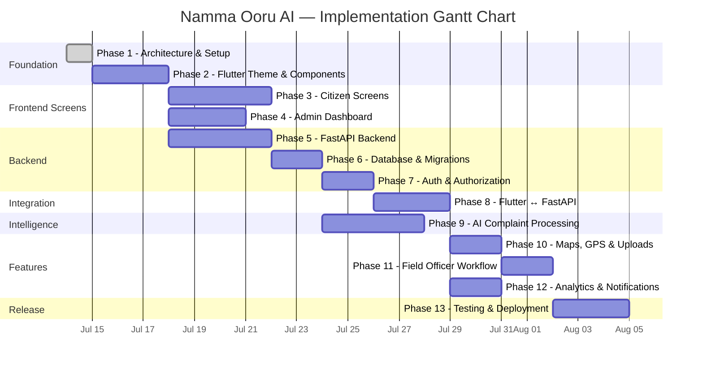
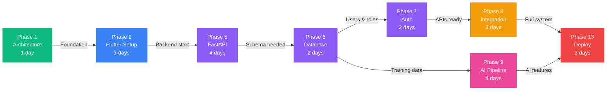
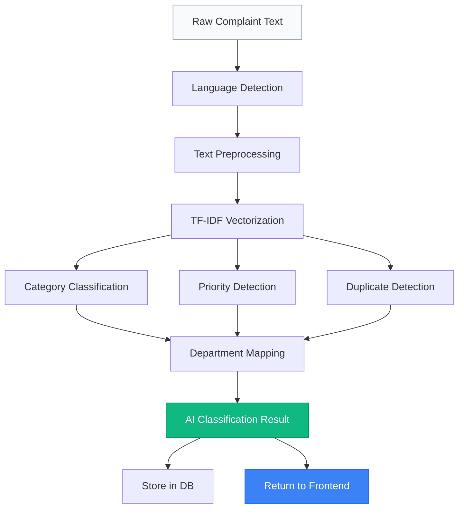
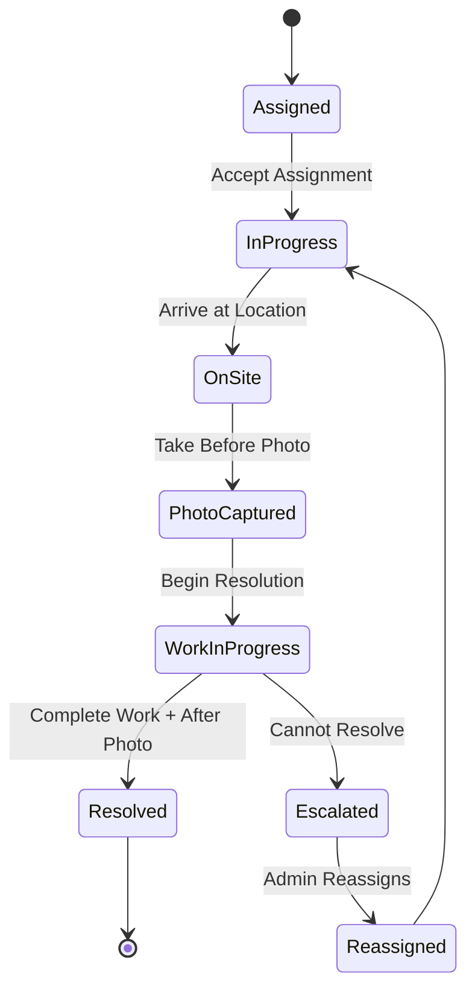

# Implementation Roadmap — Namma Ooru AI

> **Document Version**: 1.0
> **Last Updated**: 2025-07-14
> **Status**: Active — Phase 1 In Progress

---

## Table of Contents

1. [Overview](#overview)
2. [Timeline Visualization](#timeline-visualization)
3. [Critical Path](#critical-path)
4. [Phase Details](#phase-details)
   - [Phase 1: Project Setup & Architecture](#phase-1-project-setup--architecture)
   - [Phase 2: Flutter Project, Theme & Reusable Components](#phase-2-flutter-project-theme--reusable-components)
   - [Phase 3: Citizen Application Screens](#phase-3-citizen-application-screens)
   - [Phase 4: Admin Dashboard](#phase-4-admin-dashboard)
   - [Phase 5: FastAPI Backend](#phase-5-fastapi-backend)
   - [Phase 6: PostgreSQL Database & Migrations](#phase-6-postgresql-database--migrations)
   - [Phase 7: Authentication & Authorization](#phase-7-authentication--authorization)
   - [Phase 8: Connect Flutter & FastAPI](#phase-8-connect-flutter--fastapi)
   - [Phase 9: AI Complaint Processing](#phase-9-ai-complaint-processing)
   - [Phase 10: Maps, GPS & Image Uploads](#phase-10-maps-gps--image-uploads)
   - [Phase 11: Field Officer Workflow](#phase-11-field-officer-workflow)
   - [Phase 12: Analytics & Notifications](#phase-12-analytics--notifications)
   - [Phase 13: Testing, Optimization & Deployment](#phase-13-testing-optimization--deployment)
5. [Timeline Summary](#timeline-summary)
6. [Risk-Adjusted Schedule](#risk-adjusted-schedule)
7. [Definition of Done](#definition-of-done)

---

## Overview

This document defines the complete implementation roadmap for **Namma Ooru AI** — an AI-powered civic complaint management platform. The project is structured into **13 sequential and partially parallelizable phases**, spanning approximately **26–35 working days**.

The roadmap follows a **foundation-first** strategy:

1. **Architecture & Design** → lock down the technical blueprint
2. **UI Shell & Design System** → build the visual foundation
3. **Screens & Backend** → construct features in parallel where possible
4. **Integration & AI** → wire everything together with intelligence
5. **Polish & Deploy** → test, optimize, and ship

> [!IMPORTANT]
> All phase durations are estimates for a single developer. Parallel phases (3 & 4, parts of 5 & 9) can reduce total calendar time with additional contributors.

---

## Timeline Visualization



---

## Critical Path

The **critical path** determines the minimum possible project duration. Any delay on these phases directly delays the final delivery.



> [!WARNING]
> **Critical path length: ~22 days minimum.** Phases 3, 4, 11, and 12 are off the critical path and have schedule float. Focus resources on critical-path phases first.

---

## Phase Details

---

### Phase 1: Project Setup & Architecture

| Attribute | Value |
|-----------|-------|
| **Duration** | 1 day |
| **Prerequisites** | None |
| **Status** | ✅ Complete |

#### Checklist

- [x] Workspace inspection and project structure planning
- [x] System architecture document (`01_system_architecture.md`)
- [x] Flutter architecture document (`02_flutter_architecture.md`)
- [x] Backend architecture document (`03_backend_architecture.md`)
- [x] Database ER design (`04_database_er_design.md`)
- [x] API specification (`05_api_specification.md`)
- [x] UI/UX plan (`06_ui_ux_plan.md`)
- [x] Implementation roadmap (`07_implementation_roadmap.md`)

#### Deliverables

| Deliverable | Location |
|-------------|----------|
| Architecture documents | `docs/architecture/` |

---

### Phase 2: Flutter Project, Theme & Reusable Components

| Attribute | Value |
|-----------|-------|
| **Duration** | 2–3 days |
| **Prerequisites** | Flutter SDK installed |
| **Depends On** | Phase 1 |

#### Task Breakdown

##### 2.1 — Project Initialization (0.5 day)

| # | Task | Priority |
|---|------|----------|
| 1 | Create Flutter project with proper directory structure | 🔴 Critical |
| 2 | Configure `pubspec.yaml` with all dependencies | 🔴 Critical |
| 3 | Set up analysis options and linting rules | 🟡 High |

**Dependencies to configure in `pubspec.yaml`:**

```yaml
# State Management
- flutter_riverpod, riverpod_annotation, riverpod_generator

# Routing
- go_router

# Networking
- dio

# Code Generation
- freezed, freezed_annotation, json_annotation, json_serializable

# Security
- flutter_secure_storage

# Maps
- flutter_map, latlong2

# Media
- image_picker, camera

# Audio
- record

# Charts
- fl_chart

# UI Utilities
- shimmer, cached_network_image, google_fonts (Inter, Noto Sans Tamil)

# Platform Services
- intl, permission_handler, geolocator, url_launcher
```

##### 2.2 — Design System (0.5 day)

| # | Task | File | Priority |
|---|------|------|----------|
| 1 | Color palette (primary, secondary, semantic, neutral) | `app_colors.dart` | 🔴 Critical |
| 2 | Light + Dark ThemeData configuration | `app_theme.dart` | 🔴 Critical |
| 3 | Typography scale (Inter + Noto Sans Tamil) | `app_typography.dart` | 🔴 Critical |
| 4 | Spacing constants and grid system | `app_spacing.dart` | 🟡 High |

##### 2.3 — Shared Widgets Library (1 day)

| # | Widget | Variants / Notes |
|---|--------|-----------------|
| 1 | `AppButton` | Primary, secondary, outlined, text, loading state |
| 2 | `AppTextField` | Validation, prefixes, suffixes, error display |
| 3 | `AppSearchBar` | Debounced input, clear button, filter chips |
| 4 | `LoadingSkeleton` | Configurable shapes: card, list item, circle |
| 5 | `EmptyState` | Icon, title, subtitle, action button |
| 6 | `ErrorState` | Error message, retry callback |
| 7 | `StatusBadge` | Complaint status colors and labels |
| 8 | `PriorityIndicator` | Critical, high, medium, low visual indicators |
| 9 | `ComplaintCard` | Thumbnail, title, status, priority, timestamp |
| 10 | `MetricCard` | Value, label, trend indicator, icon |
| 11 | `AppDialog` | Confirm, alert, and custom content variants |
| 12 | `AppBottomSheet` | Scrollable content, drag handle |
| 13 | `ConfirmationScreen` | Success animation, action buttons |
| 14 | `ResponsiveScaffold` | Breakpoints for mobile/tablet/desktop |
| 15 | `AdaptiveNavigation` | BottomNav on mobile, side rail/drawer on larger |

##### 2.4 — Infrastructure (0.5 day)

| # | Task | Priority |
|---|------|----------|
| 1 | Configure GoRouter with full route tree | 🔴 Critical |
| 2 | Set up Dio client with base URL, interceptors, logging | 🔴 Critical |
| 3 | Set up Riverpod providers architecture | 🔴 Critical |
| 4 | Configure localization for English (`en`) and Tamil (`ta`) | 🟡 High |

#### Deliverables

| Deliverable | Validation |
|-------------|------------|
| Running Flutter app with themed shell | `flutter run` succeeds |
| All shared widgets rendering | Widget gallery screen |
| Routing skeleton navigable | All route paths reachable |

#### Tests

- Widget tests for every shared component
- Theme consistency tests (light/dark)
- Localization key coverage tests

---

### Phase 3: Citizen Application Screens

| Attribute | Value |
|-----------|-------|
| **Duration** | 3–4 days |
| **Prerequisites** | Phase 2 complete |
| **Parallelizable** | Yes — with Phases 4, 5 |

#### Task Breakdown

##### 3.1 — Onboarding Flow (0.5 day)

| # | Screen | Key Features |
|---|--------|-------------|
| 1 | Splash screen | App logo, auto-navigation logic (check auth state) |
| 2 | Onboarding screens | 3-page swipeable, illustrations, skip button |
| 3 | Language selection | Tamil / English toggle, persisted preference |

##### 3.2 — Authentication (0.5 day)

| # | Screen | Key Features |
|---|--------|-------------|
| 4 | Login screen | Phone/email input, form validation, forgot password |
| 5 | Registration screen | Full form with validation, terms acceptance |
| 6 | OTP verification | 6-digit input, countdown timer, resend logic |

##### 3.3 — Home & Navigation (0.5 day)

| # | Screen | Key Features |
|---|--------|-------------|
| 7 | Citizen home dashboard | Greeting header, quick actions, active complaints summary, recent complaints list, nearby issues mini map, announcements banner |
| 8 | Bottom navigation shell | 5 tabs: Home, My Complaints, Map, Notifications, Profile |

##### 3.4 — AI Complaint Submission (1 day)

| # | Screen | Key Features |
|---|--------|-------------|
| 9 | AI complaint assistant | Chat-like conversational UI for guided complaint entry |
| 10 | Complaint form (text) | Category, title, description, location, attachments |
| 11 | Voice recording interface | Record, playback, re-record, duration display |
| 12 | Image attachment picker | Camera capture, gallery selection, multi-image, preview |
| 13 | Location confirmation map | Draggable pin, address display, confirm button |
| 14 | AI classification preview | Predicted category, priority, confidence score, edit option |
| 15 | Submission confirmation | Success animation, complaint ID, tracking info |

##### 3.5 — Complaint Tracking (0.5 day)

| # | Screen | Key Features |
|---|--------|-------------|
| 16 | Complaint tracking list | Filter/sort, search, status tabs, pull-to-refresh |
| 17 | Complaint detail | Full info, status timeline, assigned officer, photos, updates |
| 18 | Complaint history | Chronological log of all status changes |

##### 3.6 — Supporting Screens (0.5 day)

| # | Screen | Key Features |
|---|--------|-------------|
| 19 | Notifications list | Grouped by date, read/unread, swipe to dismiss |
| 20 | Nearby issues map (full) | Clustered markers, category filters, complaint popups |
| 21 | Profile screen | User info, avatar, complaint stats |
| 22 | Settings screen | Language, notifications, theme, data management |
| 23 | Help & support | FAQ, contact info, feedback form |

#### Deliverables

| Deliverable | Validation |
|-------------|------------|
| All 23 citizen screens built | Navigate every screen with mock data |
| Mock data layer | Realistic sample complaints, users, notifications |

#### Tests

- Widget tests for home dashboard, complaint form, detail screen
- Navigation flow tests (onboarding → login → home → submit → confirm)
- Form validation tests

---

### Phase 4: Admin Dashboard

| Attribute | Value |
|-----------|-------|
| **Duration** | 2–3 days |
| **Prerequisites** | Phase 2 complete |
| **Parallelizable** | Yes — with Phase 3 |

#### Task Breakdown

##### 4.1 — Dashboard Shell (0.5 day)

| # | Screen | Key Features |
|---|--------|-------------|
| 1 | Admin shell | Collapsible sidebar, breadcrumbs, top bar with notifications |

##### 4.2 — Overview & Charts (0.5 day)

| # | Screen | Key Features |
|---|--------|-------------|
| 2 | Overview dashboard | Metric cards (total, pending, resolved, avg time) |
| 3 | Complaint trend chart | Line chart with date range filter (fl_chart) |
| 4 | Category distribution | Pie/donut chart with legend |
| 5 | Department performance | Grouped bar chart |

##### 4.3 — Complaint Management (0.5 day)

| # | Screen | Key Features |
|---|--------|-------------|
| 6 | All complaints table | Sortable columns, search, filters, pagination |
| 7 | Pending complaints view | Priority-sorted, quick assign action |

##### 4.4 — Resource Management (0.5 day)

| # | Screen | Key Features |
|---|--------|-------------|
| 8 | Department management | CRUD operations, department head assignment |
| 9 | Field officer management | List, assign to department, performance stats |

##### 4.5 — Map & Intelligence (0.5 day)

| # | Screen | Key Features |
|---|--------|-------------|
| 10 | Live issue map | Heatmap overlay, real-time markers, zone boundaries |
| 11 | AI insights | Classification accuracy, trending categories, predictions |

##### 4.6 — Administration (0.5 day)

| # | Screen | Key Features |
|---|--------|-------------|
| 12 | Analytics & reports | Exportable reports, date range filtering |
| 13 | Announcements management | Create, edit, schedule, target audience |
| 14 | User management table | Search, filter by role, activate/deactivate |
| 15 | Audit logs viewer | Filterable action log, user attribution |
| 16 | Admin settings | System configuration, feature flags |

#### Deliverables

| Deliverable | Validation |
|-------------|------------|
| Full admin dashboard | All 16 screens rendered with mock data |
| Responsive layout | Works on tablet and desktop breakpoints |

#### Tests

- Widget tests for metric cards, chart components, data tables
- Layout tests at multiple screen sizes

---

### Phase 5: FastAPI Backend

| Attribute | Value |
|-----------|-------|
| **Duration** | 3–4 days |
| **Prerequisites** | Python 3.15, pip |
| **Depends On** | Phase 1 (architecture docs) |

#### Task Breakdown

##### 5.1 — Project Bootstrap (0.5 day)

| # | Task | Priority |
|---|------|----------|
| 1 | Project directory structure setup | 🔴 Critical |
| 2 | FastAPI app initialization with lifespan | 🔴 Critical |
| 3 | Configuration management (Pydantic Settings, `.env`) | 🔴 Critical |

##### 5.2 — Core Utilities (0.5 day)

| # | Task | Priority |
|---|------|----------|
| 4 | Security utilities (password hashing, JWT helpers) | 🔴 Critical |
| 5 | Dependency injection functions | 🔴 Critical |
| 6 | Custom exception classes and handlers | 🟡 High |

##### 5.3 — Schemas (0.5 day)

| # | Task | Priority |
|---|------|----------|
| 7 | All Pydantic request/response schemas | 🔴 Critical |

Schemas include: `UserCreate`, `UserResponse`, `TokenPair`, `ComplaintCreate`, `ComplaintResponse`, `ComplaintUpdate`, `StatusUpdate`, `DepartmentSchema`, `OfficerSchema`, `NotificationSchema`, `AnnouncementSchema`, `AIClassificationResult`, `MapQueryParams`, `PaginatedResponse`, `ErrorResponse`.

##### 5.4 — API Routes (1.5 days)

| # | Route Module | Endpoints | Priority |
|---|-------------|-----------|----------|
| 1 | Auth routes | `POST /login`, `POST /register`, `POST /refresh`, `POST /logout`, `POST /verify-otp` | 🔴 Critical |
| 2 | User routes | `GET /me`, `PUT /me`, `GET /users`, `GET /users/{id}` | 🔴 Critical |
| 3 | Complaint routes | `POST /`, `GET /`, `GET /{id}`, `PUT /{id}`, `PATCH /{id}/status`, `GET /my-complaints`, `GET /nearby` | 🔴 Critical |
| 4 | Upload routes | `POST /image`, `POST /audio`, `GET /files/{id}` | 🟡 High |
| 5 | AI routes | `POST /classify`, `POST /detect-duplicates`, `GET /insights` | 🟡 High |
| 6 | Admin routes | `GET /dashboard`, `GET /analytics`, `GET /audit-logs` | 🟡 High |
| 7 | Officer routes | `GET /assignments`, `PATCH /assignments/{id}`, `POST /assignments/{id}/update` | 🟡 High |
| 8 | Map routes | `GET /complaints`, `GET /heatmap`, `GET /zones` | 🟢 Medium |
| 9 | Notification routes | `GET /`, `PATCH /{id}/read`, `POST /push` | 🟢 Medium |
| 10 | Announcement routes | `GET /`, `POST /`, `PUT /{id}`, `DELETE /{id}` | 🟢 Medium |

##### 5.5 — Middleware & Docs (0.5 day)

| # | Task | Priority |
|---|------|----------|
| 8 | CORS middleware configuration | 🔴 Critical |
| 9 | Rate limiting middleware | 🟡 High |
| 10 | Global error handling middleware | 🔴 Critical |
| 11 | Request/response validation | 🔴 Critical |
| 12 | OpenAPI documentation customization | 🟢 Medium |

#### Deliverables

| Deliverable | Validation |
|-------------|------------|
| Running FastAPI server | `uvicorn` starts, `/docs` accessible |
| All routes registered | Every endpoint returns stub responses |
| OpenAPI spec | Auto-generated and browsable at `/docs` |

#### Tests

- Route registration tests (all endpoints reachable)
- Schema validation tests (valid/invalid payloads)
- Middleware tests (CORS headers, rate limiting)

---

### Phase 6: PostgreSQL Database & Migrations

| Attribute | Value |
|-----------|-------|
| **Duration** | 2 days |
| **Prerequisites** | PostgreSQL installed (SQLite fallback for dev) |
| **Depends On** | Phase 5 |

#### Task Breakdown

##### 6.1 — Models & Session (1 day)

| # | Task | Priority |
|---|------|----------|
| 1 | SQLAlchemy 2.0 model definitions (all tables per ER design) | 🔴 Critical |
| 2 | Async database session management (`AsyncSession`) | 🔴 Critical |
| 3 | Database indexes and constraints | 🟡 High |

**Models to define:**

| Model | Key Fields |
|-------|-----------|
| `User` | id, phone, email, name, role, ward, hashed_password, is_active |
| `Complaint` | id, title, description, category, priority, status, location, reporter_id |
| `ComplaintMedia` | id, complaint_id, file_url, media_type |
| `StatusHistory` | id, complaint_id, old_status, new_status, changed_by, notes |
| `Department` | id, name, description, head_officer_id |
| `Assignment` | id, complaint_id, officer_id, department_id, status |
| `Notification` | id, user_id, title, body, type, is_read |
| `Announcement` | id, title, content, target_audience, publish_at |
| `AuditLog` | id, user_id, action, resource_type, resource_id, timestamp |
| `AIClassification` | id, complaint_id, predicted_category, confidence, model_version |

##### 6.2 — Migrations & Seed Data (0.5 day)

| # | Task | Priority |
|---|------|----------|
| 4 | Alembic configuration | 🔴 Critical |
| 5 | Initial migration file | 🔴 Critical |
| 6 | Seed data script (departments, default admin, sample zones) | 🟡 High |

##### 6.3 — Repository Layer (0.5 day)

| # | Task | Priority |
|---|------|----------|
| 7 | Base repository with common CRUD operations | 🔴 Critical |
| 8 | Entity-specific repositories (User, Complaint, Department, etc.) | 🔴 Critical |

#### Deliverables

| Deliverable | Validation |
|-------------|------------|
| All database tables created | `alembic upgrade head` succeeds |
| Seed data loaded | Default admin, departments exist |
| Repository layer functional | CRUD operations work end-to-end |

#### Tests

- Model relationship tests
- Repository CRUD tests
- Migration up/down tests

---

### Phase 7: Authentication & Authorization

| Attribute | Value |
|-----------|-------|
| **Duration** | 2 days |
| **Prerequisites** | Phases 5, 6 |
| **Depends On** | Phase 6 (user model, repositories) |

#### Task Breakdown

##### 7.1 — Token Management (0.5 day)

| # | Task | Priority |
|---|------|----------|
| 1 | Password hashing with bcrypt | 🔴 Critical |
| 2 | JWT access token creation and validation | 🔴 Critical |
| 3 | Refresh token rotation and secure storage | 🔴 Critical |

##### 7.2 — Auth Services (0.5 day)

| # | Task | Priority |
|---|------|----------|
| 4 | Login service (validate credentials → issue tokens) | 🔴 Critical |
| 5 | Register service (create user → issue tokens) | 🔴 Critical |
| 6 | Refresh service (rotate tokens) | 🔴 Critical |
| 7 | Logout service (invalidate refresh token) | 🟡 High |

##### 7.3 — Middleware & Guards (0.5 day)

| # | Task | Priority |
|---|------|----------|
| 8 | `get_current_user` dependency (decode JWT → fetch user) | 🔴 Critical |
| 9 | `require_role` dependency/decorator (citizen, officer, admin) | 🔴 Critical |
| 10 | OTP verification flow (mock SMS in dev) | 🟡 High |

##### 7.4 — Auditing (0.5 day)

| # | Task | Priority |
|---|------|----------|
| 11 | Audit logging for all auth events | 🟡 High |

#### Deliverables

| Deliverable | Validation |
|-------------|------------|
| Working auth system | Register → Login → Access protected route → Refresh → Logout |
| Role-based access | Citizen cannot access admin routes, admin can access all |

#### Tests

- Auth flow integration tests (register, login, refresh, logout)
- Role-based authorization tests (citizen, officer, admin)
- Token expiration and rotation tests
- Invalid token rejection tests

---

### Phase 8: Connect Flutter & FastAPI

| Attribute | Value |
|-----------|-------|
| **Duration** | 2–3 days |
| **Prerequisites** | Phases 3, 4, 5, 6, 7 |
| **Depends On** | All frontend and backend phases |

> [!IMPORTANT]
> This is the **integration phase** — the first time the full stack operates together. Expect to uncover interface mismatches. Budget extra time for debugging.

#### Task Breakdown

##### 8.1 — Network Layer (0.5 day)

| # | Task | Priority |
|---|------|----------|
| 1 | Dio client configuration pointing to FastAPI base URL | 🔴 Critical |
| 2 | Auth interceptor (attach token, handle 401 → refresh) | 🔴 Critical |
| 3 | Error handling interceptor (parse API errors → UI errors) | 🔴 Critical |

##### 8.2 — Data Providers (1 day)

| # | Task | Priority |
|---|------|----------|
| 4 | Auth repository + Riverpod provider (real API) | 🔴 Critical |
| 5 | Complaint repository + provider (real API) | 🔴 Critical |
| 6 | Admin dashboard data providers (real API) | 🟡 High |
| 7 | Notification providers (real API) | 🟡 High |

##### 8.3 — Migration & Resilience (1 day)

| # | Task | Priority |
|---|------|----------|
| 8 | Remove all mock data references | 🔴 Critical |
| 9 | Connect all screens to live providers | 🔴 Critical |
| 10 | Retry logic with exponential backoff | 🟡 High |
| 11 | Offline state handling (detect, cache, queue) | 🟡 High |

#### Deliverables

| Deliverable | Validation |
|-------------|------------|
| Flutter app connected to live backend | Login, submit complaint, view dashboard with real data |
| Error handling functional | Graceful errors for network failures, auth expiry |

#### Tests

- Integration tests for API communication
- Auth flow end-to-end tests
- Offline/online state transition tests

---

### Phase 9: AI Complaint Processing

| Attribute | Value |
|-----------|-------|
| **Duration** | 3–4 days |
| **Prerequisites** | Phase 6 (database for training data) |
| **Parallelizable** | Partially with Phase 8 |

#### Task Breakdown

##### 9.1 — Language & Text Processing (0.5 day)

| # | Task | Priority |
|---|------|----------|
| 1 | Language detection (langdetect + Tamil Unicode range check) | 🔴 Critical |
| 2 | Text preprocessing (tokenization, normalization, Tamil handling) | 🔴 Critical |

##### 9.2 — Classification Pipeline (1.5 days)

| # | Task | Priority |
|---|------|----------|
| 3 | Training data preparation (synthetic civic complaint corpus) | 🔴 Critical |
| 4 | Category classifier (TF-IDF + LogisticRegression) | 🔴 Critical |
| 5 | Priority detection (heuristic + keyword scoring) | 🔴 Critical |
| 6 | Department recommendation mapping (category → department) | 🟡 High |

##### 9.3 — Advanced AI Features (1 day)

| # | Task | Priority |
|---|------|----------|
| 7 | Duplicate detection (sentence embeddings + cosine similarity) | 🟡 High |
| 8 | Complaint summarization (extractive summarization) | 🟢 Medium |
| 9 | Hotspot analysis (DBSCAN clustering on PostGIS data) | 🟢 Medium |

##### 9.4 — Integration & Evaluation (0.5 day)

| # | Task | Priority |
|---|------|----------|
| 10 | AI pipeline orchestrator (chain all stages) | 🔴 Critical |
| 11 | API route integration (`/ai/classify`, `/ai/detect-duplicates`) | 🔴 Critical |
| 12 | Model evaluation metrics (precision, recall, F1) | 🟡 High |

#### AI Pipeline Flow



#### Deliverables

| Deliverable | Validation |
|-------------|------------|
| Working AI pipeline | Classify → Prioritize → Map Department |
| Duplicate detection | Identify similar complaints above threshold |
| Measurable accuracy | F1 score > 0.75 on test set |

#### Tests

- Classification accuracy tests against held-out test set
- Pipeline integration tests (input → output contract)
- Edge case tests (empty text, mixed language, very short input)

---

### Phase 10: Maps, GPS & Image Uploads

| Attribute | Value |
|-----------|-------|
| **Duration** | 2 days |
| **Prerequisites** | Phases 8, 9 |
| **Depends On** | Integration complete, AI available |

#### Task Breakdown

##### 10.1 — Map Features (1 day)

| # | Task | Priority |
|---|------|----------|
| 1 | flutter_map integration with OpenStreetMap tiles | 🔴 Critical |
| 2 | GPS location capture with permission handling | 🔴 Critical |
| 3 | Reverse geocoding via Nominatim | 🟡 High |
| 4 | Complaint markers on map | 🔴 Critical |
| 5 | Marker clustering for dense areas | 🟡 High |
| 6 | Map filters (by category, status, date range) | 🟢 Medium |

##### 10.2 — File Uploads (1 day)

| # | Task | Priority |
|---|------|----------|
| 7 | Image upload to object storage (MinIO / local fallback) | 🔴 Critical |
| 8 | Image compression before upload (reduce bandwidth) | 🟡 High |
| 9 | Secure file access via presigned URLs | 🟡 High |
| 10 | Before/after photo support for field officers | 🟢 Medium |

#### Deliverables

| Deliverable | Validation |
|-------------|------------|
| Map with complaint markers | Tap marker → see complaint info |
| GPS-based location tagging | Pin auto-placed at current location |
| Image upload pipeline | Capture → compress → upload → display |

#### Tests

- Location permission handling tests
- Upload validation tests (file size, format)
- Map marker rendering tests

---

### Phase 11: Field Officer Workflow

| Attribute | Value |
|-----------|-------|
| **Duration** | 1–2 days |
| **Prerequisites** | Phases 8, 10 |
| **Depends On** | Integration + maps/uploads |

#### Task Breakdown

| # | Task | Priority |
|---|------|----------|
| 1 | Officer home screen with real assignment data | 🔴 Critical |
| 2 | Assignment list from API (grouped by status) | 🔴 Critical |
| 3 | Assignment detail with map navigation (deep link to maps app) | 🔴 Critical |
| 4 | Progress update submission (status + notes) | 🔴 Critical |
| 5 | Photo capture (before/after with timestamps) | 🟡 High |
| 6 | Resolution notes (text entry + photo evidence) | 🟡 High |
| 7 | Completion workflow (mark resolved → citizen notified) | 🔴 Critical |
| 8 | Activity history (officer's completed assignments) | 🟢 Medium |

#### Officer Workflow State Machine



#### Deliverables

| Deliverable | Validation |
|-------------|------------|
| Full field officer workflow | Assign → Accept → Navigate → Update → Resolve |
| Photo evidence pipeline | Before/after photos attached to resolution |

#### Tests

- Assignment acceptance flow tests
- Status transition tests (valid and invalid transitions)
- Photo upload tests within officer workflow

---

### Phase 12: Analytics & Notifications

| Attribute | Value |
|-----------|-------|
| **Duration** | 2 days |
| **Prerequisites** | Phases 8, 9 |
| **Parallelizable** | Yes — with Phases 10, 11 |

#### Task Breakdown

##### 12.1 — Analytics (1 day)

| # | Task | Priority |
|---|------|----------|
| 1 | Admin analytics API with real database queries | 🔴 Critical |
| 2 | Chart rendering with real-time data | 🔴 Critical |
| 3 | Department performance calculations (resolution time, volume) | 🟡 High |
| 4 | Zone/ward statistics (complaints per ward, trending areas) | 🟡 High |

##### 12.2 — Notifications (1 day)

| # | Task | Priority |
|---|------|----------|
| 5 | Firebase Cloud Messaging setup (or mock in dev) | 🟡 High |
| 6 | Push notification sending (status updates, assignments) | 🟡 High |
| 7 | In-app notification delivery and badge counts | 🔴 Critical |
| 8 | Email notification via SMTP (configurable, optional) | 🟢 Medium |
| 9 | User notification preferences (channels, frequency) | 🟢 Medium |

#### Deliverables

| Deliverable | Validation |
|-------------|------------|
| Real-time analytics dashboard | Charts reflect actual database state |
| Notification system | Status change → citizen receives notification |

#### Tests

- Analytics query correctness tests
- Notification delivery tests (in-app, push, email)
- Notification preference filtering tests

---

### Phase 13: Testing, Optimization & Deployment

| Attribute | Value |
|-----------|-------|
| **Duration** | 2–3 days |
| **Prerequisites** | All previous phases |
| **Depends On** | Phases 10, 11, 12 |

> [!CAUTION]
> Do not skip this phase. Production readiness requires thorough testing, security review, and proper deployment configuration.

#### Task Breakdown

##### 13.1 — Code Quality (0.5 day)

| # | Task | Priority |
|---|------|----------|
| 1 | `flutter analyze` — fix all warnings and errors | 🔴 Critical |
| 2 | `flutter test` — all tests pass | 🔴 Critical |
| 3 | `pytest` — all backend tests pass | 🔴 Critical |

##### 13.2 — Audits (0.5 day)

| # | Task | Priority |
|---|------|----------|
| 4 | Performance audit (identify and fix bottlenecks) | 🟡 High |
| 5 | Security audit (injection, auth bypass, data exposure) | 🔴 Critical |
| 6 | Accessibility review (screen reader, contrast, tap targets) | 🟡 High |

##### 13.3 — Containerization (0.5 day)

| # | Task | Priority |
|---|------|----------|
| 7 | Docker Compose setup (FastAPI + PostgreSQL + MinIO + Redis) | 🔴 Critical |
| 8 | Dockerfile for backend (multi-stage build) | 🔴 Critical |

##### 13.4 — Build & Release (0.5 day)

| # | Task | Priority |
|---|------|----------|
| 9 | Build Flutter Web (`flutter build web`) | 🔴 Critical |
| 10 | Build Android APK (`flutter build apk`) | 🟡 High |
| 11 | iOS build check (report availability) | 🟢 Medium |

##### 13.5 — Documentation (0.5 day)

| # | Task | Priority |
|---|------|----------|
| 12 | `README.md` — comprehensive project documentation | 🔴 Critical |
| 13 | Deployment documentation (step-by-step guide) | 🔴 Critical |
| 14 | Demo data seeding (realistic sample data for demo) | 🟡 High |

#### Deliverables

| Deliverable | Validation |
|-------------|------------|
| All tests passing | `flutter test` and `pytest` green |
| Docker deployment | `docker-compose up` starts entire stack |
| Production builds | Web and Android builds generated |
| Complete documentation | README, deployment guide, architecture docs |

---

## Timeline Summary

| Phase | Name | Duration | Dependencies | Parallelizable |
|-------|------|----------|-------------|----------------|
| **1** | Architecture & Setup | 1 day | None | — |
| **2** | Flutter Theme & Components | 2–3 days | Flutter SDK | — |
| **3** | Citizen Screens | 3–4 days | Phase 2 | ✅ with Phase 4, 5 |
| **4** | Admin Dashboard | 2–3 days | Phase 2 | ✅ with Phase 3, 5 |
| **5** | FastAPI Backend | 3–4 days | Python | ✅ with Phase 3, 4 |
| **6** | Database & Migrations | 2 days | Phase 5 | — |
| **7** | Auth & Authorization | 2 days | Phases 5, 6 | — |
| **8** | Flutter ↔ FastAPI Integration | 2–3 days | Phases 3, 4, 5, 6, 7 | — |
| **9** | AI Complaint Processing | 3–4 days | Phase 6 | ✅ partial with Phase 8 |
| **10** | Maps, GPS & Uploads | 2 days | Phases 8, 9 | ✅ with Phase 12 |
| **11** | Field Officer Workflow | 1–2 days | Phases 8, 10 | ✅ with Phase 12 |
| **12** | Analytics & Notifications | 2 days | Phases 8, 9 | ✅ with Phase 10, 11 |
| **13** | Testing & Deployment | 2–3 days | All phases | — |
| | **Total (sequential)** | **~26–35 days** | | |
| | **Total (with parallelism)** | **~20–25 days** | | |

---

## Risk-Adjusted Schedule

| Scenario | Duration | Assumption |
|----------|----------|------------|
| **Optimistic** | 20 days | Parallel execution, no blockers, experienced developer |
| **Expected** | 28 days | Some parallel work, minor issues, single developer |
| **Pessimistic** | 35 days | Sequential execution, dependency issues, learning curve |

> [!TIP]
> **Highest-risk phases** that tend to slip:
> - **Phase 8 (Integration)** — interface mismatches between frontend and backend
> - **Phase 9 (AI)** — model accuracy may require iteration on training data
> - **Phase 13 (Deployment)** — environment-specific issues with Docker, build tools
>
> Budget 20–30% extra time for these phases.

---

## Definition of Done

A phase is considered **complete** when all of the following criteria are met:

| Criterion | Description |
|-----------|-------------|
| ✅ **Code Complete** | All tasks in the phase checklist are implemented |
| ✅ **Tests Passing** | All unit and integration tests for the phase pass |
| ✅ **No Regressions** | Existing tests from prior phases still pass |
| ✅ **Lint Clean** | No analyzer warnings or errors |
| ✅ **Documented** | Inline code documentation for all public APIs |
| ✅ **Reviewed** | Code has been self-reviewed for quality and security |
| ✅ **Demo-Ready** | Feature can be demonstrated end-to-end |

---

> **Next Step**: Begin **Phase 2** — create the Flutter project, implement the design system, and build the shared widget library.
