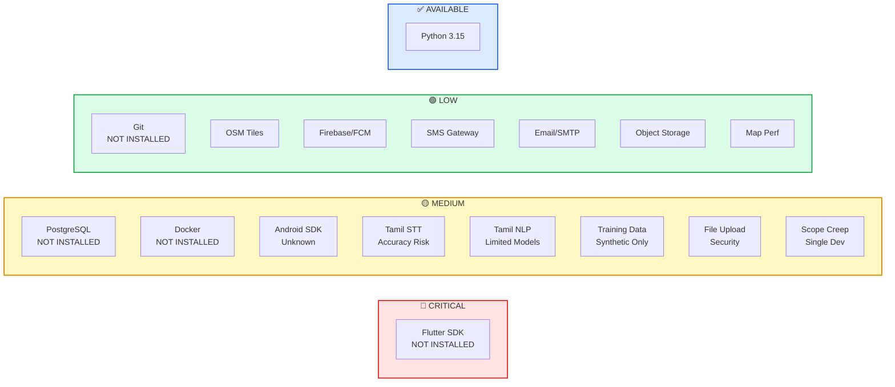
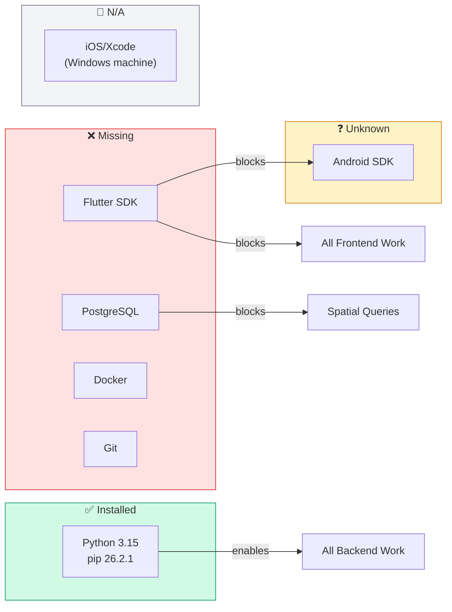
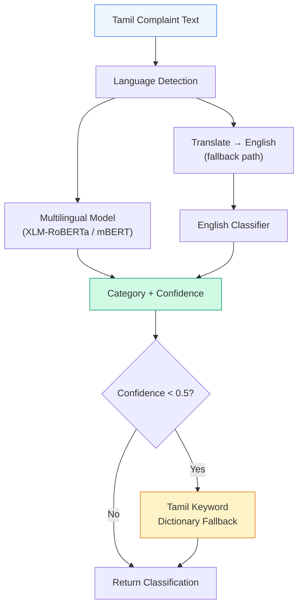
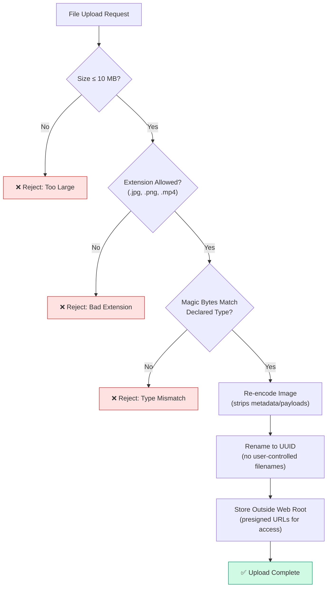
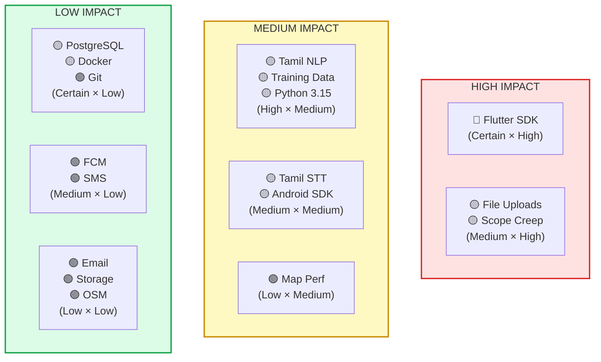

# Risk & Dependency Report — Namma Ooru AI

> **Document**: `08_risk_dependency_report.md`
> **Project**: Namma Ooru AI — AI-Powered Civic Complaint Platform
> **Generated**: 2025-07-14
> **Classification**: Internal / Engineering

---

## Table of Contents

1. [Executive Summary](#1-executive-summary)
2. [Environment Dependencies](#2-environment-dependencies)
3. [External Service Dependencies](#3-external-service-dependencies)
4. [AI/ML Risks](#4-aiml-risks)
5. [Security Risks](#5-security-risks)
6. [Performance Risks](#6-performance-risks)
7. [Development Risks](#7-development-risks)
8. [Dependency Version Risks](#8-dependency-version-risks)
9. [Risk Matrix](#9-risk-matrix)
10. [Recommended Immediate Actions](#10-recommended-immediate-actions)
11. [Deferred Features](#11-deferred-features-nice-to-have)

---

## 1. Executive Summary

This report catalogs every known risk, external dependency, and environmental prerequisite for the Namma Ooru AI platform. Each item is assigned a **risk level** (CRITICAL / HIGH / MEDIUM / LOW) based on the probability of occurrence and the severity of impact on delivery. The goal is to surface blockers early and define concrete mitigations so the project can proceed with eyes open.

> [!CAUTION]
> **Flutter SDK is not installed.** This is the single highest-priority blocker. All mobile and web frontend work is gated on its installation. Backend work (Python) **can** proceed immediately.

---

## 2. Environment Dependencies

### 2.1 Flutter SDK — 🔴 CRITICAL

| Attribute | Detail |
|-----------|--------|
| **Status** | ❌ NOT INSTALLED on current machine |
| **Impact** | Cannot create Flutter project, run widget tests, or build any app target |
| **Disk Space** | ~1.5 GB for SDK + platform tools |
| **Download** | [flutter.dev/docs/get-started/install/windows](https://docs.flutter.dev/get-started/install/windows) |
| **Risk Level** | **HIGH** — blocks all Phase 2+ frontend work |

**Mitigation**:
1. Install Flutter SDK before Phase 2 begins.
2. Run `flutter doctor` to validate the toolchain.
3. Ensure `flutter` is on the system `PATH`.

---

### 2.2 Python 3.15 — ✅ AVAILABLE

| Attribute | Detail |
|-----------|--------|
| **Status** | ✅ Installed |
| **Location** | `C:\Users\SAN\AppData\Local\Python\pythoncore-3.15-64\python.exe` |
| **pip** | Available — v26.2.1 |
| **Impact** | Backend work **can proceed immediately** |
| **Risk Level** | **NONE** |

> [!TIP]
> Python is ready. Backend scaffolding, API design, and AI model training can all begin now while the Flutter SDK installation is pending.

---

### 2.3 PostgreSQL — 🟡 MEDIUM

| Attribute | Detail |
|-----------|--------|
| **Status** | ❌ Not detected |
| **Impact** | Cannot run the production database stack with PostGIS spatial extensions |
| **Risk Level** | **MEDIUM** — can use SQLite fallback for development |

**Mitigation Options** (choose one for development):

| Option | Pros | Cons |
|--------|------|------|
| **SQLite + aiosqlite** | Zero install, fast dev loop | No PostGIS, limited spatial queries |
| **PostgreSQL native install** | Full feature parity with production | Manual setup, ~300 MB |
| **Docker (PostgreSQL + PostGIS)** | Identical to production | Requires Docker Desktop |

**Recommended**: Use SQLite for Phase 1–3 backend development. Defer PostgreSQL installation until spatial queries are actively needed (Phase 6+). Design the repository layer with a clean abstraction so the switch is transparent.

---

### 2.4 Docker — 🟡 MEDIUM

| Attribute | Detail |
|-----------|--------|
| **Status** | ❌ Not detected |
| **Impact** | Cannot run Docker Compose for local infrastructure (PostgreSQL, MinIO, Redis) |
| **Risk Level** | **MEDIUM** — not blocking development, affects deployment testing |

**Mitigation**:
- Install Docker Desktop for Windows (requires WSL2 or Hyper-V).
- Alternatively, install PostgreSQL, MinIO, and Redis natively.
- Docker is **optional** for development but **recommended** for production parity.

---

### 2.5 Git — 🟢 LOW

| Attribute | Detail |
|-----------|--------|
| **Status** | ❌ Not detected |
| **Impact** | No version control for the codebase |
| **Risk Level** | **LOW** — does not block development, but critical for production |

**Mitigation**:
- Install [Git for Windows](https://git-scm.com/download/win).
- Initialize repository after installation (`git init`, `.gitignore` already planned).
- Code can be written without Git; history begins when Git is installed.

---

### 2.6 Android SDK — 🟡 MEDIUM

| Attribute | Detail |
|-----------|--------|
| **Status** | Unknown (Flutter not installed, so `flutter doctor` cannot report) |
| **Impact** | Cannot build Android APK or run Android emulator |
| **Risk Level** | **MEDIUM** — Flutter installer may bundle required components |

**Mitigation**:
- Install Android Studio (recommended) or standalone Android command-line tools.
- `flutter doctor` will identify missing components after Flutter is installed.
- Minimum API level: 21 (Android 5.0).

---

### 2.7 iOS / macOS — ℹ️ EXPECTED

| Attribute | Detail |
|-----------|--------|
| **Status** | Current machine is Windows — iOS builds are **not possible** |
| **Impact** | No iOS `.ipa` generation |
| **Risk Level** | **EXPECTED** — documented as a Windows platform limitation |

**Mitigation**:
- iOS builds require a macOS machine with Xcode 15+.
- Use CI/CD services (Codemagic, GitHub Actions with macOS runners) for iOS builds if needed.
- The Flutter codebase is fully cross-platform; no code changes needed for iOS.

---

### Environment Status Summary

---

## 3. External Service Dependencies

### 3.1 OpenStreetMap Tiles — 🟢 LOW

| Attribute | Detail |
|-----------|--------|
| **Status** | Free and publicly available, no API key required |
| **Risk** | Rate limiting on public tile servers; aggressive usage may result in bans |
| **Risk Level** | **LOW** |

**Mitigation**:
- Set a proper `User-Agent` header identifying the application.
- Respect the [OSM Tile Usage Policy](https://operations.osmfoundation.org/policies/tiles/).
- For production, consider self-hosted tile servers or paid providers (Mapbox, Stadia Maps).

---

### 3.2 Firebase Cloud Messaging (FCM) — 🟢 LOW

| Attribute | Detail |
|-----------|--------|
| **Status** | Requires Firebase project creation and API key configuration |
| **Impact** | No push notifications without configuration |
| **Risk Level** | **LOW** — graceful degradation to in-app notifications |

**Mitigation**:
- Mock notification service in development (log to console).
- FCM setup is optional; the notification service interface is abstracted.
- In-app notification inbox works without FCM.

---

### 3.3 Speech-to-Text (Tamil) — 🟡 MEDIUM

| Attribute | Detail |
|-----------|--------|
| **Status** | No free Tamil STT service with high accuracy |
| **Risk Level** | **MEDIUM** — Tamil accuracy may vary across providers and devices |

**Available Options**:

| Provider | Cost | Tamil Support | Notes |
|----------|------|--------------|-------|
| **Device-native** (`speech_to_text` plugin) | Free | Varies by device | Best first choice; most Android devices support Tamil |
| Google Cloud Speech-to-Text | Paid | ✅ Good | High accuracy, requires API key and billing |
| Azure Speech Services | Paid | ✅ Good | Alternative paid option |
| OpenAI Whisper | Open-source | ⚠️ Limited | Can run locally, Tamil accuracy is lower |

**Recommended**: Use the Flutter `speech_to_text` plugin for device-native recognition (free, supports Tamil on most modern Android devices). Provide manual text input as a universal fallback.

---

### 3.4 SMS Gateway — 🟢 LOW

| Attribute | Detail |
|-----------|--------|
| **Status** | Requires a paid service (Twilio, MSG91, TextLocal, etc.) |
| **Impact** | No SMS-based OTP verification without a provider |
| **Risk Level** | **LOW** — development works without it |

**Mitigation**:
- Use a **mock OTP provider** in development that accepts a fixed code (`123456`).
- Log OTP values to the server console for debugging.
- SMS provider is configured via environment variable; pluggable at deployment.

---

### 3.5 Email Service (SMTP) — 🟢 LOW

| Attribute | Detail |
|-----------|--------|
| **Status** | Requires SMTP credentials (Gmail, SendGrid, Mailgun, etc.) |
| **Risk Level** | **LOW** |

**Mitigation**:
- Use a **console email backend** in development (prints emails to stdout).
- SMTP credentials configured via environment variables.
- Email is not on the critical path for core functionality.

---

### 3.6 Object Storage (S3/MinIO) — 🟢 LOW

| Attribute | Detail |
|-----------|--------|
| **Status** | MinIO not installed; no S3 bucket configured |
| **Risk Level** | **LOW** — local filesystem fallback works for development |

**Mitigation**:
- Use **local filesystem storage** in development (`uploads/` directory).
- The storage service interface abstracts the backend (local ↔ S3 ↔ MinIO).
- Configure MinIO or S3 for staging/production via environment variables.

---

## 4. AI/ML Risks

### 4.1 Tamil NLP Models — 🟡 MEDIUM

| Attribute | Detail |
|-----------|--------|
| **Risk** | Limited pre-trained Tamil NLP models compared to English |
| **Impact** | Lower classification accuracy for Tamil-language complaints |
| **Risk Level** | **MEDIUM** |

**Mitigation Strategy** (layered approach):

1. **Primary**: Use multilingual models (XLM-RoBERTa, multilingual sentence-transformers) that natively support Tamil.
2. **Fallback**: Translate Tamil → English for classification, then map results back.
3. **Safety Net**: Tamil keyword dictionary for basic category matching when model confidence is low.
4. **Long-term**: Fine-tune models on real Tamil complaint data as it accumulates.

---

### 4.2 Training Data — 🟡 MEDIUM

| Attribute | Detail |
|-----------|--------|
| **Risk** | No real civic complaint dataset is publicly available |
| **Impact** | Models trained on synthetic data may not generalize well to real-world complaints |
| **Risk Level** | **MEDIUM** — synthetic data is a known and documented limitation |

**Mitigation**:

| Strategy | Description |
|----------|-------------|
| **Synthetic corpus** | Create 500+ examples per category (10 categories = 5,000+ total), covering Tamil, English, and Tanglish |
| **Transfer learning** | Fine-tune from pre-trained multilingual models rather than training from scratch |
| **Easy retraining** | Design the pipeline so retraining with real data is a single command |
| **Active learning** | Flag low-confidence predictions for human review; feed corrections back into training |
| **Data augmentation** | Paraphrase, synonym substitution, back-translation to increase diversity |

> [!IMPORTANT]
> All training data must be clearly labeled as synthetic in the model metadata. Classification responses must include the model version and data provenance so users and administrators understand the basis for predictions.

---

### 4.3 Model Size & Latency — 🟢 LOW

| Attribute | Detail |
|-----------|--------|
| **Risk** | Large transformer models (300MB+) may be slow on CPU-only servers |
| **Impact** | Slow classification response times (>2 seconds) |
| **Risk Level** | **LOW** — lightweight models are fast enough for the expected load |

**Model Options (by size and speed)**:

| Model | Size | Inference Time (CPU) | Accuracy |
|-------|------|---------------------|----------|
| TF-IDF + Logistic Regression | ~5 MB | <50 ms | Baseline (~85%) |
| Sentence Transformers (distilled) | ~80 MB | ~200 ms | Good (~92%) |
| XLM-RoBERTa (base) | ~1.1 GB | ~500 ms | Best (~95%) |

**Recommended**: Start with TF-IDF + LogisticRegression as a fast baseline. Upgrade to distilled sentence-transformers for production. Use async processing so classification does not block the API response.

---

### 4.4 Confidence Score Integrity — 🟢 LOW

| Attribute | Detail |
|-----------|--------|
| **Risk** | Confidence scores must be genuine, not fabricated |
| **Risk Level** | **LOW** — architecture enforces honest scoring |

**Safeguards**:
- Use `sklearn.predict_proba()` for real probability distributions.
- Heuristic scores (keyword-based) are clearly labeled with `method: "heuristic"` in the API response.
- Every classification response includes `model_version`, `method`, and `confidence_source`.
- No hardcoded confidence values anywhere in the codebase.

---

## 5. Security Risks

### 5.1 JWT Secret Management — 🟢 LOW

| Attribute | Detail |
|-----------|--------|
| **Risk** | Hardcoded JWT secrets in source code |
| **Risk Level** | **LOW** — enforced by architecture |

**Safeguards**:
- All secrets loaded from environment variables or `.env` files.
- `.env` is in `.gitignore` — never committed.
- `.env.example` provides templates with placeholder values.
- FastAPI `Settings` class validates that required secrets are present at startup.

---

### 5.2 File Upload Attacks — 🟡 MEDIUM

| Attribute | Detail |
|-----------|--------|
| **Risk** | Malicious file uploads: oversized files, wrong MIME types, embedded code, metadata exfiltration |
| **Risk Level** | **MEDIUM** — requires careful implementation |

**Defense-in-Depth Mitigation**:

| Layer | Control |
|-------|---------|
| **Size limit** | 10 MB maximum per file |
| **Extension whitelist** | `.jpg`, `.jpeg`, `.png`, `.webp`, `.mp4`, `.mov` |
| **Magic byte validation** | Verify file signature matches declared MIME type |
| **Image re-encoding** | Re-save images via Pillow to strip EXIF metadata and embedded payloads |
| **UUID filenames** | Never use user-supplied filenames; generate UUID-based names |
| **Storage isolation** | Files stored outside the web root; accessed only via presigned URLs |
| **Antivirus scan** | Optional ClamAV integration for production |

---

### 5.3 Rate Limiting Without Redis — 🟢 LOW

| Attribute | Detail |
|-----------|--------|
| **Risk** | In-memory rate limiting state resets on server restart |
| **Risk Level** | **LOW** |

**Mitigation**:
- Use `slowapi` (in-memory) for development — sufficient for single-process dev server.
- Switch to Redis-backed rate limiting for production (requires Redis).
- Rate limit configuration is environment-driven.

---

### 5.4 SQL Injection — 🟢 LOW

| Attribute | Detail |
|-----------|--------|
| **Risk** | Raw SQL queries could allow injection attacks |
| **Risk Level** | **LOW** — ORM prevents this by default |

**Safeguards**:
- All database queries go through SQLAlchemy ORM.
- No raw SQL without parameterized `text()` constructs.
- Input validation via Pydantic models before any data reaches the database layer.
- Code review checklist includes raw SQL prohibition.

---

## 6. Performance Risks

### 6.1 Map Rendering with Many Markers — 🟡 MEDIUM

| Attribute | Detail |
|-----------|--------|
| **Risk** | Rendering 10,000+ markers simultaneously will freeze the map UI |
| **Risk Level** | **MEDIUM** |

**Mitigation**:

| Strategy | Description |
|----------|-------------|
| **Server-side clustering** | Aggregate markers into clusters at the API level based on zoom level |
| **Viewport-based loading** | Only fetch markers visible in the current map viewport (bounding box query) |
| **Client-side clustering** | Use `flutter_map_marker_cluster` for additional client-side aggregation |
| **Progressive loading** | Load summary markers first, detail on zoom/tap |

---

### 6.2 Large Dataset Analytics — 🟢 LOW (at launch)

| Attribute | Detail |
|-----------|--------|
| **Risk** | Dashboard aggregate queries may be slow with millions of records |
| **Risk Level** | **LOW** for initial launch; increases as data grows |

**Mitigation**:
- Database indexes on all query filter columns (`status`, `category`, `ward_id`, `created_at`).
- Materialized views for pre-computed analytics (daily counts, category distributions).
- Pagination enforced on all list endpoints (max 100 items per page).
- Caching layer (in-memory or Redis) for expensive dashboard queries.

---

## 7. Development Risks

### 7.1 Workspace Path with Spaces — 🟢 LOW

| Attribute | Detail |
|-----------|--------|
| **Risk** | Project path `f:\namma ooru ai` contains spaces |
| **Impact** | Some CLI tools and scripts may break on unquoted paths |
| **Risk Level** | **LOW** |

**Mitigation**:
- Always quote paths in scripts and configuration files.
- Test all CLI commands with the actual project path.
- Use relative paths within the project where possible.

---

### 7.2 Single Developer Bandwidth — 🟡 MEDIUM

| Attribute | Detail |
|-----------|--------|
| **Risk** | The project scope (13 phases) is ambitious for a single developer / session |
| **Impact** | May not complete all phases; risk of incomplete features |
| **Risk Level** | **MEDIUM** |

**Mitigation**:
- **Phased delivery**: Each phase produces a working, testable deliverable.
- **Prioritized backlog**: Core features first (auth, complaints, AI classification, admin dashboard).
- **Deferrable features**: Email, SMS, push notifications, PDF export, advanced analytics can be deferred.
- **Working increments**: The application is usable after Phase 5, even if later phases are not complete.

```mermaid
flowchart LR
    P1["Phase 1\nProject Setup"] --> P2["Phase 2\nFlutter Scaffold"]
    P2 --> P3["Phase 3\nBackend API"]
    P3 --> P4["Phase 4\nAuth System"]
    P4 --> P5["Phase 5\nComplaint CRUD"]
    P5 --> P6["Phase 6\nAI/ML Pipeline"]
    P6 --> P7["Phase 7\nMap Integration"]
    P7 --> P8["Phase 8\nAdmin Dashboard"]
    P8 --> P9["Phase 9\nNotifications"]
    P9 --> P10["Phase 10\nAnalytics"]
    P10 --> P11["Phase 11\nSecurity Hardening"]
    P11 --> P12["Phase 12\nTesting"]
    P12 --> P13["Phase 13\nDeployment"]

    style P1 fill:#d1fae5,stroke:#059669
    style P2 fill:#fef3c7,stroke:#d97706
    style P3 fill:#d1fae5,stroke:#059669
    style P4 fill:#d1fae5,stroke:#059669
    style P5 fill:#d1fae5,stroke:#059669
    style P6 fill:#eff6ff,stroke:#3b82f6
    style P7 fill:#eff6ff,stroke:#3b82f6
    style P8 fill:#eff6ff,stroke:#3b82f6
    style P9 fill:#f3f4f6,stroke:#9ca3af
    style P10 fill:#f3f4f6,stroke:#9ca3af
    style P11 fill:#f3f4f6,stroke:#9ca3af
    style P12 fill:#f3f4f6,stroke:#9ca3af
    style P13 fill:#f3f4f6,stroke:#9ca3af
```

> **Legend**: 🟢 Green = can proceed now | 🟡 Yellow = blocked by Flutter | 🔵 Blue = core feature | ⚪ Gray = deferrable

---

## 8. Dependency Version Risks

Potential version compatibility issues that must be verified during setup:

| Dependency | Concern | Mitigation |
|------------|---------|------------|
| **Flutter + Riverpod** | Riverpod 2.x requires Flutter 3.10+; code generation may change | Pin Riverpod version in `pubspec.yaml`; test with `flutter pub get` |
| **SQLAlchemy 2.0** | Async driver requires `aiosqlite` (SQLite) or `asyncpg` (PostgreSQL) | Already planned; ensure `greenlet` is installed for async |
| **Pydantic v2** | Breaking changes from v1 (model_validate, model_dump) | All schemas will be written for v2 from day one; no migration needed |
| **Python 3.15** | Bleeding-edge Python; some ML libraries may lag behind | Verify `scikit-learn`, `sentence-transformers`, `torch` support for 3.15; fallback to 3.12 if needed |
| **flutter_map** | Version must be compatible with chosen Flutter version | Pin version; test map rendering early |
| **fastapi + uvicorn** | FastAPI 0.110+ requires Starlette 0.36+ | Use latest FastAPI; pin in `requirements.txt` |

> [!WARNING]
> Python 3.15 is very new. Some native extension packages (especially `torch`, `numpy`, `scipy`) may not have pre-built wheels for 3.15 yet. If pip compilation fails, consider using Python 3.12 as a fallback. Test with `pip install scikit-learn sentence-transformers` early.

---

## 9. Risk Matrix

### Summary Table

| # | Risk | Probability | Impact | Level | Mitigation Status |
|---|------|-------------|--------|-------|-------------------|
| 1 | Flutter SDK not installed | Certain | High | 🔴 **CRITICAL** | ⏳ Install required before Phase 2 |
| 2 | PostgreSQL not installed | Certain | Medium | 🟡 **MEDIUM** | ✅ SQLite fallback designed |
| 3 | Tamil NLP accuracy | High | Medium | 🟡 **MEDIUM** | ✅ Multilingual models + fallbacks |
| 4 | Training data quality | High | Medium | 🟡 **MEDIUM** | ✅ Synthetic + transfer learning |
| 5 | File upload security | Medium | High | 🟡 **MEDIUM** | ✅ Defense-in-depth planned |
| 6 | Scope creep / bandwidth | Medium | High | 🟡 **MEDIUM** | ✅ Phased delivery |
| 7 | Docker not installed | Certain | Low | 🟡 **MEDIUM** | ✅ Native installs as alternative |
| 8 | Tamil STT accuracy | Medium | Medium | 🟡 **MEDIUM** | ✅ Device-native + text fallback |
| 9 | Android SDK status | High | Medium | 🟡 **MEDIUM** | ⏳ Depends on Flutter install |
| 10 | iOS build unavailable | Certain | Low | 🟢 **LOW** | ✅ Expected on Windows |
| 11 | Push notifications (FCM) | Medium | Low | 🟢 **LOW** | ✅ Mock in development |
| 12 | SMS/OTP service | Medium | Low | 🟢 **LOW** | ✅ Mock in development |
| 13 | Git not installed | Certain | Low | 🟢 **LOW** | ⏳ Install recommended |
| 14 | Map performance (10k+ markers) | Low | Medium | 🟢 **LOW** | ✅ Clustering designed |
| 15 | Object storage | Low | Low | 🟢 **LOW** | ✅ Local filesystem fallback |
| 16 | Email service | Low | Low | 🟢 **LOW** | ✅ Console backend |
| 17 | OSM tile rate limits | Low | Low | 🟢 **LOW** | ✅ Proper User-Agent |
| 18 | Python 3.15 compat | Medium | Medium | 🟡 **MEDIUM** | ⏳ Early verification needed |

### Risk Quadrant Visualization

---

## 10. Recommended Immediate Actions

> [!IMPORTANT]
> These actions should be taken **before** or **during** Phase 1 to unblock downstream work.

### Priority 1 — Blockers

| # | Action | Why | Effort |
|---|--------|-----|--------|
| 1 | **Install Flutter SDK** | Required before any frontend work (Phase 2+) | ~30 min |
| 2 | **Run `flutter doctor`** | Validates Flutter, Android SDK, and toolchain | ~5 min |

### Priority 2 — Important

| # | Action | Why | Effort |
|---|--------|-----|--------|
| 3 | **Install Git for Windows** | Version control for all code | ~10 min |
| 4 | **Verify Python 3.15 ML compatibility** | Test `pip install scikit-learn sentence-transformers` | ~10 min |

### Priority 3 — Decisions

| # | Decision | Options | Recommendation |
|---|----------|---------|----------------|
| 5 | **Database for development** | SQLite (easy) vs PostgreSQL (full-featured) | SQLite first, PostgreSQL later |
| 6 | **Docker for infrastructure** | Docker Desktop vs native installs | Defer Docker; use native installs |

### Priority 4 — Proceed Now

| # | Action | Status |
|---|--------|--------|
| 7 | **Start backend development** | ✅ Python is available — begin immediately |
| 8 | **Create project structure** | ✅ No dependencies required |
| 9 | **Design API schemas** | ✅ No dependencies required |
| 10 | **Build AI training pipeline** | ✅ Python available; verify ML library installs |

---

## 11. Deferred Features (Nice-to-Have)

The following features from the original specification are **not on the critical path** and can be implemented in later iterations if time and resources permit:

| Feature | Reason for Deferral | Fallback |
|---------|---------------------|----------|
| SMS OTP verification | Requires paid SMS gateway | Mock OTP (fixed code `123456`) |
| Email notifications | Requires SMTP credentials | Console email backend |
| Push notifications (FCM) | Requires Firebase project setup | In-app notification inbox only |
| Certificate pinning | Security hardening, not MVP | Standard HTTPS |
| PDF report export | Convenience feature | CSV export, screen-based reports |
| Advanced hotspot prediction | ML feature, needs real data | Basic heatmap from existing complaints |
| Real-time WebSocket updates | Requires additional infrastructure | Polling-based refresh |
| Multi-language UI (beyond Tamil/English) | Translation effort | Tamil + English only for MVP |
| Offline-first with full sync | Complex sync logic | Online-required with graceful offline handling |

> [!NOTE]
> Deferring these features does **not** mean the architecture ignores them. The codebase is designed with extension points (service interfaces, plugin architecture) so that each deferred feature can be added without refactoring core code.

---

## Document Revision History

| Date | Version | Change |
|------|---------|--------|
| 2025-07-14 | 1.0 | Initial risk and dependency report |

---

*This is a living document. It should be updated as dependencies are installed, risks are resolved, or new risks are identified.*
